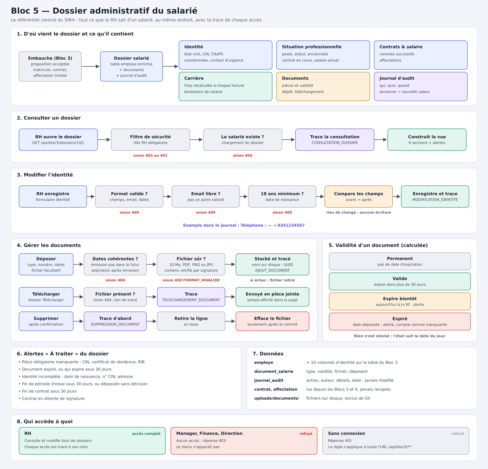

# Bloc 5 — Dossier administratif du salarié

> Documentation technique rédigée par l'auteur du code. J'y explique **ce que j'ai fait, comment et pourquoi**, fichier par fichier, bloc par bloc.



---

## Sommaire

1. [Objectif et règles métier retenues](#1-objectif-et-règles-métier-retenues)
2. [Vue d'ensemble de l'architecture](#2-vue-densemble-de-larchitecture)
3. [Base de données — `schema.sql`](#3-base-de-données--schemasql)
4. [Configuration — `application.properties` et `.gitignore`](#4-configuration)
5. [Entités et énumérations](#5-entités-et-énumérations)
6. [Repositories](#6-repositories)
7. [DTOs](#7-dtos)
8. [Service de stockage — `DocumentStorageService`](#8-service-de-stockage--documentstorageservice)
9. [Service métier — `DossierSalarieService`](#9-service-métier--dossiersalarieservice)
10. [Contrôleur REST — `DossierSalarieController`](#10-contrôleur-rest--dossiersalariecontroller)
11. [Sécurité et gestion des erreurs](#11-sécurité-et-gestion-des-erreurs)
12. [Frontend](#12-frontend)
13. [Tests](#13-tests)
14. [Référence de l'API](#14-référence-de-lapi)
15. [Flux complets](#15-flux-complets)
16. [Procédure de vérification](#16-procédure-de-vérification)
17. [Limites connues et pistes](#17-limites-connues-et-pistes)

---

## 1. Objectif et règles métier retenues

Le cours définit le Bloc 5 ainsi :

- Centraliser identité, coordonnées, documents et situation professionnelle.
- Conserver contrats, affectations, salaire et historique de carrière.
- Gérer les documents administratifs et leur validité.
- Prévoir confidentialité, habilitations et journal d'audit.
- **Le dossier salarié devient le référentiel central du SIRH.**

Au Bloc 3, l'embauche créait déjà un `EmployeEmbauche` (matricule, nom, prénom, email, poste, dates), un `Contrat` et une `Affectation`. Le RH ne voyait qu'un tableau avec ces trois éléments. J'ai donc construit **sur l'existant**, sans dupliquer : le dossier salarié, c'est la table `mrtovo.employe` enrichie, plus deux nouvelles tables (documents et audit), plus une vue qui rassemble tout.

Les règles métier que j'ai retenues :

| Règle | Où elle est implémentée |
|---|---|
| Seul le **RH** voit et modifie le dossier (données confidentielles : salaire, pièces d'identité). | `SecurityConfig` : `/api/bloc5/**` → `hasRole("RH")` ; routes Vue `meta.roles: ['RH']` |
| **Chaque consultation** et **chaque modification** est tracée (qui, quoi, quand, détail). | `DossierSalarieService.tracer(...)`, table `journal_audit` |
| Le journal est **immuable** : jamais modifié, jamais supprimé. | colonnes `updatable = false`, aucun endpoint d'écriture/suppression du journal |
| La modification d'identité enregistre **l'ancienne et la nouvelle valeur** de chaque champ changé. | `modifierIdentite` + `comparer(...)` |
| Un document a un **état de validité** calculé : Permanent / Valide / Expire bientôt (≤ 30 j) / Expiré. | `EtatValidite.calculer(...)` |
| Pièces **obligatoires** : CIN, certificat de résidence, RIB. Une pièce expirée compte comme manquante. | `PIECES_OBLIGATOIRES`, `construireAlertes` |
| L'**historique de carrière** n'est pas une table de plus : il est reconstruit à partir des contrats et des affectations (qui ne sont jamais écrasés, règle du Bloc 4). | `construireCarriere` |
| Le salarié doit avoir **18 ans minimum** ; l'**email** reste unique. | `modifierIdentite` |
| Les fichiers acceptés sont **PDF, PNG, JPG**, 10 Mo max, contrôlés par leur **signature binaire** (pas seulement l'extension). | `DocumentStorageService.extensionReelle` |

---

## 2. Vue d'ensemble de l'architecture

```
 Vue 3 (frontend)                         Spring Boot (backend)                       PostgreSQL (schéma mrtovo)
┌──────────────────────────┐   HTTP    ┌───────────────────────────────┐           ┌─────────────────────────┐
│ EmployesView.vue (liste) │──────────▶│ DossierSalarieController      │           │ employe (+10 colonnes)  │
│ DossierSalarieView.vue   │  Basic    │   /api/bloc5/dossiers/**      │           │ contrat      (Bloc 3/4) │
│   6 onglets              │  auth     │            │                  │           │ affectation  (Bloc 3/4) │
│ api/dossiers.js          │           │ DossierSalarieService ────────┼──────────▶│ document_salarie (new)  │
└──────────────────────────┘           │   │  construit le dossier     │   JPA     │ journal_audit    (new)  │
                                       │   │  écrit le journal d'audit │           └─────────────────────────┘
                                       │   ▼                           │
                                       │ DocumentStorageService ───────┼──▶ disque : uploads/documents/<uuid>.pdf
                                       └───────────────────────────────┘
```

Fichiers créés ou modifiés :

| Couche | Fichier | Nouveau / modifié |
|---|---|---|
| SQL | `backend/src/main/resources/schema.sql` | modifié |
| Config | `backend/src/main/resources/application.properties`, `.gitignore` | modifié |
| Entité | `entity/EmployeEmbauche.java` | modifié |
| Entité | `entity/DocumentSalarie.java`, `entity/JournalAudit.java` | nouveau |
| Enum | `entity/TypeDocument.java`, `entity/ActionAudit.java`, `entity/EtatValidite.java` | nouveau |
| Repository | `repository/DocumentSalarieRepository.java`, `repository/JournalAuditRepository.java` | nouveau |
| Repository | `repository/EmployeEmbaucheRepository.java` | modifié |
| DTO | `dto/DossierSalarieDto.java`, `DossierResumeDto`, `DocumentSalarieDto`, `EvenementCarriereDto`, `JournalAuditDto`, `IdentiteRequest` | nouveau |
| Service | `service/DocumentStorageService.java`, `service/DossierSalarieService.java` | nouveau |
| Contrôleur | `controller/DossierSalarieController.java` | nouveau |
| Contrôleur | `controller/RecrutementExceptionHandler.java` | modifié |
| Sécurité | `security/SecurityConfig.java` | modifié |
| Test | `src/test/.../service/DossierSalarieServiceTest.java` | nouveau |
| Front | `api/dossiers.js`, `views/DossierSalarieView.vue` | nouveau |
| Front | `api/http.js`, `views/EmployesView.vue`, `router/index.js`, `components/AppLayout.vue`, `components/RecrutementStatutBadge.vue` | modifié |

---

## 3. Base de données — `schema.sql`

Le projet exécute `schema.sql` **à chaque démarrage** (`spring.sql.init.mode=always`). Tout ce que j'ai ajouté est donc **idempotent** : on peut redémarrer cent fois, rien ne casse et aucune donnée n'est perdue.

### 3.1 Colonnes d'identité ajoutées à `mrtovo.employe`

```sql
ALTER TABLE mrtovo.employe ADD COLUMN IF NOT EXISTS date_naissance DATE;
ALTER TABLE mrtovo.employe ADD COLUMN IF NOT EXISTS lieu_naissance VARCHAR(150);
ALTER TABLE mrtovo.employe ADD COLUMN IF NOT EXISTS sexe VARCHAR(1);
ALTER TABLE mrtovo.employe ADD COLUMN IF NOT EXISTS nationalite VARCHAR(100);
ALTER TABLE mrtovo.employe ADD COLUMN IF NOT EXISTS numero_cin VARCHAR(50);
ALTER TABLE mrtovo.employe ADD COLUMN IF NOT EXISTS numero_cnaps VARCHAR(50);
ALTER TABLE mrtovo.employe ADD COLUMN IF NOT EXISTS situation_familiale VARCHAR(30);
ALTER TABLE mrtovo.employe ADD COLUMN IF NOT EXISTS nombre_enfants INTEGER;
ALTER TABLE mrtovo.employe ADD COLUMN IF NOT EXISTS contact_urgence_nom VARCHAR(255);
ALTER TABLE mrtovo.employe ADD COLUMN IF NOT EXISTS contact_urgence_telephone VARCHAR(50);
```

- J'ai choisi `ALTER TABLE ... ADD COLUMN IF NOT EXISTS` plutôt qu'une nouvelle table `identite` : l'identité est en relation **1-1** avec le salarié, une table séparée n'apporterait qu'une jointure de plus.
- Toutes les colonnes sont **nullable** : les salariés déjà embauchés au Bloc 3 n'ont pas ces informations. Le RH les complète ensuite, et le service lève une **alerte « Identité incomplète »** tant que c'est le cas.
- `numero_cnaps` : numéro d'affiliation à la Caisse Nationale de Prévoyance Sociale (Madagascar), utile pour la paie (Bloc 8+).
- `nom`, `prenom`, `email`, `telephone`, `adresse` existaient déjà depuis le Bloc 3 ; je ne les ai pas recréés.

### 3.2 Table `document_salarie`

```sql
CREATE TABLE IF NOT EXISTS mrtovo.document_salarie (
    id BIGSERIAL PRIMARY KEY,
    employe_id BIGINT NOT NULL REFERENCES mrtovo.employe(id),
    type_document VARCHAR(40) NOT NULL,
    libelle VARCHAR(255) NOT NULL,
    numero VARCHAR(100),
    date_emission DATE,
    date_expiration DATE,
    fichier_cle VARCHAR(100),
    nom_fichier_original VARCHAR(255),
    content_type VARCHAR(100),
    date_depot TIMESTAMP NOT NULL DEFAULT CURRENT_TIMESTAMP,
    depose_par VARCHAR(150) NOT NULL
);
CREATE INDEX IF NOT EXISTS idx_document_salarie_employe ON mrtovo.document_salarie(employe_id);
```

Ligne par ligne :

- `id BIGSERIAL PRIMARY KEY` : même convention que toutes les tables du schéma `mrtovo`.
- `employe_id ... REFERENCES mrtovo.employe(id)` : un document appartient à **un** salarié ; la clé étrangère empêche un document orphelin.
- `type_document` : la valeur de l'enum Java `TypeDocument` (`CIN`, `RIB`…), stockée en texte (`EnumType.STRING`) pour rester lisible en SQL et robuste si on réordonne l'enum.
- `libelle` : texte libre (« Licence informatique 2019 ») ; s'il n'est pas saisi, le service met le libellé du type.
- `numero` : n° de la pièce (n° CIN, n° diplôme…).
- `date_emission` / `date_expiration` : la **validité**. `date_expiration` est nullable car certaines pièces n'expirent pas (diplôme).
- `fichier_cle` : nom **technique** du fichier sur disque (`<uuid>.pdf`). Nullable : on peut enregistrer une fiche sans scan.
- `nom_fichier_original` : le nom donné par l'utilisateur, conservé uniquement pour l'affichage et le téléchargement — **jamais** pour construire un chemin disque (sécurité).
- `content_type` : type MIME déterminé par le serveur, renvoyé au téléchargement.
- `date_depot`, `depose_par` : traçabilité du dépôt (qui / quand).
- L'index sur `employe_id` accélère la requête la plus fréquente : « tous les documents de ce salarié ».

### 3.3 Table `journal_audit`

```sql
CREATE TABLE IF NOT EXISTS mrtovo.journal_audit (
    id BIGSERIAL PRIMARY KEY,
    employe_id BIGINT NOT NULL REFERENCES mrtovo.employe(id),
    action VARCHAR(40) NOT NULL,
    auteur VARCHAR(150) NOT NULL,
    details TEXT,
    date_action TIMESTAMP NOT NULL DEFAULT CURRENT_TIMESTAMP
);
CREATE INDEX IF NOT EXISTS idx_journal_audit_employe ON mrtovo.journal_audit(employe_id, date_action DESC);
```

- Une ligne = une action d'un utilisateur sur un dossier.
- `auteur` : l'email de l'utilisateur connecté (le « username » Spring Security).
- `details` est en `TEXT` (pas de limite) car une modification d'identité peut lister de nombreux champs.
- **Il n'y a pas de clé étrangère vers `document_salarie`** : volontairement. Quand un document est supprimé, sa trace de suppression doit **survivre** ; c'est pourquoi la description du document est recopiée dans `details`.
- L'index composite `(employe_id, date_action DESC)` correspond exactement à la requête « journal de ce salarié, du plus récent au plus ancien ».

### 3.4 Contraintes de domaine

En fin de fichier, j'ai suivi le motif déjà utilisé par le projet : `DROP CONSTRAINT IF EXISTS` puis `ADD CONSTRAINT`. Cela permet de **ré-appliquer** une contrainte modifiée sur une base existante.

```sql
ALTER TABLE mrtovo.employe DROP CONSTRAINT IF EXISTS ck_employe_sexe;
ALTER TABLE mrtovo.employe ADD CONSTRAINT ck_employe_sexe
    CHECK (sexe IS NULL OR sexe IN ('M','F'));
```
→ `sexe` est soit vide, soit `M`/`F`.

```sql
... CHECK (situation_familiale IS NULL
           OR situation_familiale IN ('CELIBATAIRE','MARIE','DIVORCE','VEUF','UNION_LIBRE'));
... CHECK (nombre_enfants IS NULL OR nombre_enfants >= 0);
```
→ Mêmes listes que les validations Java (`@Pattern`, `@Min(0)`) : la base est le **dernier rempart** si une donnée arrivait par un autre chemin.

```sql
... ck_document_salarie_type CHECK (type_document IN ('CIN','DIPLOME', ... ,'AUTRE'));
... ck_document_salarie_dates CHECK (date_emission IS NULL OR date_expiration IS NULL
                                     OR date_expiration >= date_emission);
... ck_journal_audit_action  CHECK (action IN ('CONSULTATION_DOSSIER', ... ,'TELECHARGEMENT_DOCUMENT'));
```
→ Les valeurs des enums Java sont recopiées en base ; la cohérence des dates est vérifiée deux fois (Java pour un message clair, SQL en garde-fou).

---

## 4. Configuration

### `application.properties`

```properties
# Bloc 5 : pieces administratives des salaries (hors depot Git).
bloc5.documents-dir=${BLOC5_DOCUMENTS_DIR:uploads/documents}
```

- `${BLOC5_DOCUMENTS_DIR:uploads/documents}` : si la variable d'environnement `BLOC5_DOCUMENTS_DIR` existe, elle est utilisée ; sinon le dossier relatif `uploads/documents`. Même mécanique que `bloc2.cv-storage-dir` pour les CV.
- La taille max (10 Mo) est déjà réglée globalement par `spring.servlet.multipart.max-file-size=10MB`.

### `.gitignore`

J'ai ajouté `backend/uploads/documents/` et `uploads/documents/` : les pièces d'identité des salariés **ne doivent jamais** être poussées sur GitHub.

---

## 5. Entités et énumérations

### 5.1 `EmployeEmbauche.java` (modifié)

J'ai ajouté, après le champ `statut`, les dix attributs correspondant aux colonnes SQL :

```java
    // ----- Bloc 5 : identite complete du dossier administratif -----

    @Column(name = "date_naissance")
    private LocalDate dateNaissance;

    @Column(name = "lieu_naissance")
    private String lieuNaissance;

    @Column(length = 1)
    private String sexe;

    private String nationalite;
    ...
    @Column(name = "nombre_enfants")
    private Integer nombreEnfants;
    ...
```

- `@Column(name = "...")` fait le lien entre le nom Java en camelCase et la colonne SQL en snake_case. Quand le nom est identique (`nationalite`), l'annotation est inutile.
- `Integer` (et non `int`) pour `nombreEnfants` : un `int` ne peut pas être `null`, or la valeur peut être inconnue.
- `sexe` et `situationFamiliale` sont des `String` et non des enums : ce sont des valeurs de saisie simples, contrôlées par `@Pattern` dans `IdentiteRequest` et par un `CHECK` SQL. Un enum aurait imposé un mapping supplémentaire côté front sans bénéfice métier.
- Les getters/setters suivent exactement le style déjà présent dans la classe (pas de Lombok dans cette entité, je n'ai pas changé la convention).

### 5.2 `TypeDocument.java` (nouveau)

```java
public enum TypeDocument {
    CIN("Carte d'identité nationale"),
    DIPLOME("Diplôme"),
    CERTIFICAT_RESIDENCE("Certificat de résidence"),
    CASIER_JUDICIAIRE("Bulletin de casier judiciaire"),
    RIB("Relevé d'identité bancaire"),
    CONTRAT_SIGNE("Contrat signé"),
    CERTIFICAT_MEDICAL("Certificat médical d'aptitude"),
    AUTRE("Autre document");

    private final String libelle;
    TypeDocument(String libelle) { this.libelle = libelle; }
    public String getLibelle() { return libelle; }
}
```

- Même modèle que `TypeContrat` et `StatutEmploye` : chaque constante porte un **libellé lisible** utilisé dans les messages et le DTO.
- La liste correspond au dossier administratif classique d'une embauche à Madagascar (CIN, certificat de résidence, casier judiciaire bulletin n° 3, RIB pour la paie, certificat médical d'aptitude).

### 5.3 `ActionAudit.java` (nouveau)

```java
public enum ActionAudit {
    CONSULTATION_DOSSIER("Consultation du dossier"),
    MODIFICATION_IDENTITE("Modification de l'identité"),
    AJOUT_DOCUMENT("Ajout d'un document"),
    SUPPRESSION_DOCUMENT("Suppression d'un document"),
    TELECHARGEMENT_DOCUMENT("Téléchargement d'un document");
    ...
}
```

Les cinq actions tracées. J'inclus la **consultation** et le **téléchargement** et pas seulement les modifications : pour des données confidentielles, savoir *qui a regardé* est aussi important que savoir *qui a modifié*.

### 5.4 `EtatValidite.java` (nouveau)

```java
public enum EtatValidite {
    PERMANENT("Sans date d'expiration"),
    VALIDE("Valide"),
    EXPIRE_BIENTOT("Expire bientôt"),
    EXPIRE("Expiré");

    public static final int SEUIL_ALERTE_JOURS = 30;
```

- Cet état **n'est pas stocké en base** : il dépend de la date du jour. Un document « Valide » aujourd'hui sera « Expiré » dans un an sans que personne ne touche à la base. Le stocker obligerait à un traitement planifié pour le mettre à jour ; le calculer à la lecture est plus simple et toujours juste.
- `SEUIL_ALERTE_JOURS = 30` : constante publique, réutilisée aussi pour les alertes de fin de période d'essai et de fin de contrat.

```java
    public static EtatValidite calculer(LocalDate dateExpiration, LocalDate aujourdhui) {
        if (dateExpiration == null) {
            return PERMANENT;                                   // (1)
        }
        if (dateExpiration.isBefore(aujourdhui)) {
            return EXPIRE;                                      // (2)
        }
        if (!dateExpiration.isAfter(aujourdhui.plusDays(SEUIL_ALERTE_JOURS))) {
            return EXPIRE_BIENTOT;                              // (3)
        }
        return VALIDE;                                          // (4)
    }
```

1. Pas de date d'expiration → document permanent.
2. Expiration strictement **avant** aujourd'hui → expiré. Un document qui expire *aujourd'hui* est encore valable aujourd'hui.
3. `!isAfter(aujourdhui + 30)` signifie « expiration ≤ aujourd'hui + 30 jours » → expire bientôt (bornes incluses : J et J+30).
4. Sinon → valide.

La méthode est `static` et reçoit `aujourdhui` en paramètre : elle est **pure**, donc testable sans dépendre de l'horloge système.

```java
    public boolean demandeAttention() {
        return this == EXPIRE || this == EXPIRE_BIENTOT;
    }
```
Petit utilitaire de lecture pour savoir si l'état doit être signalé.

### 5.5 `DocumentSalarie.java` (nouveau)

```java
@Entity
@Table(name = "document_salarie")
public class DocumentSalarie {

    @Id
    @GeneratedValue(strategy = GenerationType.IDENTITY)
    private Long id;
```
- `@Entity` : classe gérée par JPA. `@Table` : pas besoin de préciser le schéma, `hibernate.default_schema=mrtovo` s'en charge.
- `GenerationType.IDENTITY` : l'id est produit par le `BIGSERIAL` de PostgreSQL.

```java
    @ManyToOne(fetch = FetchType.LAZY, optional = false)
    @JoinColumn(name = "employe_id", nullable = false)
    private EmployeEmbauche employe;
```
- Plusieurs documents pour un salarié → `@ManyToOne`.
- `LAZY` : on ne charge pas le salarié complet à chaque lecture de document si on n'en a pas besoin (même choix que `Contrat` et `Affectation`).

```java
    @Enumerated(EnumType.STRING)
    @Column(name = "type_document", nullable = false)
    private TypeDocument typeDocument;
```
- `EnumType.STRING` : on stocke `"CIN"` et pas `0`. Indispensable pour la contrainte `CHECK` et la lisibilité.

```java
    @Column(name = "date_depot", nullable = false)
    private LocalDateTime dateDepot = LocalDateTime.now();
```
- Valeur par défaut côté Java : la date de dépôt est fixée à la création de l'objet.

```java
    public EtatValidite etatValidite(LocalDate aujourdhui) {
        return EtatValidite.calculer(dateExpiration, aujourdhui);
    }

    public boolean aUnFichier() {
        return fichierCle != null;
    }
```
- Deux méthodes métier sur l'entité : le document « sait » calculer sa validité et dire s'il a un fichier. Le service reste ainsi lisible (`document.etatValidite(aujourdhui)`).

Le reste de la classe : getters/setters classiques.

### 5.6 `JournalAudit.java` (nouveau)

```java
@Entity
@Table(name = "journal_audit")
public class JournalAudit {
    ...
    @ManyToOne(fetch = FetchType.LAZY, optional = false)
    @JoinColumn(name = "employe_id", nullable = false, updatable = false)
    private EmployeEmbauche employe;

    @Enumerated(EnumType.STRING)
    @Column(nullable = false, updatable = false)
    private ActionAudit action;

    @Column(nullable = false, updatable = false)
    private String auteur;

    @Column(columnDefinition = "TEXT", updatable = false)
    private String details;

    @Column(name = "date_action", nullable = false, updatable = false)
    private LocalDateTime dateAction = LocalDateTime.now();
```

- **Toutes** les colonnes ont `updatable = false` : même si quelqu'un modifiait un objet `JournalAudit` chargé, Hibernate n'émettrait jamais d'`UPDATE` sur ces colonnes. C'est l'immuabilité garantie au niveau du mapping.
- `columnDefinition = "TEXT"` aligne le type Hibernate sur le SQL (sinon il attendrait un `VARCHAR(255)`).

```java
    protected JournalAudit() {
        // requis par JPA
    }

    public JournalAudit(EmployeEmbauche employe, ActionAudit action, String auteur, String details) {
        this.employe = employe;
        this.action = action;
        this.auteur = auteur;
        this.details = details;
    }
```
- Le constructeur sans argument est `protected` : JPA en a besoin, mais le code applicatif est obligé de passer par le constructeur complet.
- **Il n'y a aucun setter** : une ligne d'audit se construit en une fois et ne change plus.

---

## 6. Repositories

```java
public interface DocumentSalarieRepository extends JpaRepository<DocumentSalarie, Long> {
    List<DocumentSalarie> findByEmployeIdOrderByDateDepotDesc(Long employeId);
}
```
- Spring Data génère la requête à partir du nom : `WHERE employe.id = ? ORDER BY date_depot DESC` → les documents les plus récents en premier.

```java
public interface JournalAuditRepository extends JpaRepository<JournalAudit, Long> {
    List<JournalAudit> findByEmployeIdOrderByDateActionDesc(Long employeId);
}
```
- Même principe pour le journal, du plus récent au plus ancien (et couvert par l'index composite créé en SQL).

Dans `EmployeEmbaucheRepository` (existant), j'ai ajouté :

```java
    Optional<EmployeEmbauche> findByEmailIgnoreCase(String email);
```
- Pour vérifier qu'un nouvel email n'est pas déjà pris par **un autre** salarié avant de modifier l'identité. `IgnoreCase` : `Jean@Mail.com` et `jean@mail.com` sont la même adresse.

---

## 7. DTOs

J'utilise des `record` Java, comme le reste du projet (`EmployeDto`, `ContratDto`…). Un record est immuable, son constructeur, ses accesseurs, `equals` et `toString` sont générés, et Jackson le sérialise directement en JSON.

### `IdentiteRequest` — ce que le RH envoie

```java
public record IdentiteRequest(
        @NotBlank @Size(max = 255) String nom,
        @NotBlank @Size(max = 255) String prenom,
        @NotBlank @Email @Size(max = 255) String email,
        @Size(max = 50) String telephone,
        @Size(max = 255) String adresse,
        @Past LocalDate dateNaissance,
        @Size(max = 150) String lieuNaissance,
        @Pattern(regexp = "M|F", message = "doit valoir M ou F") String sexe,
        ...
        @Pattern(regexp = "CELIBATAIRE|MARIE|DIVORCE|VEUF|UNION_LIBRE",
                message = "valeur de situation familiale inconnue") String situationFamiliale,
        @Min(0) Integer nombreEnfants,
        ...) {
}
```
- Les annotations Bean Validation sont vérifiées automatiquement grâce à `@Valid` dans le contrôleur. En cas d'erreur, `RecrutementExceptionHandler` renvoie un **400** avec la liste des champs fautifs.
- `@Size(max = ...)` reprend les longueurs des colonnes SQL : on refuse proprement au lieu d'une erreur base de données.
- `@Past` : une date de naissance est forcément dans le passé. La règle « 18 ans minimum » est métier, je l'ai donc mise dans le service.
- `@Pattern` ignore les valeurs `null` : les champs restent facultatifs, mais s'ils sont remplis ils doivent être valides.

### `DossierSalarieDto` — la vue complète renvoyée au front

```java
public record DossierSalarieDto(
        Long id,
        String matricule,
        Identite identite,
        SituationProfessionnelle situation,
        OrigineRecrutement origine,
        List<ContratDto> contrats,
        List<AffectationDto> affectations,
        List<EvenementCarriereDto> carriere,
        List<DocumentSalarieDto> documents,
        List<String> alertes) {
```
- J'ai organisé le dossier **par sections**, chacune correspondant à un onglet de l'écran. Les sections simples sont des **records imbriqués** (`Identite`, `SituationProfessionnelle`, `OrigineRecrutement`) déclarés dans le même fichier : ils n'ont de sens qu'à l'intérieur du dossier.
- `contrats` et `affectations` **réutilisent** les DTOs existants du Bloc 3 (`ContratDto`, `AffectationDto`) — aucune duplication.
- `Identite.age` est calculé (pas stocké).
- `SituationProfessionnelle` expose le **contrat en cours** et le **salaire actuel**, calculés à partir de l'historique des contrats.
- `OrigineRecrutement` relie le salarié à son parcours de recrutement (Bloc 2/3) : candidat, candidature, titre de l'offre, proposition acceptée. C'est ce qui fait du dossier le « référentiel central » : on remonte tout le cycle de vie.

### `DossierResumeDto` — une ligne de la liste

Contient l'essentiel (matricule, nom, poste, statut) plus des **compteurs** : nombre de documents, expirés, bientôt expirés, nombre total d'alertes. Le RH repère ainsi en un coup d'œil les dossiers à traiter.

### `DocumentSalarieDto`

Les champs de l'entité, plus :
- `typeLibelle` : libellé lisible du type ;
- `etatValidite` et `joursAvantExpiration` : calculés ;
- `fichierDisponible` : booléen. **Je n'expose jamais `fichierCle`** (le nom technique sur disque) : le front n'en a pas besoin, il télécharge par l'id du document.

### `EvenementCarriereDto` et `JournalAuditDto`

- `EvenementCarriereDto(date, type, titre, description)` : une ligne de la frise chronologique. `type` (`EMBAUCHE`, `CONTRAT`, `EVOLUTION_SALAIRE`…) sert au front pour colorer l'évènement.
- `JournalAuditDto` : la ligne d'audit + `actionLibelle` lisible.

---

## 8. Service de stockage — `DocumentStorageService`

J'ai repris la structure éprouvée de `CvStorageService` (Bloc 2), adaptée aux pièces administratives (PDF/PNG/JPG au lieu de PDF/DOCX) et en levant des `ApiException` (le format d'erreur du module).

```java
    private static final long TAILLE_MAX = 10L * 1024 * 1024;
    private static final String CLE_VALIDE = "[0-9a-fA-F-]{36}\\.(pdf|png|jpg)";

    private static final byte[] SIGNATURE_PDF = {'%', 'P', 'D', 'F', '-'};
    private static final byte[] SIGNATURE_PNG = {(byte) 0x89, 'P', 'N', 'G', 0x0D, 0x0A, 0x1A, 0x0A};
    private static final byte[] SIGNATURE_JPG = {(byte) 0xFF, (byte) 0xD8, (byte) 0xFF};
```
- `TAILLE_MAX` : 10 Mo, vérifié ici en plus de la limite Spring.
- `CLE_VALIDE` : forme exacte d'une clé générée (UUID de 36 caractères + extension autorisée). Toute autre chaîne est refusée avant d'accéder au disque.
- Les **signatures** (« magic numbers ») sont les premiers octets de chaque format. Un fichier `virus.exe` renommé `cin.pdf` commence par `MZ`, pas par `%PDF-` : il est rejeté.

```java
    public DocumentStorageService(@Value("${bloc5.documents-dir:uploads/documents}") String dossierStockage) {
        this.dossierStockage = Path.of(dossierStockage).toAbsolutePath().normalize();
    }
```
- Le dossier vient de la configuration. `toAbsolutePath().normalize()` donne un chemin canonique, indispensable pour la vérification `startsWith` plus bas.

### `enregistrer`

```java
    public FichierStocke enregistrer(MultipartFile fichier) {
        if (fichier == null || fichier.isEmpty()) { throw ApiException.badRequest("FICHIER_VIDE", ...); }
        if (fichier.getSize() > TAILLE_MAX) { throw ApiException.badRequest("FICHIER_TROP_GROS", ...); }

        String extension = extensionReelle(fichier);
        String cle = UUID.randomUUID() + "." + extension;
        Path destination = dossierStockage.resolve(cle).normalize();
        if (!destination.startsWith(dossierStockage)) { throw ApiException.badRequest("NOM_FICHIER_INVALIDE", ...); }
```
1. Fichier vide ou trop gros → 400.
2. `extensionReelle` vérifie extension **et** contenu (voir plus bas).
3. Le nom sur disque est un **UUID aléatoire** : deux fichiers `cin.pdf` ne s'écrasent pas, et le nom ne révèle rien sur le salarié.
4. `startsWith(dossierStockage)` : défense contre la traversée de répertoire (`../../etc/passwd`). Avec un UUID c'est déjà impossible, mais je garde la vérification par principe de défense en profondeur.

```java
        try {
            Files.createDirectories(dossierStockage);
            try (InputStream entree = fichier.getInputStream()) {
                Files.copy(entree, destination, StandardCopyOption.REPLACE_EXISTING);
            }
        } catch (IOException exception) {
            throw new IllegalStateException("Impossible d'enregistrer le document.", exception);
        }
        return new FichierStocke(cle, typeMime(extension).toString());
```
- Le dossier est créé au besoin. Le `try-with-resources` ferme le flux même en cas d'erreur.
- On renvoie la clé et le type MIME **déterminé par le serveur** (on ne fait pas confiance au `Content-Type` envoyé par le navigateur).

### `charger` et `supprimer`

```java
    public Resource charger(String cle) {
        Path fichier = cheminVerifie(cle);
        if (!Files.isRegularFile(fichier)) { throw ApiException.notFound(...); }
        return new UrlResource(fichier.toUri());
    }

    public void supprimer(String cle) {
        Files.deleteIfExists(cheminVerifie(cle));
    }
```
- Les deux passent par `cheminVerifie` qui valide la clé avec `CLE_VALIDE` puis refait le contrôle `startsWith`.
- `deleteIfExists` : supprimer un fichier déjà absent n'est pas une erreur (idempotence).

### `extensionReelle`

```java
        String nom = fichier.getOriginalFilename();
        String extension = nom == null || nom.lastIndexOf('.') < 0
                ? ""
                : nom.substring(nom.lastIndexOf('.') + 1).toLowerCase(Locale.ROOT);
        if (extension.equals("jpeg")) {
            extension = "jpg";
        }
```
- Extraction de l'extension, en minuscules (`Locale.ROOT` évite les surprises de casse selon la langue du système). `jpeg` est normalisé en `jpg`.

```java
        byte[] debut;
        try (InputStream entree = fichier.getInputStream()) {
            debut = entree.readNBytes(8);
        }
        boolean conforme = switch (extension) {
            case "pdf" -> commencePar(debut, SIGNATURE_PDF);
            case "png" -> commencePar(debut, SIGNATURE_PNG);
            case "jpg" -> commencePar(debut, SIGNATURE_JPG);
            default -> false;
        };
        if (!conforme) {
            throw ApiException.badRequest("FORMAT_INVALIDE", "Format de document invalide. Formats acceptés : PDF, PNG, JPG.");
        }
        return extension;
```
- On lit les 8 premiers octets (la plus longue signature, PNG, en fait 8).
- `switch` expression (Java 17+) : chaque extension autorisée est confrontée à sa signature ; toute autre extension → `false`.

```java
    private static boolean commencePar(byte[] contenu, byte[] signature) {
        return contenu.length >= signature.length
                && Arrays.equals(Arrays.copyOf(contenu, signature.length), signature);
    }
```
- On compare le début du fichier à la signature attendue ; le test de longueur évite une erreur sur un fichier de 2 octets.

`public record FichierStocke(String cle, String contentType)` : petit objet de retour.

---

## 9. Service métier — `DossierSalarieService`

C'est le cœur du Bloc 5. Il est annoté `@Service` et `@Transactional` : chaque méthode publique s'exécute dans une transaction ; si une exception survient, **tout** est annulé (y compris la ligne d'audit).

### 9.1 Constantes et dépendances

```java
    static final Set<TypeDocument> PIECES_OBLIGATOIRES =
            EnumSet.of(TypeDocument.CIN, TypeDocument.CERTIFICAT_RESIDENCE, TypeDocument.RIB);

    private static final DateTimeFormatter FORMAT_DATE = DateTimeFormatter.ofPattern("dd/MM/yyyy");
    private static final Set<StatutContrat> CONTRATS_CLOS = EnumSet.of(StatutContrat.TERMINE, StatutContrat.RUPTURE);
```
- `EnumSet` : l'implémentation de `Set` la plus efficace pour des enums.
- `PIECES_OBLIGATOIRES` est `static final` et de visibilité *package* : le test peut y accéder.
- `CONTRATS_CLOS` : un contrat terminé ou rompu ne peut plus être « le contrat en cours ».

```java
    private final EmployeEmbaucheRepository employeRepository;
    private final ContratRepository contratRepository;
    private final AffectationRepository affectationRepository;
    private final DocumentSalarieRepository documentRepository;
    private final JournalAuditRepository journalRepository;
    private final DocumentStorageService stockage;
    private final RecrutementMapper mapper;
    private final Clock horloge;
```
- Je réutilise les repositories et le `RecrutementMapper` du Bloc 3 pour les contrats et affectations.
- `Clock horloge` : au lieu d'appeler `LocalDate.now()` partout, j'appelle `LocalDate.now(horloge)`. En production c'est l'horloge système ; dans les tests, une horloge **figée** au 03/11/2026. Ainsi les calculs d'ancienneté et d'expiration sont testables de façon déterministe.

```java
    @Autowired
    public DossierSalarieService(... 7 dépendances ...) {
        this(..., Clock.systemDefaultZone());
    }

    DossierSalarieService(... 7 dépendances ..., Clock horloge) { ... }
```
- Deux constructeurs : Spring utilise celui marqué `@Autowired` (nécessaire car il y en a deux) ; il délègue au second avec l'horloge système. Le second, de visibilité *package*, sert aux tests.

### 9.2 `listerDossiers()` — la liste avec compteurs

```java
    @Transactional(readOnly = true)
    public List<DossierResumeDto> listerDossiers() {
        LocalDate aujourdhui = LocalDate.now(horloge);
        return employeRepository.findAll().stream()
                .sorted(Comparator.comparing(EmployeEmbauche::getMatricule))
                .map(employe -> {
                    List<DocumentSalarie> documents = documentRepository.findByEmployeIdOrderByDateDepotDesc(employe.getId());
                    List<Contrat> contrats = contratRepository.findByEmployeIdOrderByDateDebutAsc(employe.getId());
                    int expires = compterEtat(documents, EtatValidite.EXPIRE, aujourdhui);
                    int bientot = compterEtat(documents, EtatValidite.EXPIRE_BIENTOT, aujourdhui);
                    int alertes = construireAlertes(employe, contrats, documents, aujourdhui).size();
                    return new DossierResumeDto(...);
                })
                .toList();
    }
```
- `readOnly = true` : la liste **n'est pas tracée** (elle n'affiche pas de données sensibles : ni salaire, ni pièces), et Hibernate peut optimiser la transaction.
- `aujourdhui` est calculé **une seule fois** : tous les dossiers sont évalués à la même date.
- Tri par matricule pour un affichage stable.
- Le nombre d'alertes réutilise **exactement** la même méthode que le dossier détaillé : la liste et le détail ne peuvent pas diverger.

### 9.3 `dossier(id, auteur)` — consulter un dossier

```java
    /** Consulter un dossier est une action tracee : la methode n'est donc pas en lecture seule. */
    public DossierSalarieDto dossier(Long employeId, String auteur) {
        EmployeEmbauche employe = chargerEmploye(employeId);
        tracer(employe, ActionAudit.CONSULTATION_DOSSIER, auteur, null);
        return construireDossier(employe);
    }
```
- Trois étapes : charger (404 si absent), **tracer la consultation**, construire la vue.
- Cette méthode n'est pas `readOnly` puisqu'elle écrit dans `journal_audit`.

### 9.4 `journal(id)`

```java
    @Transactional(readOnly = true)
    public List<JournalAuditDto> journal(Long employeId) {
        chargerEmploye(employeId);
        return journalRepository.findByEmployeIdOrderByDateActionDesc(employeId).stream()
                .map(ligne -> new JournalAuditDto(...))
                .toList();
    }
```
- `chargerEmploye` sert uniquement à renvoyer un **404** propre si l'id n'existe pas (au lieu d'une liste vide trompeuse).

### 9.5 `modifierIdentite(id, requete, auteur)`

```java
        EmployeEmbauche employe = chargerEmploye(employeId);

        String email = nettoyer(requete.email()).toLowerCase();
        employeRepository.findByEmailIgnoreCase(email)
                .filter(autre -> !autre.getId().equals(employe.getId()))
                .ifPresent(autre -> {
                    throw ApiException.conflit("EMAIL_DEJA_UTILISE",
                            "L'email " + email + " est déjà utilisé par le salarié " + autre.getMatricule());
                });
```
- L'email est normalisé (espaces retirés, minuscules).
- On cherche un salarié avec cet email ; `filter` écarte le salarié lui-même (garder son propre email n'est pas un conflit). S'il en reste un → **409 Conflict** avec le matricule de l'autre salarié pour aider le RH.

```java
        if (requete.dateNaissance() != null
                && Period.between(requete.dateNaissance(), LocalDate.now(horloge)).getYears() < 18) {
            throw ApiException.badRequest("AGE_INVALIDE", "Le salarié doit avoir au moins 18 ans.");
        }
```
- `Period.between(...).getYears()` donne l'âge exact en années révolues.

```java
        List<String> changements = new ArrayList<>();
        comparer(changements, "Nom", employe.getNom(), nettoyer(requete.nom()));
        comparer(changements, "Prénom", employe.getPrenom(), nettoyer(requete.prenom()));
        comparer(changements, "Email", employe.getEmail(), email);
        ...
        comparer(changements, "Tél. contact d'urgence", employe.getContactUrgenceTelephone(),
                nettoyer(requete.contactUrgenceTelephone()));
```
- **Avant** de modifier quoi que ce soit, je compare champ par champ l'ancienne et la nouvelle valeur. `comparer` ajoute une ligne `"Téléphone : — → 0341234567"` uniquement si la valeur change.
- C'est cette liste qui part dans le journal : on sait précisément ce qui a changé, et quelle était la valeur précédente (l'historique n'est donc jamais perdu, conformément au principe du Bloc 4 « ne pas écraser l'historique »).

```java
        if (changements.isEmpty()) {
            return construireDossier(employe);
        }
```
- Si rien ne change, on ne sauvegarde rien et on **n'écrit pas** de ligne d'audit inutile.

```java
        employe.setNom(nettoyer(requete.nom()));
        ...
        employeRepository.save(employe);

        tracer(employe, ActionAudit.MODIFICATION_IDENTITE, auteur, String.join("\n", changements));
        return construireDossier(employe);
```
- On applique tous les champs, on sauvegarde, on trace (une ligne par changement, séparées par des retours à la ligne), et on renvoie le dossier à jour.
- On appelle `construireDossier` et non `dossier(...)` : sinon on écrirait une ligne « Consultation » parasite juste après la modification.

### 9.6 `ajouterDocument(...)`

```java
        EmployeEmbauche employe = chargerEmploye(employeId);
        LocalDate aujourdhui = LocalDate.now(horloge);

        if (type == null) { throw ApiException.badRequest("TYPE_DOCUMENT_MANQUANT", ...); }
        if (dateEmission != null && dateEmission.isAfter(aujourdhui)) {
            throw ApiException.badRequest("DATE_EMISSION_FUTURE", ...);
        }
        if (dateEmission != null && dateExpiration != null && dateExpiration.isBefore(dateEmission)) {
            throw ApiException.badRequest("DATES_INCOHERENTES", ...);
        }
```
- Règles de cohérence : un type est obligatoire, une pièce ne peut pas avoir été émise dans le futur, et ne peut pas expirer avant d'avoir été émise.
- En revanche, j'**autorise** l'ajout d'un document déjà expiré : le RH doit pouvoir archiver une ancienne CIN ; il sera simplement signalé « Expiré ».

```java
        DocumentSalarie document = new DocumentSalarie();
        document.setEmploye(employe);
        document.setTypeDocument(type);
        document.setLibelle(nettoyer(libelle) != null ? nettoyer(libelle) : type.getLibelle());
        document.setNumero(nettoyer(numero));
        document.setDateEmission(dateEmission);
        document.setDateExpiration(dateExpiration);
        document.setDeposePar(auteur);
```
- Si le libellé est vide, on prend le libellé du type (« Carte d'identité nationale »).

```java
        if (fichier != null && !fichier.isEmpty()) {
            DocumentStorageService.FichierStocke stocke = stockage.enregistrer(fichier);
            document.setFichierCle(stocke.cle());
            document.setContentType(stocke.contentType());
            document.setNomFichierOriginal(nomFichierSur(fichier.getOriginalFilename()));
            apresAnnulation(() -> stockage.supprimer(stocke.cle()));
        }
        documentRepository.save(document);
```
- Le fichier est **facultatif** (on peut créer une fiche sans scan).
- Point délicat : le fichier est écrit sur disque **avant** le commit en base. Si ensuite la transaction échoue (contrainte SQL, erreur d'audit…), la ligne en base est annulée mais le fichier resterait orphelin. `apresAnnulation(...)` enregistre un « callback » qui **supprime le fichier si et seulement si la transaction est annulée**.
- `nomFichierSur` nettoie le nom d'origine avant de le stocker (voir § 9.10).

```java
        tracer(employe, ActionAudit.AJOUT_DOCUMENT, auteur, decrire(document));
        return toDocumentDto(document, aujourdhui);
```
- Trace avec une description lisible (« Carte d'identité nationale — … (n° …) · fichier : cin.pdf »).

### 9.7 `telechargerDocument(...)`

```java
        DocumentSalarie document = chargerDocument(documentId);
        if (!document.aUnFichier()) {
            throw ApiException.notFound("Aucun fichier n'est joint à ce document.");
        }
        Resource ressource = stockage.charger(document.getFichierCle());
        tracer(document.getEmploye(), ActionAudit.TELECHARGEMENT_DOCUMENT, auteur, decrire(document));
        String nom = document.getNomFichierOriginal() != null
                ? document.getNomFichierOriginal()
                : document.getFichierCle();
        return new FichierTelecharge(ressource, document.getContentType(), nom);
```
- On charge d'abord le fichier, **puis** on trace : si le fichier est introuvable (404), on ne trace pas un téléchargement qui n'a pas eu lieu.
- Le nom proposé au navigateur est le nom d'origine (plus parlant pour le RH).

### 9.8 `supprimerDocument(...)`

```java
        DocumentSalarie document = chargerDocument(documentId);
        tracer(document.getEmploye(), ActionAudit.SUPPRESSION_DOCUMENT, auteur, decrire(document));
        documentRepository.delete(document);
        if (document.aUnFichier()) {
            String cle = document.getFichierCle();
            apresValidation(() -> stockage.supprimer(cle));
        }
```
- La trace est écrite **avant** la suppression et contient la description complète du document : le journal garde la mémoire de ce qui a été supprimé.
- Le fichier n'est effacé du disque **qu'après le commit** (`apresValidation`). Sinon, si la transaction échouait après coup, la ligne en base reviendrait mais le fichier aurait disparu. Le cas inverse (commit OK mais suppression disque KO) laisse au pire un fichier orphelin inoffensif, ce qui est le moindre mal.

### 9.9 Construction du dossier

#### `construireDossier`

```java
    private DossierSalarieDto construireDossier(EmployeEmbauche employe) {
        LocalDate aujourdhui = LocalDate.now(horloge);
        List<Contrat> contrats = contratRepository.findByEmployeIdOrderByDateDebutAsc(employe.getId());
        List<Affectation> affectations = affectationRepository.findByEmployeIdOrderByDateDebutAsc(employe.getId());
        List<DocumentSalarie> documents = documentRepository.findByEmployeIdOrderByDateDepotDesc(employe.getId());

        return new DossierSalarieDto(
                employe.getId(),
                employe.getMatricule(),
                construireIdentite(employe, aujourdhui),
                construireSituation(employe, contrats, aujourdhui),
                construireOrigine(employe),
                contrats.stream().map(mapper::toContratDto).toList(),
                affectations.stream().map(mapper::toAffectationDto).toList(),
                construireCarriere(employe, contrats, affectations),
                documents.stream().map(document -> toDocumentDto(document, aujourdhui)).toList(),
                construireAlertes(employe, contrats, documents, aujourdhui));
    }
```
- Trois requêtes, puis chaque section est construite par une méthode dédiée. Les listes chargées une fois sont **partagées** entre les sections (pas de double requête).
- `mapper::toContratDto` : réutilisation du mapper du Bloc 3.

#### `construireIdentite`

Recopie les champs, et calcule `age` avec `Period.between(dateNaissance, aujourdhui).getYears()` si la date est connue.

#### `construireSituation`

```java
        Contrat enCours = contratEnCours(contrats, aujourdhui);
        return new DossierSalarieDto.SituationProfessionnelle(
                ...,
                anciennete(employe.getDateEntree(), aujourdhui),
                enCours != null ? enCours.getReference() : null,
                enCours != null ? enCours.getTypeContrat() : null,
                enCours != null ? enCours.getSalaire() : null);
```
- Le **salaire actuel** n'est pas une colonne de `employe` : c'est le salaire du contrat en cours. Une seule source de vérité, pas de risque d'incohérence.

#### `construireOrigine`

```java
        PropositionOffre proposition = employe.getProposition();
        CandidatureSelection candidature = proposition != null ? proposition.getCandidature() : null;
```
- On remonte la chaîne **salarié → proposition → candidature → offre** construite aux blocs 2 et 3. Chaque maillon est testé contre `null` pour ne jamais planter sur une donnée incomplète.

#### `construireCarriere` — la frise chronologique

```java
        evenements.add(new EvenementCarriereDto(
                employe.getDateEmbauche(), "EMBAUCHE",
                "Embauche — matricule " + employe.getMatricule(),
                employe.getPoste() != null ? "Recruté(e) au poste " + employe.getPoste().getTitre() : null));
```
1. Premier évènement : l'embauche.

```java
        Contrat precedent = null;
        for (Contrat contrat : contrats) {
            evenements.add(new EvenementCarriereDto(contrat.getDateDebut(), "CONTRAT",
                    "Contrat " + contrat.getReference() + " — " + contrat.getTypeContrat().getLibelle(),
                    "Salaire : " + montant(contrat.getSalaire()) + " · statut : " + contrat.getStatutContrat().getLibelle()));
```
2. Un évènement par contrat (les contrats arrivent triés par date de début).

```java
            if (precedent != null) {
                if (precedent.getTypeContrat() != contrat.getTypeContrat()) {
                    evenements.add(... "CHANGEMENT_CONTRAT", "Changement de type de contrat",
                            precedent.getTypeContrat().getLibelle() + " → " + contrat.getTypeContrat().getLibelle()));
                }
                if (precedent.getSalaire() != null && contrat.getSalaire() != null
                        && precedent.getSalaire().compareTo(contrat.getSalaire()) != 0) {
                    evenements.add(... "EVOLUTION_SALAIRE", "Évolution salariale",
                            montant(precedent.getSalaire()) + " → " + montant(contrat.getSalaire())
                                    + " (" + variation(precedent.getSalaire(), contrat.getSalaire()) + ")"));
                }
            }
```
3. En comparant chaque contrat au **précédent**, je déduis deux évènements de carrière : le **changement de type** (ex. CE → CDI) et l'**évolution salariale** avec son pourcentage. J'utilise `compareTo` et non `equals` sur les `BigDecimal` : `equals` considère `1000000.00` et `1000000` comme différents (échelles différentes).

```java
            if (contrat.getDateFin() != null && CONTRATS_CLOS.contains(contrat.getStatutContrat())) {
                evenements.add(... "FIN_CONTRAT", "Fin du contrat " + contrat.getReference(), ...);
            }
            precedent = contrat;
        }
```
4. Fin de contrat seulement si le contrat est effectivement clos (une date de fin *prévue* sur un CDD actif n'est pas un évènement passé).

```java
        for (Affectation affectation : affectations) {
            String lieu = (affectation.getPoste() != null ? affectation.getPoste().getTitre() : "Poste non renseigné")
                    + (affectation.getDepartement() != null ? " · " + affectation.getDepartement().getNom() : "");
            evenements.add(... "AFFECTATION", "Affectation " + affectation.getType().name().toLowerCase() + " — " + lieu, affectation.getMotif()));
            if (affectation.getDateFin() != null) {
                evenements.add(... "FIN_AFFECTATION", "Fin d'affectation — " + lieu, null));
            }
        }
```
5. Les affectations (initiale, mobilité, promotion…) et leurs fins.

```java
        evenements.sort(Comparator.comparing(EvenementCarriereDto::date,
                Comparator.nullsLast(Comparator.naturalOrder())));
```
6. Tri chronologique. `nullsLast` évite une `NullPointerException` si une date manque. Le tri Java sur une `List` est **stable** : à date égale, l'ordre d'insertion est conservé (le nouveau contrat apparaît avant le « changement » et l'« évolution » qu'il provoque).

> Pourquoi ne pas créer une table `historique_carriere` ? Parce que les contrats et affectations sont **déjà** historisés (Bloc 4 : on ne les écrase jamais). Une table de plus serait une copie à maintenir synchronisée.

#### `construireAlertes`

C'est la « to-do list » du RH pour ce salarié :

```java
        for (DocumentSalarie document : documents) {
            EtatValidite etat = document.etatValidite(aujourdhui);
            if (etat == EtatValidite.EXPIRE) {
                alertes.add(document.getLibelle() + " expiré(e) depuis le " + ...);
            } else if (etat == EtatValidite.EXPIRE_BIENTOT) {
                long jours = ChronoUnit.DAYS.between(aujourdhui, document.getDateExpiration());
                alertes.add(document.getLibelle() + " expire dans " + jours + " jour(s)");
            }
        }
```
1. Documents expirés ou expirant sous 30 jours.

```java
        Set<TypeDocument> presents = documents.stream()
                .filter(document -> document.etatValidite(aujourdhui) != EtatValidite.EXPIRE)
                .map(DocumentSalarie::getTypeDocument)
                .collect(Collectors.toSet());
        PIECES_OBLIGATOIRES.stream()
                .filter(type -> !presents.contains(type))
                .forEach(type -> alertes.add("Pièce obligatoire manquante : " + type.getLibelle()));
```
2. Pièces obligatoires manquantes. Une pièce **expirée ne compte pas** comme présente : une CIN périmée doit être renouvelée.

```java
        List<String> manquants = new ArrayList<>();
        if (employe.getDateNaissance() == null) manquants.add("date de naissance");
        if (employe.getNumeroCin() == null) manquants.add("n° CIN");
        if (employe.getAdresse() == null) manquants.add("adresse");
        if (!manquants.isEmpty()) {
            alertes.add("Identité incomplète : " + String.join(", ", manquants));
        }
```
3. Identité incomplète, regroupée en **une seule** alerte lisible.

```java
        if (employe.getStatut() == StatutEmploye.EN_PERIODE_DESSAI && employe.getDateFinPeriodeEssai() != null) {
            long jours = ChronoUnit.DAYS.between(aujourdhui, employe.getDateFinPeriodeEssai());
            if (jours < 0) {
                alertes.add("Période d'essai terminée le ... : confirmer ou rompre l'embauche");
            } else if (jours <= EtatValidite.SEUIL_ALERTE_JOURS) {
                alertes.add("Fin de période d'essai dans " + jours + " jour(s)");
            }
        }
```
4. Période d'essai (lien avec le Bloc 4) : bientôt finie, ou finie sans décision.

```java
        if (employe.getStatut() != StatutEmploye.SORTI && employe.getDateFinContrat() != null) {
            long jours = ChronoUnit.DAYS.between(aujourdhui, employe.getDateFinContrat());
            if (jours >= 0 && jours <= EtatValidite.SEUIL_ALERTE_JOURS) {
                alertes.add("Fin de contrat dans " + jours + " jour(s) : renouveler ou clôturer");
            }
        }

        contrats.stream()
                .filter(contrat -> contrat.getStatutContrat() == StatutContrat.A_SIGNER)
                .forEach(contrat -> alertes.add("Contrat " + contrat.getReference() + " en attente de signature"));
```
5. Fin de CDD proche (rappel de la règle « CDD 2 ans max, renouvelable 1 fois »), et contrats pas encore signés.

### 9.10 Outils

#### `contratEnCours`

```java
    static Contrat contratEnCours(List<Contrat> contrats, LocalDate aujourdhui) {
        List<Contrat> ouverts = contrats.stream()
                .filter(contrat -> !CONTRATS_CLOS.contains(contrat.getStatutContrat()))
                .toList();
        return ouverts.stream()
                .filter(contrat -> !contrat.getDateDebut().isAfter(aujourdhui))
                .max(Comparator.comparing(Contrat::getDateDebut))
                .orElse(ouverts.isEmpty() ? null : ouverts.get(ouverts.size() - 1));
    }
```
- On garde les contrats non clos ; parmi eux, celui qui a **déjà commencé** le plus récemment. Si aucun n'a commencé (salarié qui prend son poste le mois prochain), on prend le dernier contrat ouvert.

#### `anciennete`

```java
        if (dateEntree.isAfter(aujourdhui)) {
            return "Prise de poste prévue le " + dateEntree.format(FORMAT_DATE);
        }
        Period periode = Period.between(dateEntree, aujourdhui);
        if (periode.getYears() == 0 && periode.getMonths() == 0) {
            return "Moins d'un mois";
        }
        ... "1 an 9 mois", "2 ans", "4 mois" ...
```
- L'ancienneté part de la **date d'entrée** (prise de poste) et non de la date d'embauche (signature). Le texte gère le pluriel et les cas limites.

#### `tracer`

```java
    private void tracer(EmployeEmbauche employe, ActionAudit action, String auteur, String details) {
        journalRepository.save(new JournalAudit(employe, action, auteur != null ? auteur : "inconnu", details));
    }
```
- **Le seul point d'écriture du journal** dans tout le code. `auteur` ne peut pas être `null` en pratique (l'API est authentifiée), mais la colonne est `NOT NULL` : je sécurise.

#### `comparer`, `nettoyer`, `nomFichierSur`

```java
    private static void comparer(List<String> changements, String champ, Object avant, Object apres) {
        if (!Objects.equals(avant, apres)) {
            changements.add(champ + " : " + (avant != null ? avant : "—") + " → " + (apres != null ? apres : "—"));
        }
    }
```
- `Objects.equals` gère les `null` des deux côtés. `—` représente une valeur vide.

```java
    private static String nettoyer(String valeur) {
        if (valeur == null || valeur.isBlank()) return null;
        return valeur.trim();
    }
```
- Une chaîne vide ou faite d'espaces devient `null` : en base, « non renseigné » s'écrit toujours de la même façon, et la comparaison avant/après ne voit pas de faux changement entre `""` et `null`.

```java
    private static String nomFichierSur(String nomOriginal) {
        String nom = nomOriginal.replace('\\', '/');
        nom = nom.substring(nom.lastIndexOf('/') + 1).replaceAll("[\\r\\n\"]", "_");
        return nom.length() > 255 ? nom.substring(nom.length() - 255) : nom;
    }
```
- Certains navigateurs (anciens IE) envoient le chemin complet `C:\scan\cin.pdf` : je ne garde que `cin.pdf`.
- Les retours à la ligne et guillemets sont remplacés : ce nom finit dans un en-tête HTTP `Content-Disposition`, il ne doit pas pouvoir y injecter quoi que ce soit.
- Tronqué à 255 caractères (taille de la colonne) en gardant la **fin**, donc l'extension.

#### `montant` et `variation`

```java
    private static String montant(BigDecimal valeur) {
        return valeur == null ? "—" : String.format(Locale.FRANCE, "%,.2f Ar", valeur);
    }
```
- Format français (`1 200 000,00 Ar`) indépendamment de la langue du serveur.

```java
    private static String variation(BigDecimal avant, BigDecimal apres) {
        if (avant.signum() == 0) return "n/a";
        BigDecimal pourcentage = apres.subtract(avant)
                .multiply(BigDecimal.valueOf(100))
                .divide(avant, 1, RoundingMode.HALF_UP);
        return (pourcentage.signum() > 0 ? "+" : "") + pourcentage + " %";
    }
```
- `(après − avant) × 100 / avant`, arrondi à 1 décimale. Division par zéro évitée. Le `+` explicite rend une augmentation immédiatement visible.

#### `apresAnnulation` / `apresValidation`

```java
    private static void apresAnnulation(Runnable action) {
        if (TransactionSynchronizationManager.isSynchronizationActive()) {
            TransactionSynchronizationManager.registerSynchronization(new TransactionSynchronization() {
                @Override
                public void afterCompletion(int statut) {
                    if (statut == STATUS_ROLLED_BACK) {
                        action.run();
                    }
                }
            });
        }
    }
```
- `TransactionSynchronizationManager` est l'API Spring qui permet d'accrocher du code au cycle de vie de la transaction en cours.
- `afterCompletion` est appelé à la fin ; on n'agit que si la transaction a été **annulée**.

```java
    private static void apresValidation(Runnable action) {
        if (TransactionSynchronizationManager.isSynchronizationActive()) {
            ... afterCommit() { action.run(); }
        } else {
            action.run();
        }
    }
```
- `afterCommit` : appelé seulement si la transaction est **validée**. S'il n'y a pas de transaction (cas des tests unitaires), l'action s'exécute immédiatement.

`public record FichierTelecharge(Resource ressource, String contentType, String nomFichier)` : ce que le contrôleur reçoit pour construire la réponse de téléchargement.

---

## 10. Contrôleur REST — `DossierSalarieController`

```java
@RestController
@RequestMapping("/api/bloc5/dossiers")
public class DossierSalarieController {
    private final DossierSalarieService service;
    public DossierSalarieController(DossierSalarieService service) { this.service = service; }
```
- Préfixe `/api/bloc5` : même convention que `/api/bloc3`, et surtout cela permet de protéger tout le bloc par **une seule règle** dans `SecurityConfig`.
- Injection par constructeur (pas de `@Autowired` sur un champ) : la dépendance est `final` et le contrôleur testable.

```java
    @GetMapping
    public List<DossierResumeDto> lister() { return service.listerDossiers(); }

    @GetMapping("/{id}")
    public DossierSalarieDto dossier(@PathVariable Long id, Authentication auth) {
        return service.dossier(id, auth.getName());
    }
```
- `Authentication auth` : Spring injecte l'utilisateur connecté (comme dans `DemandeController`). `auth.getName()` = son email, qui devient l'**auteur** dans le journal. Le front ne peut donc pas falsifier l'auteur.

```java
    @PutMapping("/{id}/identite")
    public DossierSalarieDto modifierIdentite(@PathVariable Long id,
                                              @Valid @RequestBody IdentiteRequest requete,
                                              Authentication auth) { ... }
```
- `PUT` car on remplace l'ensemble de l'identité. `@Valid` déclenche les annotations de `IdentiteRequest`.

```java
    @PostMapping(value = "/{id}/documents", consumes = MediaType.MULTIPART_FORM_DATA_VALUE)
    @ResponseStatus(HttpStatus.CREATED)
    public DocumentSalarieDto ajouterDocument(
            @PathVariable Long id,
            @RequestParam TypeDocument typeDocument,
            @RequestParam(required = false) String libelle,
            @RequestParam(required = false) String numero,
            @RequestParam(required = false) @DateTimeFormat(iso = DateTimeFormat.ISO.DATE) LocalDate dateEmission,
            @RequestParam(required = false) @DateTimeFormat(iso = DateTimeFormat.ISO.DATE) LocalDate dateExpiration,
            @RequestPart(required = false) MultipartFile fichier,
            Authentication auth) { ... }
```
- Un upload de fichier impose `multipart/form-data` (on ne peut pas envoyer un binaire en JSON). Les métadonnées sont donc des champs de formulaire (`@RequestParam`) et le fichier une partie (`@RequestPart`).
- `@RequestParam TypeDocument` : Spring convertit directement `"CIN"` en enum ; une valeur inconnue donne un 400.
- `@DateTimeFormat(iso = DATE)` : les dates arrivent au format `2026-11-20` (celui de `<input type="date">`).
- `@ResponseStatus(CREATED)` : un ajout renvoie **201**, la sémantique HTTP correcte.

```java
    @GetMapping("/documents/{documentId}/fichier")
    public ResponseEntity<Resource> telecharger(@PathVariable Long documentId, Authentication auth) {
        DossierSalarieService.FichierTelecharge fichier = service.telechargerDocument(documentId, auth.getName());
        ContentDisposition disposition = ContentDisposition.attachment()
                .filename(fichier.nomFichier(), StandardCharsets.UTF_8)
                .build();
        return ResponseEntity.ok()
                .contentType(... fichier.contentType() ...)
                .header(HttpHeaders.CONTENT_DISPOSITION, disposition.toString())
                .header("X-Content-Type-Options", "nosniff")
                .body(fichier.ressource());
    }
```
- `ContentDisposition.attachment()` force le **téléchargement** (le navigateur n'essaie pas d'afficher le fichier dans la page). Le builder Spring encode correctement les accents (`filename*=UTF-8''…`).
- `X-Content-Type-Options: nosniff` : le navigateur doit respecter le type annoncé et ne pas « deviner » — protection classique contre l'exécution d'un fichier piégé.
- `Resource` est streamé par Spring : le fichier n'est pas chargé entièrement en mémoire.

```java
    @DeleteMapping("/documents/{documentId}")
    @ResponseStatus(HttpStatus.NO_CONTENT)
    public void supprimerDocument(@PathVariable Long documentId, Authentication auth) { ... }
```
- `DELETE` → **204 No Content**.

---

## 11. Sécurité et gestion des erreurs

### `SecurityConfig`

```java
                        .requestMatchers("/api/candidat/**").hasRole("CANDIDAT")
                        // Bloc 5 : dossier administratif confidentiel, reserve au RH.
                        .requestMatchers("/api/bloc5/**").hasRole("RH")
                        .requestMatchers("/api/**").hasAnyRole("MANAGER", "RH", "FINANCE", "DIRECTION")
```
- Spring Security évalue les règles **dans l'ordre** : ma règle doit précéder la règle générique `/api/**`, sinon un manager passerait.
- J'ai préféré une règle d'URL plutôt qu'un `@PreAuthorize` sur le contrôleur : dans ce projet, `RecrutementExceptionHandler` intercepte toutes les `Exception` des contrôleurs et aurait transformé le refus d'accès (`AccessDeniedException`) en **500** au lieu de **403**. La règle d'URL est appliquée par le filtre de sécurité, avant le contrôleur, et renvoie bien 403.
- Résultat vérifié : RH → 200, manager → 403, anonyme → 401.

### `RecrutementExceptionHandler`

```java
    @ExceptionHandler({HttpMessageNotReadableException.class, MethodArgumentTypeMismatchException.class,
            MissingServletRequestParameterException.class, MissingServletRequestPartException.class})
    public ResponseEntity<ErrorResponse> handleCorpsInvalide(Exception exception) { ... 400 ... }
```
- J'ai ajouté les deux exceptions levées par Spring quand un paramètre de formulaire obligatoire manque (ex. upload sans `typeDocument`). Sans cela elles tombaient dans le gestionnaire générique → 500.

---

## 12. Frontend

### 12.1 `api/http.js`

```js
export const apiDelete = (path) => request('DELETE', path)
```
- Le client HTTP commun avait GET/POST/PUT/multipart mais pas DELETE. La fonction `request` existante gère déjà l'en-tête d'authentification, la redirection sur 401 et le message d'erreur ; `res.status === 204 ? null` gère la réponse vide.

### 12.2 `api/dossiers.js` (nouveau)

```js
import { apiDelete, apiGet, apiGetBlob, apiPostMultipart, apiPut } from './http'

const BASE = '/bloc5/dossiers'

export const dossiersApi = {
  lister: () => apiGet(BASE),
  dossier: (id) => apiGet(`${BASE}/${id}`),
  modifierIdentite: (id, identite) => apiPut(`${BASE}/${id}/identite`, identite),
  journal: (id) => apiGet(`${BASE}/${id}/journal`),
```
- Un module dédié plutôt que d'étendre `api/client.js`, qui a son préfixe codé en dur `/api/bloc3` et ne sait faire que GET/POST.

```js
  ajouterDocument(id, document, fichier) {
    const form = new FormData()
    Object.entries(document).forEach(([cle, valeur]) => {
      if (valeur !== undefined && valeur !== null && valeur !== '') form.append(cle, valeur)
    })
    if (fichier) form.append('fichier', fichier)
    return apiPostMultipart(`${BASE}/${id}/documents`, form)
  },
```
- Construction du `FormData` : les champs vides ne sont **pas envoyés** (sinon Spring essaierait de convertir `""` en date et échouerait). Le nom de la partie `fichier` correspond au `@RequestPart MultipartFile fichier` du contrôleur.
- `apiPostMultipart` n'ajoute pas d'en-tête `Content-Type` : c'est le navigateur qui le met, avec la frontière (*boundary*) multipart.

```js
  telechargerDocument: (documentId) => apiGetBlob(`${BASE}/documents/${documentId}/fichier`),
  supprimerDocument: (documentId) => apiDelete(`${BASE}/documents/${documentId}`)
```
- Le téléchargement passe par `apiGetBlob` (existant, utilisé pour les CV) car l'API exige l'en-tête `Authorization` : un simple lien `<a href>` ne l'enverrait pas.

### 12.3 `views/EmployesView.vue` (réécrit)

La liste des salariés devient la **liste des dossiers** :

```js
const dossiers = ref([])
const recherche = ref('')

const dossiersFiltres = computed(() => {
  const terme = recherche.value.trim().toLowerCase()
  if (!terme) return dossiers.value
  return dossiers.value.filter((d) =>
    [d.matricule, d.nom, d.prenom, d.email, d.posteTitre, d.departementNom]
      .filter(Boolean)
      .some((valeur) => valeur.toLowerCase().includes(terme))
  )
})
```
- Recherche instantanée côté client sur plusieurs champs. `filter(Boolean)` retire les valeurs `null` avant d'appeler `toLowerCase`.

```js
async function charger() {
  chargement.value = true
  erreur.value = ''
  try {
    dossiers.value = await dossiersApi.lister()
  } catch (e) {
    erreur.value = e.message
  } finally {
    chargement.value = false
  }
}
```
- Motif standard chargement / erreur / `finally` pour toujours réactiver le bouton.

Dans le template, deux colonnes nouvelles :
- **Documents** : le nombre, avec un badge « Expiré » ou « Expire bientôt » si besoin ;
- **Alertes** : un badge orange avec le nombre d'alertes.

Le bouton « Détail » (qui dépliait un tableau) est remplacé par `<RouterLink :to="`/bloc5/dossiers/${d.id}`">Ouvrir le dossier</RouterLink>` : le dossier complet a désormais sa propre page.

### 12.4 `views/DossierSalarieView.vue` (nouveau)

#### Script

```js
const ONGLETS = [
  { cle: 'identite', libelle: 'Identité' },
  { cle: 'situation', libelle: 'Situation professionnelle' },
  { cle: 'contrats', libelle: 'Contrats & salaire' },
  { cle: 'carriere', libelle: 'Carrière' },
  { cle: 'documents', libelle: 'Documents' },
  { cle: 'journal', libelle: "Journal d'audit" }
]
```
- Les six onglets correspondent aux sections du `DossierSalarieDto` (+ le journal). Les déclarer dans un tableau permet de générer la barre d'onglets avec un `v-for`.

```js
const TYPES_DOCUMENT = { CIN: "Carte d'identité nationale", ... }
const SITUATIONS_FAMILIALES = { CELIBATAIRE: 'Célibataire', ... }
```
- Les listes de choix des `<select>`, identiques aux valeurs acceptées par le backend.

```js
const identite = computed(() => dossier.value?.identite ?? {})
const situation = computed(() => dossier.value?.situation ?? {})
const origine = computed(() => dossier.value?.origine ?? {})
```
- Raccourcis pour le template ; `?.` et `?? {}` évitent les erreurs pendant le chargement.

```js
async function charger() { ... dossier.value = await dossiersApi.dossier(employeId.value) ... }
async function chargerJournal() { ... journal.value = await dossiersApi.journal(employeId.value) ... }
```
- Le journal est chargé **à la demande** (à l'ouverture de l'onglet), pas avec le dossier : il peut être long et n'intéresse pas toujours.

```js
function commencerEdition() {
  Object.assign(formIdentite, { ...identite.value })
  delete formIdentite.age
  editionIdentite.value = true
}
```
- Le formulaire part d'une **copie** de l'identité : tant qu'on n'enregistre pas, l'affichage n'est pas modifié. `age` est retiré car c'est une valeur calculée, pas un champ de `IdentiteRequest`.

```js
async function enregistrerIdentite() {
  ...
    const corps = Object.fromEntries(
      Object.entries(formIdentite).map(([cle, valeur]) => [cle, valeur === '' ? null : valeur])
    )
    dossier.value = await dossiersApi.modifierIdentite(employeId.value, corps)
    editionIdentite.value = false
    toast.success('Identité mise à jour.')
  ...
}
```
- Les chaînes vides deviennent `null` (sinon `""` serait refusé par `@Pattern` sur `sexe`, ou par `@Email`).
- La réponse du `PUT` est le dossier complet à jour : je l'affecte directement, sans recharger (et donc sans écrire de « consultation » en plus).

```js
async function deposerDocument() {
  ...
    await dossiersApi.ajouterDocument(employeId.value, formDocument, fichier.value)
    Object.assign(formDocument, documentVide())
    fichier.value = null
    if (champFichier.value) champFichier.value.value = ''
    toast.success('Document ajouté au dossier.')
    await charger()
  ...
}
```
- Après dépôt : réinitialisation du formulaire, y compris le champ `<input type="file">` (via une `ref` de template, car un champ fichier ne se lie pas avec `v-model`), puis rechargement pour mettre à jour la liste et les alertes.

```js
async function telecharger(document) {
    const blob = await dossiersApi.telechargerDocument(document.id)
    const url = URL.createObjectURL(blob)
    const lien = window.document.createElement('a')
    lien.href = url
    lien.download = document.nomFichier ?? `document-${document.id}`
    lien.click()
    URL.revokeObjectURL(url)
}
```
- Technique standard : on récupère le fichier en `Blob` (avec authentification), on crée une URL temporaire, on simule un clic sur un lien de téléchargement, puis on **libère** l'URL pour ne pas garder le fichier en mémoire.
- `window.document` est écrit explicitement car le paramètre s'appelle déjà `document`.

```js
async function supprimer(document) {
  if (!window.confirm(`Supprimer « ${document.libelle} » du dossier ? Cette action est tracée.`)) return
  ...
}
```
- Confirmation obligatoire avant une action irréversible.

```js
watch(onglet, (valeur) => { if (valeur === 'journal') chargerJournal() })
watch(employeId, () => { editionIdentite.value = false; onglet.value = 'identite'; charger() })
onMounted(charger)
```
- Le premier `watch` charge le journal quand on ouvre l'onglet (toujours à jour, puisqu'on vient peut-être de modifier quelque chose).
- Le second gère la navigation d'un dossier à un autre sans démonter le composant (Vue Router réutilise la même instance quand seul `:id` change).

#### Template

- **En-tête** : matricule, nom, badge de statut, poste, département, ancienneté, lien retour vers la liste.
- **Carte « À traiter »** : liste des `alertes`, avec une bordure orange ; masquée s'il n'y en a pas.
- **Barre d'onglets** : `role="tablist"`, `role="tab"` et `aria-selected` pour l'accessibilité ; l'onglet Documents affiche un compteur.
- **Identité** : en lecture, une `<dl class="b3-detail-list">` ; en édition, un formulaire `b3-form-grid` (classes du Bloc 3, pour garder une interface homogène). Les `select` proposent `null` (« — ») pour pouvoir effacer une valeur.
- **Situation professionnelle** : deux cartes, situation actuelle (dont salaire actuel formaté par `ar()`) et origine du recrutement avec un lien vers la proposition du Bloc 3.
- **Contrats & salaire** : tableaux des contrats successifs et des affectations.
- **Carrière** : `<ul class="b3-timeline">` (composant visuel existant) ; chaque `<li>` reçoit la classe `evt-<TYPE>` pour colorer les évolutions en vert et les fins en gris.
- **Documents** : tableau avec badge de validité et jours restants (« dans 17 j » / « depuis 3 j »), boutons Télécharger (si fichier) et Supprimer ; puis formulaire d'ajout avec `accept=".pdf,.png,.jpg,.jpeg"` (filtre de confort côté navigateur — la vraie vérification est au serveur).
- **Journal** : tableau date / action / auteur / détails ; `white-space: pre-line` sur les détails pour afficher une ligne par champ modifié.

#### Style

Styles `scoped` (limités au composant) : barre d'onglets, compteur, carte d'alertes. Ils réutilisent les variables CSS du thème (`--b3-primary`, `--b3-warning`…) pour respecter la charte existante.

### 12.5 `router/index.js`

```js
        {
          path: 'bloc5/dossiers',
          name: 'bloc5-dossiers',
          component: () => import('@/views/EmployesView.vue'),
          meta: { roles: ['RH'] }
        },
        {
          path: 'bloc5/dossiers/:id',
          name: 'bloc5-dossier',
          component: () => import('@/views/DossierSalarieView.vue'),
          meta: { roles: ['RH'] }
        },
```
- `meta.roles: ['RH']` : le garde `beforeEach` existant renvoie à l'accueil tout autre rôle. (C'est du confort d'interface : la vraie protection est côté serveur.)
- `import()` dynamique : la page n'est téléchargée qu'à la première visite (*lazy loading*).
- L'ancienne route `bloc3/employes` est conservée et affiche la même liste, pour ne casser aucun lien existant.

### 12.6 `components/AppLayout.vue`

```js
  { to: '/bloc3/dashboard', label: 'Recrutement', icon: 'briefcase' },
  ...(auth.role === 'RH' ? [{ to: '/bloc5/dossiers', label: 'Dossiers salariés', icon: 'users' }] : [])
```
- Entrée de menu visible **uniquement** pour le RH (même technique du *spread* conditionnel que pour « Nouvelle demande »). Comme la liste et le détail commencent tous deux par `/bloc5/dossiers`, la fonction `actif()` existante (`route.path.startsWith(m.to)`) surligne le menu sur les deux pages.

### 12.7 `components/RecrutementStatutBadge.vue`

```js
  // Bloc 5 : validite des documents
  VALIDE: 'is-success',
  EXPIRE_BIENTOT: 'is-warning',
  EXPIRE: 'is-danger',
  PERMANENT: 'is-info',
```
et les libellés correspondants (« Valide », « Expire bientôt », « Expiré », « Permanent »). Le composant de badge existant affiche ainsi la validité des documents sans nouveau composant.

---

## 13. Tests

Fichier : `backend/src/test/java/com/mrtovo/backend/service/DossierSalarieServiceTest.java`. Tests **unitaires** avec Mockito, dans le même style que `NegociationServiceTest` : pas besoin de base de données.

```java
    private static final LocalDate AUJOURDHUI = LocalDate.of(2026, 11, 3);
    ...
    @TempDir
    Path dossierTemporaire;

    @BeforeEach
    void preparer() {
        ...
        Clock horloge = Clock.fixed(AUJOURDHUI.atStartOfDay(ZoneId.systemDefault()).toInstant(), ZoneId.systemDefault());
        service = new DossierSalarieService(employeRepository, contratRepository, affectationRepository,
                documentRepository, journalRepository,
                new DocumentStorageService(dossierTemporaire.toString()),
                mock(RecrutementMapper.class), horloge);
        ...
    }
```
- Horloge **figée** : les résultats ne dépendent pas du jour où on lance les tests.
- `@TempDir` : JUnit crée un dossier temporaire, supprimé après le test, pour le vrai `DocumentStorageService` (on teste ainsi réellement la vérification des signatures).
- Les repositories sont des *mocks*.

| Test | Ce qu'il vérifie |
|---|---|
| `calculeLEtatDeValiditeDUnDocument` | Les 4 états et les **bornes** (J-1 → expiré, J et J+30 → bientôt, J+31 → valide). |
| `consulterUnDossierEcritUneLigneDAudit` | Une consultation écrit exactement une ligne `CONSULTATION_DOSSIER` avec le bon auteur ; ancienneté « 1 an 9 mois ». |
| `laCarriereFaitApparaitreLEvolutionDeSalaireEtDeContrat` | CE 1 000 000 → CDI 1 200 000 produit `EVOLUTION_SALAIRE` (+20.0 %) et `CHANGEMENT_CONTRAT` ; l'embauche est en tête ; le CDI est le contrat en cours. |
| `signaleLesDocumentsExpiresEtLesPiecesManquantes` | Une CIN expirée génère une alerte **et** compte comme pièce manquante. |
| `modifierLIdentiteTraceChaqueChampChange` | Seul le téléphone change → détail d'audit exact `Téléphone : — → 0341234567`. |
| `refuseUnEmailDejaUtiliseParUnAutreSalarie` | 409 `EMAIL_DEJA_UTILISE` et **aucune** ligne d'audit écrite. |
| `refuseUnFichierDontLeContenuNeCorrespondPasALExtension` | Un faux `cin.pdf` (contenu `MZ…`) est refusé `FORMAT_INVALIDE`. |
| `ajouteUnDocumentPdfEtLeTrace` | Un vrai PDF est accepté ; libellé par défaut ; nom `C:\scan\cin.pdf` nettoyé en `cin.pdf` ; état `EXPIRE_BIENTOT` ; audit `AJOUT_DOCUMENT`. |

Lancer :

```bash
cd backend
./mvnw test -Dtest=DossierSalarieServiceTest
```

Résultat : **8 tests, 0 échec**.

---

## 14. Référence de l'API

Toutes les routes exigent l'authentification HTTP Basic d'un utilisateur **RH**.

| Méthode | URL | Corps | Réponse | Audit |
|---|---|---|---|---|
| GET | `/api/bloc5/dossiers` | — | `DossierResumeDto[]` | non |
| GET | `/api/bloc5/dossiers/{id}` | — | `DossierSalarieDto` | CONSULTATION_DOSSIER |
| PUT | `/api/bloc5/dossiers/{id}/identite` | `IdentiteRequest` (JSON) | `DossierSalarieDto` | MODIFICATION_IDENTITE (si changement) |
| GET | `/api/bloc5/dossiers/{id}/journal` | — | `JournalAuditDto[]` | non |
| POST | `/api/bloc5/dossiers/{id}/documents` | multipart : `typeDocument`*, `libelle`, `numero`, `dateEmission`, `dateExpiration`, `fichier` | 201 `DocumentSalarieDto` | AJOUT_DOCUMENT |
| GET | `/api/bloc5/dossiers/documents/{docId}/fichier` | — | binaire | TELECHARGEMENT_DOCUMENT |
| DELETE | `/api/bloc5/dossiers/documents/{docId}` | — | 204 | SUPPRESSION_DOCUMENT |

Codes d'erreur métier (`code` dans le JSON d'erreur) :

| HTTP | code | Cause |
|---|---|---|
| 400 | `VALIDATION` | Champ d'identité invalide (liste dans `details`) |
| 400 | `AGE_INVALIDE` | Moins de 18 ans |
| 400 | `TYPE_DOCUMENT_MANQUANT`, `DATE_EMISSION_FUTURE`, `DATES_INCOHERENTES` | Métadonnées de document incohérentes |
| 400 | `FICHIER_VIDE`, `FICHIER_TROP_GROS`, `FORMAT_INVALIDE` | Fichier refusé |
| 400 | `REQUETE_INVALIDE` | Paramètre manquant ou valeur d'enum inconnue |
| 401 | — | Non authentifié |
| 403 | — | Rôle autre que RH |
| 404 | `INTROUVABLE` | Dossier, document ou fichier absent |
| 409 | `EMAIL_DEJA_UTILISE` | Email pris par un autre salarié |

Exemples :

```bash
# Liste
curl -u rh@rh.com:rh123 http://localhost:8080/api/bloc5/dossiers

# Modifier l'identité
curl -u rh@rh.com:rh123 -X PUT -H 'Content-Type: application/json' \
  http://localhost:8080/api/bloc5/dossiers/1/identite \
  -d '{"nom":"Rakoto","prenom":"Jean","email":"jean.rakoto@mail.mg","dateNaissance":"1995-04-12","sexe":"M","numeroCin":"101211000111"}'

# Déposer une CIN
curl -u rh@rh.com:rh123 -F typeDocument=CIN -F numero=101211000111 \
  -F dateEmission=2020-01-01 -F dateExpiration=2030-01-01 -F fichier=@cin.pdf \
  http://localhost:8080/api/bloc5/dossiers/1/documents
```

---

## 15. Flux complets

### Consultation d'un dossier

```
RH clique « Ouvrir le dossier »
  → Vue Router /bloc5/dossiers/1 (garde : rôle RH)
  → GET /api/bloc5/dossiers/1  (filtre Spring Security : rôle RH sinon 403)
  → DossierSalarieService.dossier(1, "rh@rh.com")         [transaction]
       chargerEmploye(1)                 → 404 si absent
       tracer(CONSULTATION_DOSSIER)      → INSERT journal_audit
       construireDossier(employe)
          ├ contrats, affectations, documents (3 SELECT)
          ├ identité (+ âge), situation (+ contrat en cours, salaire, ancienneté)
          ├ origine (proposition → candidature → offre)
          ├ carrière (frise reconstruite)
          └ alertes
  ← JSON DossierSalarieDto                                  [commit]
  → affichage des 6 onglets + carte « À traiter »
```

### Modification de l'identité

```
Onglet Identité → « Modifier » → formulaire pré-rempli → « Enregistrer »
  → PUT /identite (JSON)
  → @Valid IdentiteRequest                → 400 VALIDATION si invalide
  → email unique ?                         → 409 sinon
  → âge ≥ 18 ?                             → 400 sinon
  → comparer champ par champ               → aucun changement : on s'arrête là
  → save(employe) + tracer(MODIFICATION_IDENTITE, "Champ : ancien → nouveau" ...)
  ← dossier à jour → toast « Identité mise à jour »
```

### Dépôt d'un document

```
Onglet Documents → formulaire + fichier → « Ajouter au dossier »
  → POST multipart
  → contrôles métier (type, dates)
  → DocumentStorageService.enregistrer : taille, extension, SIGNATURE, UUID, écriture disque
  → (callback : supprimer le fichier si rollback)
  → INSERT document_salarie + INSERT journal_audit           [commit]
  ← 201 DocumentSalarieDto → rechargement du dossier (alertes recalculées)
```

### Suppression d'un document

```
« Supprimer » → confirmation → DELETE
  → INSERT journal_audit (description complète)
  → DELETE document_salarie
  → (callback : supprimer le fichier APRÈS commit)            [commit] → fichier effacé
  ← 204
```

---

## 16. Procédure de vérification

1. **Tests unitaires** : `cd backend && ./mvnw test -Dtest=DossierSalarieServiceTest` → 8/8.
2. **Démarrage** : `./mvnw spring-boot:run`. Au démarrage, `schema.sql` ajoute les colonnes et tables (vérifié sur une base PostgreSQL 16 neuve : aucun message d'erreur).
3. **Contrôle d'accès** :
   - `curl -u rh@rh.com:rh123 .../api/bloc5/dossiers` → 200
   - `curl -u manager.rh@rh.com:manager123 .../api/bloc5/dossiers` → 403
   - sans identifiants → 401
4. **Parcours API** (vérifié de bout en bout sur une base de test) : consultation → frise « Embauche / CE / Fin CE / CDI / Changement de type / Évolution salariale +20 % » ; modification d'identité → 6 champs tracés ; identité invalide → 400 avec 3 détails ; dépôt d'un PDF expirant dans 17 jours → `EXPIRE_BIENTOT` ; faux PDF → 400 `FORMAT_INVALIDE` ; téléchargement → bons en-têtes ; suppression → 204 et fichier effacé du disque ; journal → 6 lignes dans l'ordre.
5. **Interface** : `cd frontend && npm run dev`, se connecter en `rh@rh.com`, menu **Dossiers salariés** → ouvrir un dossier → parcourir les 6 onglets, modifier l'identité, déposer / télécharger / supprimer un document, vérifier le journal. Se connecter en manager : le menu n'apparaît pas et `/bloc5/dossiers` renvoie à l'accueil.

---

## 17. Limites connues et pistes

- **Liste des dossiers** : pour chaque salarié, 2 requêtes (documents, contrats). C'est négligeable pour l'effectif d'une PME ; au-delà de quelques milliers de salariés, il faudrait une requête agrégée.
- **Historique de l'identité** : il est conservé dans le journal d'audit (ancienne → nouvelle valeur), pas dans une table structurée. Suffisant pour la traçabilité ; une table `historique_identite` serait utile si l'on voulait « revenir » à une ancienne valeur.
- **Notification des expirations** : les alertes s'affichent à la consultation. Une tâche planifiée (`@Scheduled`) pourrait envoyer un email au RH chaque matin.
- **Habilitations plus fines** : aujourd'hui « tout RH voit tout ». On pourrait restreindre un RH à certains départements, ou donner au manager une vue réduite (sans salaire ni pièces) de son équipe.
- **Chiffrement des fichiers** au repos : les pièces sont stockées en clair sur le disque du serveur ; en production, on chiffrerait le volume ou les fichiers.
