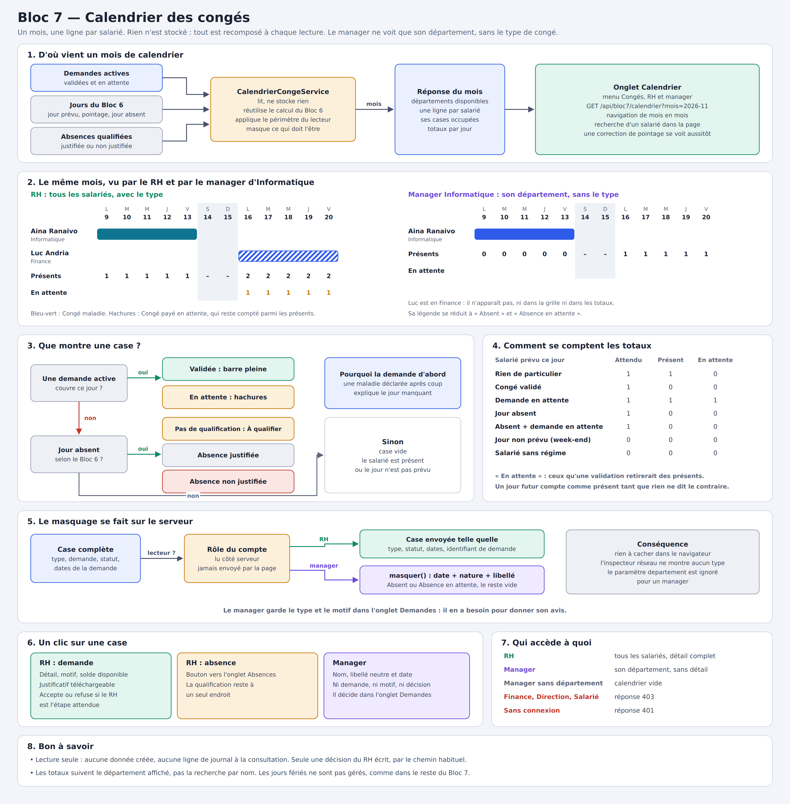

# Bloc 7 — Calendrier des congés

Cette documentation complète [`BLOC7-CONGES-ABSENCES.md`](./BLOC7-CONGES-ABSENCES.md). Je l'ai écrite pour expliquer tout ce que j'ai ajouté au Bloc 7 pour le calendrier : ce que j'ai fait, pourquoi, et comment le vérifier.



## Sommaire

1. [Objectif et décisions](#1-objectif-et-décisions)
2. [Les choix de conception](#2-les-choix-de-conception)
3. [Vue d'ensemble](#3-vue-densemble)
4. [Backend](#4-backend)
5. [Frontend](#5-frontend)
6. [Tests](#6-tests)
7. [Référence de l'API](#7-référence-de-lapi)
8. [Flux complets](#8-flux-complets)
9. [Procédure de vérification](#9-procédure-de-vérification)
10. [Limites connues et pistes](#10-limites-connues-et-pistes)

---

## 1. Objectif et décisions

Le RH voyait les congés sous forme de liste : impossible de repérer d'un coup d'œil qui est absent en même temps. J'ai donc ajouté un onglet **Calendrier** dans le menu **Congés** : une ligne par salarié, une colonne par jour du mois, et une barre pour chaque congé.

| Question | Décision |
|---|---|
| Quelle forme ? | Une frise par salarié plutôt qu'un calendrier mensuel classique, qui devient illisible dès que plusieurs personnes sont absentes le même jour. |
| Le manager y a-t-il accès ? | Oui, **limité à son département**. |
| Le manager voit-il le type de congé ? | **Non, seulement les absences** : il lit « Absent », jamais « Congé maladie ». |
| Les demandes en attente sont-elles affichées ? | **Oui**, en hachures, pour le RH comme pour le manager. |

J'ai interprété la réponse « Non seulement les absences » comme « Non, seulement les absences ». Le masquage s'étend donc aussi à la qualification d'une absence : le manager ne sait pas si elle est justifiée.

---

## 2. Les choix de conception

### Rien n'est stocké

Le calendrier n'a aucune table. Comme le solde et les absences, il est recomposé à chaque lecture. Une décision du RH ou une correction de pointage s'y voit donc aussitôt, sans synchronisation à maintenir.

### Je réutilise le calcul du Bloc 6

Savoir qu'un salarié est absent demande de connaître son régime, son planning, ses pointages et ses congés. `TempsTravailService` le fait déjà. Je n'ai pas réécrit ces règles : j'ai ajouté une méthode de lecture qui expose les jours déjà calculés. Le calendrier ne peut donc pas contredire les écrans du Bloc 6.

### Le masquage se fait sur le serveur

Cacher le type de congé dans la page ne protégerait rien : l'information resterait lisible dans l'onglet Réseau du navigateur. Le service retire donc ces données **avant** d'envoyer la réponse. La page du manager ne les reçoit jamais.

Le masquage tient dans une seule méthode, `masquer`. Il n'y a qu'un endroit à relire pour le vérifier.

### Le département vient du compte

Le filtre `departement` ne sert qu'au RH. Pour un manager, le service l'ignore et applique toujours le département de son compte. Modifier l'URL ne lui donne donc accès à rien de plus.

### Une demande passe avant une absence

Un jour peut porter à la fois une absence et une demande en attente, par exemple une maladie déclarée après coup. J'affiche la demande, parce qu'elle explique le jour manquant. Une fois la demande validée, le Bloc 6 ne compte plus ce jour comme une absence.

### La ligne « Présents » répond à la vraie question

Elle compte, jour par jour, les salariés attendus qui ne sont ni en congé validé, ni absents. La ligne « En attente » compte ceux qu'une validation retirerait des présents : le RH voit l'effet de sa décision avant de la prendre.

---

## 3. Vue d'ensemble

| Fichier | Rôle | État |
|---|---|---|
| `service/CalendrierCongeService.java` | compose le mois, limite et masque | nouveau |
| `dto/CalendrierCongeDto.java` | format de la réponse | nouveau |
| `entity/NatureCaseCalendrier.java` | nature d'une case | nouveau |
| `service/TempsTravailService.java` | expose les jours de l'effectif | modifié |
| `repository/DemandeCongeRepository.java` | demandes d'une période | modifié |
| `service/CongeService.java` | `memeDepartement` réutilisable | modifié |
| `controller/CongeController.java` | route `GET /api/bloc7/calendrier` | modifié |
| `CalendrierCongeServiceTest.java` | 13 tests | nouveau |
| `frontend/src/components/conges/CalendrierConges.vue` | écran du calendrier | nouveau |
| `frontend/src/views/CongesView.vue` | onglet, désormais visible par le manager | modifié |
| `frontend/src/api/conges.js` | appel `calendrier` | modifié |
| `docs/BLOC7-CALENDRIER-PLAN.png` | plan | nouveau |

Je n'ai touché ni à la base de données, ni à `SecurityConfig` : la règle existante `/api/bloc7/**` ouvre déjà la route au RH et aux managers.

---

## 4. Backend

### 4.1 `DemandeCongeRepository.surPeriode`

```java
    /** Toutes les demandes dans ces etats qui touchent la periode : elles alimentent le calendrier. */
    @EntityGraph(attributePaths = "typeConge")
    @Query("""
            select d from DemandeConge d
            where d.statut in :statuts
              and d.dateDebut <= :au and d.dateFin >= :du
            """)
    List<DemandeConge> surPeriode(@Param("du") LocalDate du,
                                  @Param("au") LocalDate au,
                                  @Param("statuts") Collection<StatutDemandeConge> statuts);
```

- `d.dateDebut <= :au and d.dateFin >= :du` est le test classique de chevauchement : il garde aussi un congé commencé le mois précédent.
- Je passe les statuts en paramètre : le service demande `StatutDemandeConge.ACTIFS`, soit les demandes en attente et validées. Les refusées et annulées disparaissent.
- `@EntityGraph` charge le type dans la même requête, ce qui évite une requête par demande.

### 4.2 `TempsTravailService.joursDeLEffectif`

```java
    /** Bloc 7 : les jours d'une periode pour tout l'effectif, avec le calcul du Bloc 6 : le calendrier ne le refait pas. */
    public List<JoursSalarie> joursDeLEffectif(LocalDate du, LocalDate au) {
        verifierPeriode(du, au);
        LocalDate aujourdhui = LocalDate.now(horloge);
        LocalDate premierLundi = lundiDe(du);
        LocalDate dernierLundi = lundiDe(au);
        Donnees donnees = chargerDonnees(premierLundi, dernierLundi.plusDays(6));

        List<JoursSalarie> resultat = new ArrayList<>();
        for (EmployeEmbauche employe : effectif()) {
            if (employe.getDateEntree().isAfter(au)) {
                continue;
            }
            List<JourTempsDto> jours = new ArrayList<>();
            for (LocalDate lundi = premierLundi; !lundi.isAfter(dernierLundi); lundi = lundi.plusWeeks(1)) {
                calculerSemaine(employe, lundi, donnees, aujourdhui).jours().stream()
                        .filter(jour -> !jour.date().isBefore(du) && !jour.date().isAfter(au))
                        .forEach(jours::add);
            }
            resultat.add(new JoursSalarie(employe, jours));
        }
        return resultat;
    }

    public record JoursSalarie(EmployeEmbauche employe, List<JourTempsDto> jours) {
    }
```

- `chargerDonnees` charge d'un coup pointages, plannings, congés et absences. `calculerSemaine` réutilise ensuite ces données, sans requête par jour.
- Le calcul se fait par semaine : le premier lundi peut tomber dans le mois précédent. Le filtre sur la date retire les jours hors période.
- Un salarié entré après la fin de la période est ignoré.
- `effectif()` exclut déjà les salariés sortis.

### 4.3 `NatureCaseCalendrier`

```java
/** Ce qu'une case du calendrier represente. Le manager ne recoit que ABSENT et EN_ATTENTE. */
public enum NatureCaseCalendrier {

    CONGE,
    EN_ATTENTE,
    ABSENCE_A_QUALIFIER,
    ABSENCE_JUSTIFIEE,
    ABSENCE_NON_JUSTIFIEE,
    ABSENT
}
```

Le RH reçoit les cinq premières valeurs. Le manager ne reçoit que `ABSENT` et `EN_ATTENTE`.

### 4.4 `CalendrierCongeDto`

```java
/** Un mois du calendrier. detailVisible est faux pour un manager : ses cases ne portent que « absent ». */
public record CalendrierCongeDto(
        String mois,
        LocalDate du,
        LocalDate au,
        boolean detailVisible,
        List<String> departements,
        List<Ligne> salaries,
        List<Synthese> jours) {

    public record Ligne(
            Long employeId,
            String matricule,
            String nomComplet,
            String departementNom,
            List<Case> cases) {
    }

    /** Une case par jour occupe. Pour un manager, seuls date, nature et libelle sont remplis. */
    public record Case(
            LocalDate date,
            NatureCaseCalendrier nature,
            String libelle,
            Long demandeId,
            Long typeCongeId,
            StatutDemandeConge statut,
            LocalDate dateDebut,
            LocalDate dateFin) {
    }

    /** attendus : salaries prevus ce jour ; enAttente : ceux qu'une validation retirerait des presents. */
    public record Synthese(
            LocalDate date,
            int attendus,
            int presents,
            int enAttente) {
    }
}
```

- `detailVisible` indique à la page qui elle sert. Cela ne protège rien, le masquage est déjà fait : ce champ adapte seulement l'affichage.
- `departements` alimente le filtre du RH. Je l'envoie indépendamment du filtre appliqué : choisir « Finance » ne doit pas vider la liste.
- `cases` ne contient que les jours occupés, ce qui garde la réponse légère.
- `Synthese` porte les totaux, calculés côté serveur et donc testés.

### 4.5 `CalendrierCongeService.calendrier`

```java
    /** Le filtre departement ne vaut que pour le RH : un manager reste toujours sur le sien. */
    public CalendrierCongeDto calendrier(YearMonth mois, String departement, String auteur) {
        Utilisateur lecteur = utilisateurRepository.findByEmailIgnoreCase(auteur)
                .orElseThrow(() -> ApiException.notFound("Utilisateur introuvable : " + auteur));
        boolean rh = lecteur.getRole() == RoleUtilisateur.RH;
        LocalDate du = mois.atDay(1);
        LocalDate au = mois.atEndOfMonth();

        List<TempsTravailService.JoursSalarie> visibles = tempsService.joursDeLEffectif(du, au).stream()
                .filter(salarie -> rh || CongeService.memeDepartement(lecteur, salarie.employe()))
                .toList();
        List<String> departements = visibles.stream()
                .map(salarie -> nomDepartement(salarie.employe()))
                .filter(Objects::nonNull)
                .distinct()
                .sorted()
                .toList();
        List<TempsTravailService.JoursSalarie> affiches = visibles.stream()
                .filter(salarie -> !rh || departement == null || departement.isBlank()
                        || departement.equalsIgnoreCase(nomDepartement(salarie.employe())))
                .sorted(Comparator.comparing((TempsTravailService.JoursSalarie salarie) -> salarie.employe().getNomComplet()))
                .toList();

        Map<Long, List<DemandeConge>> demandes = new HashMap<>();
        for (DemandeConge demande : demandeRepository.surPeriode(du, au, StatutDemandeConge.ACTIFS)) {
            demandes.computeIfAbsent(demande.getEmploye().getId(), id -> new ArrayList<>()).add(demande);
        }

        Compteurs compteurs = new Compteurs(mois);
        List<CalendrierCongeDto.Ligne> lignes = new ArrayList<>();
        for (TempsTravailService.JoursSalarie salarie : affiches) {
            lignes.add(ligne(salarie, demandes.getOrDefault(salarie.employe().getId(), List.of()), rh, compteurs));
        }
        return new CalendrierCongeDto(mois.toString(), du, au, rh, departements, lignes, compteurs.synthese());
    }
```

Bloc par bloc :

1. **Le lecteur** : je recharge l'utilisateur depuis son email. Le rôle vient de la base, jamais de la requête.
2. **`visibles`** : le périmètre. Le RH voit tout ; un manager ne garde que son département grâce à `memeDepartement`, déjà utilisée pour les demandes. Sans département, il ne voit personne.
3. **`departements`** : calculé sur `visibles`, avant le filtre, pour la raison vue plus haut.
4. **`affiches`** : le filtre du RH, ignoré pour un manager (`!rh ||`), puis le tri par nom.
5. **`demandes`** : regroupées par salarié. `getEmploye().getId()` ne déclenche pas de requête, car l'identifiant est déjà connu du proxy Hibernate.
6. **`compteurs`** : les totaux, alimentés pendant la construction des lignes. Ils portent donc exactement sur les salariés affichés.

### 4.6 Une ligne et ses cases

```java
    private static CalendrierCongeDto.Ligne ligne(TempsTravailService.JoursSalarie salarie, List<DemandeConge> demandes,
                                                  boolean rh, Compteurs compteurs) {
        EmployeEmbauche employe = salarie.employe();
        List<CalendrierCongeDto.Case> cases = new ArrayList<>();
        for (JourTempsDto jour : salarie.jours()) {
            // Deux demandes actives ne se chevauchent jamais : un jour porte au plus une demande.
            DemandeConge demande = demandes.stream()
                    .filter(candidate -> candidate.couvre(jour.date()))
                    .findFirst()
                    .orElse(null);
            compteurs.compter(jour, demande);

            CalendrierCongeDto.Case detail = caseDuJour(jour, demande);
            if (detail != null) {
                cases.add(rh ? detail : masquer(detail));
            }
        }
        return new CalendrierCongeDto.Ligne(employe.getId(), employe.getMatricule(), employe.getNomComplet(),
                nomDepartement(employe), cases);
    }

    /** La demande passe avant l'absence : une maladie declaree apres coup explique le jour manquant. */
    private static CalendrierCongeDto.Case caseDuJour(JourTempsDto jour, DemandeConge demande) {
        if (demande != null) {
            return new CalendrierCongeDto.Case(jour.date(),
                    demande.getStatut().enAttente() ? NatureCaseCalendrier.EN_ATTENTE : NatureCaseCalendrier.CONGE,
                    demande.getTypeConge().getLibelle(),
                    demande.getId(),
                    demande.getTypeConge().getId(),
                    demande.getStatut(),
                    demande.getDateDebut(),
                    demande.getDateFin());
        }
        if (!jour.absent()) {
            return null;
        }
        NatureCaseCalendrier nature = natureAbsence(jour.absenceStatut());
        String libelle = switch (nature) {
            case ABSENCE_JUSTIFIEE -> "Absence justifiée";
            case ABSENCE_NON_JUSTIFIEE -> "Absence non justifiée";
            default -> "Absence à qualifier";
        };
        return new CalendrierCongeDto.Case(jour.date(), nature, libelle, null, null, null, jour.date(), jour.date());
    }
```

- `compteurs.compter` passe **avant** le masquage : les totaux restent justes pour un manager, sans jamais révéler le détail.
- `rh ? detail : masquer(detail)` est la seule décision de masquage.
- `caseDuJour` applique la priorité : d'abord la demande, puis l'absence, sinon rien. Un retour `null` signifie une case vide.

### 4.7 Le masquage

```java
    /** Point unique du masquage : ce que le manager n'a pas a voir ne quitte jamais le serveur. */
    private static CalendrierCongeDto.Case masquer(CalendrierCongeDto.Case detail) {
        boolean enAttente = detail.nature() == NatureCaseCalendrier.EN_ATTENTE;
        return new CalendrierCongeDto.Case(detail.date(),
                enAttente ? NatureCaseCalendrier.EN_ATTENTE : NatureCaseCalendrier.ABSENT,
                enAttente ? "Absence en attente" : "Absent",
                null, null, null, null, null);
    }
```

Je construis une nouvelle case plutôt que d'effacer des champs : seuls la date, la nature et un libellé neutre sont recopiés. Si j'ajoute un champ sensible plus tard, il restera vide par défaut pour le manager.

`demandeId` est retiré aussi : sinon le manager pourrait relier une case à une demande de sa liste, et en déduire le type.

### 4.8 Les totaux

```java
    /** Totaux par jour de la population affichee, salaries sans regime exclus : on ne sait pas s'ils sont attendus. */
    private static final class Compteurs {

        private final YearMonth mois;
        private final int[] attendus;
        private final int[] presents;
        private final int[] enAttente;

        private Compteurs(YearMonth mois) {
            int jours = mois.lengthOfMonth();
            this.mois = mois;
            this.attendus = new int[jours];
            this.presents = new int[jours];
            this.enAttente = new int[jours];
        }

        private void compter(JourTempsDto jour, DemandeConge demande) {
            if (jour.heureDebutPrevue() == null) {
                return;
            }
            int indice = jour.date().getDayOfMonth() - 1;
            boolean congeValide = demande != null && demande.getStatut() == StatutDemandeConge.VALIDEE;
            attendus[indice]++;
            if (congeValide || jour.absent()) {
                return;
            }
            presents[indice]++;
            if (demande != null) {
                enAttente[indice]++;
            }
        }
```

| Situation d'un salarié prévu | Attendu | Présent | En attente |
|---|---|---|---|
| Rien de particulier | 1 | 1 | 0 |
| Congé validé | 1 | 0 | 0 |
| Demande en attente | 1 | 1 | 1 |
| Jour absent | 1 | 0 | 0 |
| Absent avec demande en attente | 1 | 0 | 0 |

La dernière ligne évite de compter deux fois : ce salarié n'est déjà plus présent, une validation ne retirerait donc personne.

`jour.heureDebutPrevue() == null` écarte les jours non prévus, comme le week-end d'un régime de bureau, et les salariés sans régime : on ne sait pas s'ils sont attendus.

### 4.9 Le contrôleur

```java
    /** Ouvert au manager : le service limite a son departement et retire ce qu'il n'a pas a voir. */
    @GetMapping("/calendrier")
    public CalendrierCongeDto calendrier(@RequestParam @DateTimeFormat(pattern = "yyyy-MM") YearMonth mois,
                                         @RequestParam(required = false) String departement,
                                         Authentication auth) {
        return calendrierService.calendrier(mois, departement, auth.getName());
    }
```

- La route est sous `/api/bloc7/` et non `/api/bloc7/rh/` : c'est ce qui l'ouvre au manager.
- `@DateTimeFormat(pattern = "yyyy-MM")` convertit `2026-11` en `YearMonth`. Une valeur invalide renvoie une erreur 400.

### 4.10 `memeDepartement`

J'ai seulement retiré `private` de cette méthode de `CongeService`. La règle reste écrite une seule fois : les départements du Bloc 1 et du Bloc 3 étant deux tables distinctes, ils sont reliés par leur nom.

---

## 5. Frontend

### 5.1 `api/conges.js`

```js
calendrier: (mois, departement) => apiGet(`${BASE}/calendrier?mois=${mois}${departement ? `&departement=${encodeURIComponent(departement)}` : ''}`),
```

`encodeURIComponent` protège les noms de département contenant un espace, comme « Ressources Humaines ».

### 5.2 `views/CongesView.vue`

```js
const ONGLETS_MANAGER = [
  { cle: 'demandes', libelle: 'Demandes' },
  { cle: 'calendrier', libelle: 'Calendrier' }
]
const ONGLETS_RH = [
  ...ONGLETS_MANAGER,
  { cle: 'absences', libelle: 'Absences' },
  { cle: 'soldes', libelle: 'Soldes et comptes' },
  { cle: 'types', libelle: 'Types de congé' }
]
const onglets = computed(() => (estRh.value ? ONGLETS_RH : ONGLETS_MANAGER))
```

La barre d'onglets était masquée pour le manager. Elle est maintenant visible, avec seulement **Demandes** et **Calendrier**. Le composant remonte l'événement `aller`, qui permet de passer à l'onglet Absences.

### 5.3 Les données affichées

```js
const jours = computed(() => (calendrier.value?.jours ?? []).map((jour) => {
  const dateJour = new Date(`${jour.date}T12:00:00`)
  return {
    ...jour,
    numero: dateJour.getDate(),
    initiale: INITIALES[dateJour.getDay()],
    weekEnd: dateJour.getDay() === 0 || dateJour.getDay() === 6,
    aujourdhui: jour.date === dateIso()
  }
}))

const lignes = computed(() => {
  const texte = recherche.value.trim().toLowerCase()
  return (calendrier.value?.salaries ?? [])
    .filter((l) => !texte || `${l.nomComplet} ${l.matricule}`.toLowerCase().includes(texte))
    .map((l) => ({ ...l, parJour: new Map(l.cases.map((c) => [c.date, c])) }))
})

const typesDuMois = computed(() => {
  const types = new Map()
  for (const ligne of calendrier.value?.salaries ?? []) {
    for (const c of ligne.cases) {
      if (c.typeCongeId) types.set(c.typeCongeId, c.libelle)
    }
  }
  return [...types].map(([id, libelle]) => ({ id, libelle })).sort((a, b) => a.id - b.id)
})

const panneauAbsence = computed(() => selection.value?.case.nature.startsWith('ABSENCE'))
```

- `T12:00:00` évite qu'un fuseau horaire ne décale la date d'un jour.
- `parJour` transforme la liste des cases en index par date : la grille retrouve une case en temps constant.
- La recherche filtre les lignes dans la page, sans appel au serveur. Les totaux restent ceux du département.
- `typesDuMois` construit la légende à partir des types réellement présents dans le mois.

### 5.4 Le chargement

```js
async function charger() {
  erreur.value = ''
  const numero = ++dernierChargement
  try {
    const reponse = await congesApi.calendrier(mois.value, departement.value)
    // Après plusieurs clics rapprochés, seule la dernière demande compte.
    if (numero === dernierChargement) calendrier.value = reponse
  } catch (e) {
    if (numero === dernierChargement) erreur.value = e.message
  }
}
```

`dernierChargement` empêche une réponse lente d'écraser le bon mois. Sans lui, trois clics rapides pouvaient faire arriver les réponses dans le désordre et laisser à l'écran un mois différent du titre.

### 5.5 Le panneau de détail

```js
async function ouvrir(ligne, c) {
  selection.value = { ligne, case: c }
  demande.value = null
  commentaire.value = ''
  if (!c.demandeId) return
  try {
    demande.value = (await congesApi.demandes()).find((d) => d.id === c.demandeId) ?? null
  } catch (e) {
    toast.error(e.message)
  }
}

async function decider(accepte) {
  try {
    await congesApi.decisionRh(demande.value.id, { accepte, commentaire: commentaire.value })
    toast.success(accepte ? 'Demande acceptée.' : 'Demande refusée.')
    selection.value = null
    await charger()
  } catch (e) {
    toast.error(e.message)
  }
}
```

- Un manager ne reçoit pas de `demandeId` : `ouvrir` s'arrête donc là, et son panneau ne montre qu'un libellé neutre et la date.
- Pour le RH, je recharge les demandes afin d'afficher le motif, le solde disponible et le justificatif.
- `decider` passe par la route habituelle : toutes les règles du RH s'appliquent, et un refus sans motif reste bloqué.
- Le bouton **Accepter** n'apparaît que pour le statut `EN_ATTENTE_RH`, l'étape où le RH peut réellement décider.

### 5.6 La grille

Chaque case occupée est un vrai `<button>` : elle se manipule au clavier et porte une description pour les lecteurs d'écran. La colonne des noms reste fixe quand la grille défile sur un petit écran, et la page elle-même ne déborde pas.

```js
function couleur(c) {
  return c.typeCongeId ? `couleur-${c.typeCongeId % NB_COULEURS}` : ''
}

function memeBarre(a, b) {
  return a && b && a.nature === b.nature && a.demandeId === b.demandeId
}

function classesCase(ligne, jour, index) {
  const c = ligne.parJour.get(jour.date)
  return [
    couleur(c),
    c.nature.toLowerCase().replaceAll('_', '-'),
    {
      'suite-avant': memeBarre(c, ligne.parJour.get(jours.value[index - 1]?.date)),
      'suite-apres': memeBarre(c, ligne.parJour.get(jours.value[index + 1]?.date))
    }
  ]
}
```

- La couleur dépend de l'identifiant du type, modulo 6 : un type garde sa couleur d'un mois à l'autre.
- `suite-avant` et `suite-apres` retirent les arrondis entre deux jours d'une même demande, ce qui forme une barre continue.
- Une demande en attente reste hachurée : elle se distingue même sans percevoir les couleurs.

---

## 6. Tests

`CalendrierCongeServiceTest` contient 13 tests. `TempsTravailService` y est simulé, ce qui permet de choisir précisément les jours.

| Sujet | Ce que je vérifie |
|---|---|
| RH | il voit tous les salariés, le type et la demande |
| Filtre | le département filtre les lignes sans vider la liste des départements |
| Périmètre | un manager reste sur son département, même s'il en demande un autre |
| Périmètre | un manager sans département ne voit personne |
| Masquage | un manager ne reçoit ni type, ni demande, ni statut, ni dates |
| Masquage | une demande en attente reste visible, sans son type |
| Masquage | une absence qualifiée redevient « Absent » |
| Totaux | un congé validé retire le salarié des présents |
| Totaux | une demande en attente le laisse présent et se compte à part |
| Totaux | les totaux suivent le filtre de département |
| Absences | une absence non qualifiée reste à qualifier et ne compte qu'une fois |
| Priorité | une demande en attente passe avant l'absence du même jour |
| Repos | personne n'est attendu un jour non prévu, même si le congé le couvre |

---

## 7. Référence de l'API

### `GET /api/bloc7/calendrier`

| Paramètre | Obligatoire | Rôle |
|---|---|---|
| `mois` | oui | format `AAAA-MM` |
| `departement` | non | nom du département, RH uniquement |

| Appelant | Réponse |
|---|---|
| RH | 200, tous les salariés avec le détail |
| Manager | 200, son département sans le détail |
| Manager sans département | 200, calendrier vide |
| Finance, Direction, salarié | 403 |
| Sans connexion | 401 |
| `mois` absent ou invalide | 400 |

Une case reçue par le RH :

```json
{
  "date": "2026-11-09",
  "nature": "CONGE",
  "libelle": "Congé maladie",
  "demandeId": 2,
  "typeCongeId": 2,
  "statut": "VALIDEE",
  "dateDebut": "2026-11-09",
  "dateFin": "2026-11-13"
}
```

La même case reçue par le manager :

```json
{
  "date": "2026-11-09",
  "nature": "ABSENT",
  "libelle": "Absent",
  "demandeId": null,
  "typeCongeId": null,
  "statut": null,
  "dateDebut": null,
  "dateFin": null
}
```

---

## 8. Flux complets

### Le RH décide depuis le calendrier

1. Il ouvre **Congés**, onglet **Calendrier**, et voit les hachures d'Aina du 23 au 27.
2. La ligne « En attente » montre 1 sur ces jours : une validation retirerait une personne.
3. Il clique sur la barre : le panneau affiche le motif et le solde disponible.
4. Il accepte. `decisionRh` rejoue ses contrôles et écrit la décision dans le journal d'audit.
5. Le calendrier se recharge : la barre devient pleine et les présents baissent de 1.

### Le manager consulte son équipe

1. Le menu **Congés** affiche ses deux onglets.
2. Le serveur lit son compte et ne renvoie que son département.
3. Il voit « Absent » et « Absence en attente », avec les présents du jour.
4. Pour donner son avis, il passe par l'onglet **Demandes**.

### Une correction de pointage

1. Le calendrier affiche une absence à qualifier.
2. Le RH saisit le pointage oublié dans **Temps de travail**.
3. Le Bloc 6 ne compte plus ce jour comme absent : la case disparaît à la lecture suivante, sans autre mise à jour.

---

## 9. Procédure de vérification

Lancer les tests :

```bash
cd backend
JAVA_HOME=/usr/lib/jvm/jdk-21.0.12-oracle-x64 ./mvnw test
```

Puis redémarrer le backend et tester dans l'application :

1. **RH** : `rh@rh.com` / `rh123`, menu **Congés**, onglet **Calendrier**. Changer de mois, filtrer par département, chercher un nom.
2. Cliquer sur une demande en attente du RH, puis l'accepter : la barre devient pleine.
3. Cliquer sur une absence à qualifier, puis suivre le bouton vers l'onglet **Absences**.
4. **Manager** : `manager.informatique@rh.com` / `manager123`. Seuls ses salariés apparaissent, avec « Absent » pour seul libellé.
5. Dans les outils du navigateur, onglet Réseau, ouvrir la réponse de `calendrier` : aucun type de congé n'y figure.
6. **Finance** : `finance@rh.com` / `finance123`. Le menu **Congés** n'apparaît pas.

Les scripts `database/bloc5-donnees-test.sql` à `bloc7-donnees-test.sql` créent Aina, Luc et une demande en attente.

---

## 10. Limites connues et pistes

- **Onglet Demandes du manager** : il y voit toujours le type et le motif, car il en a besoin pour donner son avis. Le masquage ne vaut que pour le calendrier.
- **Un mois à la fois** : il n'existe ni vue semaine, ni vue annuelle.
- **Jours fériés** : ils ne sont pas gérés, comme dans le reste du Bloc 7.
- **Jour en cours** : un salarié sans pointage aujourd'hui n'est pas encore absent. Le Bloc 6 ne le considère absent qu'à partir du lendemain.
- **Jours futurs** : « Présents » signifie « prévus présents ». Une absence imprévue ne se voit qu'après coup.
- **Salarié sans régime** : il a sa ligne, mais ne compte pas dans les totaux et ne peut pas être marqué absent.
- **Salarié sans département** : seul le RH le voit, et le filtre ne propose pas de choix « sans département ».
- **Seuil d'alerte** : aucun effectif minimum n'est défini, donc rien ne signale un sous-effectif. C'est le prochain ajout le plus utile.
- **Décision du manager** : il ne peut pas donner son avis depuis le calendrier, pour ne pas lui exposer la demande.
- **Audit** : consulter le calendrier n'écrit rien au journal, contrairement à l'ouverture d'un dossier salarié.
- **Volume** : chaque lecture recalcule tout l'effectif sur le mois. C'est largement suffisant ici, mais à surveiller avec plusieurs centaines de salariés.
