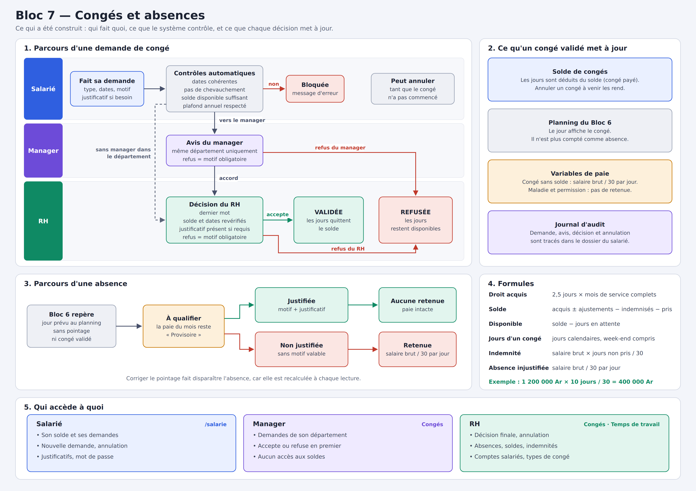

# Bloc 7 — Congés et absences

> Documentation technique rédigée par l'auteur du code. J'y explique **ce que j'ai fait, comment et pourquoi**, fichier par fichier, bloc par bloc.



---

## Sommaire

1. [Objectif et règles métier retenues](#1-objectif-et-règles-métier-retenues)
2. [Les choix de conception](#2-les-choix-de-conception)
3. [Vue d'ensemble de l'architecture](#3-vue-densemble-de-larchitecture)
4. [Base de données — `schema.sql` et `data.sql`](#4-base-de-données--schemasql-et-datasql)
5. [Configuration](#5-configuration)
6. [Entités et énumérations](#6-entités-et-énumérations)
7. [Repositories](#7-repositories)
8. [DTOs](#8-dtos)
9. [Le moteur de calcul — `CalculConge`](#9-le-moteur-de-calcul--calculconge)
10. [Droits et soldes — `SoldeCongeService`](#10-droits-et-soldes--soldecongeservice)
11. [Le parcours d'une demande — `CongeService`](#11-le-parcours-dune-demande--congeservice)
12. [Absences — `AbsenceService`](#12-absences--absenceservice)
13. [Comptes salariés — `CompteSalarieService`](#13-comptes-salariés--comptesalarieservice)
14. [Espace salarié — `EspaceSalarieService`](#14-espace-salarié--espacesalarieservice)
15. [Lien avec le Bloc 6 — `TempsTravailService`](#15-lien-avec-le-bloc-6--tempstravailservice)
16. [Contrôleurs REST](#16-contrôleurs-rest)
17. [Sécurité](#17-sécurité)
18. [Frontend](#18-frontend)
19. [Tests](#19-tests)
20. [Référence de l'API](#20-référence-de-lapi)
21. [Flux complets](#21-flux-complets)
22. [Exemples chiffrés](#22-exemples-chiffrés)
23. [Procédure de vérification](#23-procédure-de-vérification)
24. [Limites connues et pistes](#24-limites-connues-et-pistes)

---

## 1. Objectif et règles métier retenues

Le cours définit le Bloc 7 ainsi :

- Demande de congé → contrôle du solde → validation manager/RH.
- Gérer droits, soldes, types de congés, absences et justificatifs.
- Contrôler chevauchements et disponibilité du solde.
- Mettre à jour planning et variables de paie.
- Objets : `TypeConge`, `DroitConge`, `SoldeConge`, `DemandeConge`, `Absence`.
- **Congé = Salaire brut × nombre de jours non pris / 30.**

Quatre choix ont été arrêtés avant d'écrire le code :

| Question | Choix |
|---|---|
| Qui fait la demande ? | **Le salarié, avec son propre compte.** Le manager puis le RH confirment. |
| Comment calculer les droits ? | **2,5 jours par mois**, décomptés en **jours calendaires**. |
| Comment traiter les absences ? | **Le RH qualifie** chaque jour : justifiée, ou non justifiée avec une retenue de salaire brut / 30. |
| Quel plan livrer ? | Un **fichier PNG** : [`docs/BLOC7-PLAN.png`](./BLOC7-PLAN.png). |

Les règles qui en découlent :

| Règle | Où elle est implémentée |
|---|---|
| Un salarié ne peut faire une demande que pour lui-même. | `EspaceSalarieService`, `EspaceSalarieController` |
| Une demande ne peut pas chevaucher une demande active du salarié. | `CongeService.controlerDisponibilite` |
| Un congé payé ne dépasse pas le **solde disponible**, qui déduit aussi les demandes en attente. | `SoldeCongeService`, `controlerDisponibilite` |
| Un type de congé peut avoir un **plafond annuel**. | `controlerDisponibilite` |
| Un congé se demande à l'avance ; un type à justificatif (maladie) peut se déclarer après coup. | `CongeService.controlerDates` |
| Le manager donne son avis **d'abord**, et seulement pour **son département**. | `CongeService.avisManager` |
| S'il n'y a pas de manager dans le département, la demande va directement au RH. | `CongeService.demander`, `decisionRh` |
| Le RH a le dernier mot, après une **nouvelle vérification** du solde et des dates. | `CongeService.decisionRh` |
| Un refus doit être **justifié**, par le manager comme par le RH. | `CongeService.exigerMotifDeRefus` |
| Un type à justificatif ne se valide pas sans sa pièce. | `CongeService.decisionRh` |
| Un congé déjà commencé ne s'annule plus. | `CongeService.annuler` |
| Un jour de congé validé n'est plus une absence. | `TempsTravailService.calculerJour` |
| Une absence justifiée demande un **motif et un justificatif**. | `AbsenceService.qualifier` |
| La paie reste **Provisoire** tant qu'une absence n'est pas qualifiée. | `TempsTravailService.variablesDe` |

> **Hypothèses à faire confirmer** : les 2,5 jours par mois, le décompte calendaire et la liste des types de congé ne viennent pas du cours, seule la formule en / 30 en vient. Les 2,5 jours se changent dans `application.properties`, les types dans l'application.

---

## 2. Les choix de conception

### Le solde n'est pas stocké

Le cours cite `SoldeConge` comme objet. Je l'ai bien créé, mais comme **résultat de calcul** (`SoldeCongeDto`), pas comme table. C'est la même décision qu'au Bloc 6 : on stocke les faits, on calcule les résultats.

```
solde      = droits acquis + mouvements du RH − jours validés
disponible = solde − jours en attente
```

Une colonne `solde` devrait être modifiée à chaque validation, annulation ou correction. Le moindre oubli la rendrait fausse sans que personne ne le voie. Ici, annuler une demande rend les jours automatiquement, sans une ligne de code dédiée.

### `DroitConge` ne stocke que les décisions du RH

Les 2,5 jours mensuels se déduisent de l'ancienneté : je ne les enregistre pas. `droit_conge` ne contient que ce qui ne peut pas se déduire : les ajustements et les indemnisations.

### Le statut de la demande est une machine à états

```
                          ┌─ refus ──────────────────────▶ REFUSEE
EN_ATTENTE_MANAGER ───────┤
        │                 └─ accord ─▶ EN_ATTENTE_RH ─┬─ refus ─▶ REFUSEE
        │ (pas de manager)                 ▲          └─ accord ─▶ VALIDEE
        └──────────────────────────────────┘

EN_ATTENTE_* ou VALIDEE non commencée ─▶ ANNULEE
```

Chaque méthode vérifie l'état de départ : on ne peut pas sauter une étape.

### Le salarié n'est jamais passé en paramètre

Aucune route `/api/salarie/**` ne reçoit d'identifiant de salarié. Le serveur le déduit du compte connecté. Il est donc impossible de demander un congé pour quelqu'un d'autre, ou de lire ses demandes, en modifiant une requête.

---

## 3. Vue d'ensemble de l'architecture

```
 Vue 3                                 Spring Boot                              PostgreSQL
┌───────────────────────────┐    ┌──────────────────────────────────┐    ┌─────────────────────┐
│ EspaceSalarieView (EMPLOYE)│───▶│ EspaceSalarieController          │    │ mrtovo.type_conge   │
│ CongesView (RH, MANAGER)   │    │   /api/salarie/**                │    │ mrtovo.droit_conge  │
│  ├ DemandesConge           │    │ CongeController                  │    │ mrtovo.demande_conge│
│  ├ AbsencesAQualifier (RH) │───▶│   /api/bloc7/**, /api/bloc7/rh/**│    │ mrtovo.absence      │
│  ├ SoldesConges (RH)       │    │         │                        │───▶│ public.utilisateur  │
│  └ TypesConge (RH)         │    │ CongeService · SoldeCongeService │    │   + id_employe      │
│ PointagesSemaine (Bloc 6)  │    │ AbsenceService · CompteSalarie   │    │ journal_audit       │
│ VariablesPaie (Bloc 6)     │    │         │                        │    │ (Bloc 5)            │
└───────────────────────────┘    │ TempsTravailService (Bloc 6)     │    └─────────────────────┘
                                 │ CalculConge (règles pures)       │
                                 └──────────────────────────────────┘
```

| Couche | Fichier | Nouveau / modifié |
|---|---|---|
| SQL | `schema.sql`, `data.sql`, `application.properties` | modifié |
| Config | `config/CongeProperties.java` | nouveau |
| Config | `RecrutementConfiguration`, `SecurityConfig` | modifié |
| Entité | `TypeConge`, `DroitConge`, `DemandeConge`, `Absence` | nouveau |
| Entité | `Utilisateur` (lien vers le salarié) | modifié |
| Enum | `StatutDemandeConge`, `StatutAbsence`, `TypeDroitConge` | nouveau |
| Enum | `RoleUtilisateur`, `ActionAudit`, `TypeAnomaliePointage` | modifié |
| Repository | `TypeCongeRepository`, `DroitCongeRepository`, `DemandeCongeRepository`, `AbsenceRepository` | nouveau |
| Repository | `EmployeEmbaucheRepository`, `UtilisateurRepository` | modifié |
| DTO | `DemandeCongeDto`, `SoldeCongeDto`, `TypeCongeDto`, `TypeCongeRequest`, `DroitCongeDto`, `AjustementDroitRequest`, `IndemnisationRequest`, `DecisionCongeRequest`, `AnnulationCongeRequest`, `AbsenceDto`, `SalarieProfilDto`, `CompteSalarieRequest`, `ChangementMotDePasseRequest` | nouveau |
| DTO | `JourTempsDto`, `VariablesPaieDto` | modifié |
| Service | `CalculConge`, `SoldeCongeService`, `CongeService`, `AbsenceService`, `CompteSalarieService`, `EspaceSalarieService` | nouveau |
| Service | `TempsTravailService`, `DossierSalarieService` | modifié |
| Contrôleur | `CongeController`, `EspaceSalarieController` | nouveau |
| Contrôleur | `DossierSalarieController` | modifié |
| Test | `CalculCongeTest`, `CongeServiceTest`, `CompteSalarieServiceTest` | nouveau |
| Test | `TempsTravailServiceTest` | modifié |
| Front | `api/conges.js`, `api/salarie.js`, `utils/fichier.js`, `layouts/SalarieLayout.vue`, `views/CongesView.vue`, `views/salarie/EspaceSalarieView.vue`, `components/conges/*.vue` | nouveau |
| Front | `router/index.js`, `LoginView.vue`, `AppLayout.vue`, `RecrutementStatutBadge.vue`, `PointagesSemaine.vue`, `VariablesPaie.vue` | modifié |
| Données | `database/bloc7-donnees-test.sql` | nouveau |
| Plan | `docs/BLOC7-PLAN.png` | nouveau |

---

## 4. Base de données — `schema.sql` et `data.sql`

### 4.1 Le piège du nouveau rôle

```sql
ALTER TABLE IF EXISTS public.utilisateur DROP CONSTRAINT IF EXISTS utilisateur_role_check;
```

C'est une ligne, mais sans elle le bloc ne fonctionnerait pas sur une base existante.

Pour une colonne `@Enumerated(EnumType.STRING)`, Hibernate crée une contrainte `CHECK` avec la liste des valeurs de l'énumération **au moment de la création de la table**. Or `ddl-auto=update` ne modifie jamais une contrainte existante. Une base déjà créée refuserait donc toute insertion du rôle `EMPLOYE`.

Je l'ai vérifié : avec l'ancienne contrainte, l'insertion échoue (`violates check constraint "utilisateur_role_check"`). Après un démarrage, elle réussit. `IF EXISTS` couvre le cas d'une base neuve, où la table n'existe pas encore quand `schema.sql` s'exécute.

Le contrôle du rôle reste assuré : par l'énumération Java côté application.

### 4.2 `type_conge`

```sql
CREATE TABLE IF NOT EXISTS mrtovo.type_conge (
    id BIGSERIAL PRIMARY KEY,
    code VARCHAR(50) NOT NULL UNIQUE,
    libelle VARCHAR(255) NOT NULL,
    decompte_solde BOOLEAN NOT NULL DEFAULT FALSE,
    remunere BOOLEAN NOT NULL DEFAULT TRUE,
    justificatif_requis BOOLEAN NOT NULL DEFAULT FALSE,
    plafond_annuel_jours INTEGER
);
```

Les règles d'un type sont des **données**, pas du code. Le service ne teste jamais `si le type est MALADIE`, il lit `justificatif_requis`. Le RH peut donc créer un nouveau type sans développement.

- `decompte_solde` : les jours pris diminuent le solde.
- `remunere` : à `false`, chaque jour est retenu sur la paie.
- `justificatif_requis` : la pièce est obligatoire pour valider. Ce champ autorise aussi la déclaration après coup.
- `plafond_annuel_jours` : `NULL` signifie sans plafond.

### 4.3 `droit_conge`

```sql
CREATE TABLE IF NOT EXISTS mrtovo.droit_conge (
    id BIGSERIAL PRIMARY KEY,
    employe_id BIGINT NOT NULL REFERENCES mrtovo.employe(id),
    type_droit VARCHAR(30) NOT NULL,
    jours NUMERIC(6,2) NOT NULL,
    motif VARCHAR(255) NOT NULL,
    mois_paie VARCHAR(7),
    montant NUMERIC(14,2),
    cree_par VARCHAR(150) NOT NULL,
    date_creation TIMESTAMP NOT NULL DEFAULT CURRENT_TIMESTAMP
);
```

- `jours` est **signé** : positif pour ajouter, négatif pour retirer. La somme de la colonne donne directement l'effet sur le solde.
- `NUMERIC(6,2)` : les droits contiennent des demi-journées (2,5 jours).
- `mois_paie` et `montant` ne servent qu'aux indemnisations. Le montant est **figé** : si le salaire change ensuite, ce qui a été décidé reste vrai.

### 4.4 `demande_conge`

```sql
CREATE TABLE IF NOT EXISTS mrtovo.demande_conge (
    id BIGSERIAL PRIMARY KEY,
    employe_id BIGINT NOT NULL REFERENCES mrtovo.employe(id),
    type_conge_id BIGINT NOT NULL REFERENCES mrtovo.type_conge(id),
    date_debut DATE NOT NULL,
    date_fin DATE NOT NULL,
    nb_jours INTEGER NOT NULL,
    motif VARCHAR(255),
    statut VARCHAR(30) NOT NULL,
    ...
```

- `nb_jours` se déduit des dates, mais je le stocke : c'est le nombre validé au moment de la décision. Une évolution de la règle de décompte ne doit pas modifier les congés passés.
- `avis_manager_par`, `date_avis_manager`, `commentaire_manager`, puis `decide_par`, `date_decision`, `commentaire_rh` : chaque étape garde son auteur, sa date et sa raison.
- `justificatif_cle`, `_nom`, `_type` : même modèle que `document_salarie` au Bloc 5.

### 4.5 `absence`

```sql
CREATE TABLE IF NOT EXISTS mrtovo.absence (
    id BIGSERIAL PRIMARY KEY,
    employe_id BIGINT NOT NULL REFERENCES mrtovo.employe(id),
    date_absence DATE NOT NULL,
    statut VARCHAR(20) NOT NULL,
    motif VARCHAR(255),
    ...
    qualifie_par VARCHAR(150) NOT NULL,
    date_qualification TIMESTAMP NOT NULL DEFAULT CURRENT_TIMESTAMP,
    UNIQUE (employe_id, date_absence)
);
```

Cette table ne dit pas « le salarié est absent » : c'est le Bloc 6 qui le calcule. Elle enregistre la **décision du RH** sur ce jour. Pas de ligne signifie « à qualifier », comme `decision_heures_sup` au Bloc 6.

### 4.6 Contraintes de domaine

```sql
ALTER TABLE mrtovo.demande_conge ADD CONSTRAINT ck_demande_conge_dates
    CHECK (date_fin >= date_debut AND nb_jours > 0);
```

Comme aux blocs précédents, j'ai suivi le motif `DROP CONSTRAINT IF EXISTS` puis `ADD CONSTRAINT`. J'ai aussi élargi `ck_journal_audit_action` pour accepter les neuf nouvelles actions.

### 4.7 Données de démarrage

```sql
INSERT INTO type_conge (id, code, libelle, decompte_solde, remunere, justificatif_requis, plafond_annuel_jours) VALUES
(1, 'CONGE_PAYE', 'Congé payé', TRUE, TRUE, FALSE, NULL),
(2, 'MALADIE', 'Congé maladie', FALSE, TRUE, TRUE, NULL),
(3, 'PERMISSION', 'Permission exceptionnelle', FALSE, TRUE, TRUE, 10),
(4, 'SANS_SOLDE', 'Congé sans solde', FALSE, FALSE, FALSE, NULL) ON CONFLICT DO NOTHING;
```

| Type | Décompte le solde | Rémunéré | Justificatif | Plafond |
|---|---|---|---|---|
| Congé payé | Oui | Oui | Facultatif | — |
| Maladie | Non | Oui | Obligatoire | — |
| Permission | Non | Oui | Obligatoire | 10 j/an |
| Sans solde | Non | **Non** | Facultatif | — |

---

## 5. Configuration

```properties
bloc7.jours-acquis-par-mois=2.5
```

```java
@ConfigurationProperties(prefix = "bloc7")
public class CongeProperties {
    private BigDecimal joursAcquisParMois = new BigDecimal("2.5");
```

- `BigDecimal` : 2,5 n'est pas une valeur exacte pour tout calcul en `double`, et il entre dans des sommes de jours et d'argent.
- La division par 30 reste une constante de `CalculConge` : elle vient de la formule du cours.

---

## 6. Entités et énumérations

### 6.1 `Utilisateur` (modifié)

```java
    @OneToOne(fetch = FetchType.LAZY)
    @JoinColumn(name = "id_employe", unique = true)
    private EmployeEmbauche employe;
```

- Même technique que le lien `candidat` existant.
- `unique = true` : un salarié, un compte.
- La colonne est ajoutée par Hibernate (`ddl-auto=update`), comme le reste du schéma `public`.

J'ai préféré ce lien à une correspondance par email : l'email d'un salarié peut changer dans son dossier (Bloc 5), et le compte ne doit pas se détacher pour autant.

### 6.2 `StatutDemandeConge`

```java
    public static final Set<StatutDemandeConge> ACTIFS = EnumSet.of(EN_ATTENTE_MANAGER, EN_ATTENTE_RH, VALIDEE);

    public boolean enAttente() {
        return this == EN_ATTENTE_MANAGER || this == EN_ATTENTE_RH;
    }
```

- `ACTIFS` : les états qui occupent des dates. Une demande refusée ou annulée libère ses dates.
- `enAttente` : ces jours sont réservés, pas encore pris.

### 6.3 `TypeConge`, `DroitConge`, `Absence`

Elles reflètent leurs tables, avec Lombok. Dans `DroitConge`, `precision` et `scale` correspondent au `NUMERIC` du SQL.

### 6.4 `DemandeConge`

```java
    public boolean couvre(LocalDate date) {
        return !date.isBefore(dateDebut) && !date.isAfter(dateFin);
    }
```

Bornes incluses : le premier et le dernier jour font partie du congé. Le Bloc 6 s'en sert pour savoir si un jour est couvert.

### 6.5 Énumérations modifiées

- `RoleUtilisateur` : ajout d'`EMPLOYE`.
- `ActionAudit` : `CREATION_COMPTE_SALARIE`, `DEMANDE_CONGE`, `AVIS_MANAGER_CONGE`, `DECISION_RH_CONGE`, `ANNULATION_CONGE`, `AJOUT_JUSTIFICATIF`, `QUALIFICATION_ABSENCE`, `AJUSTEMENT_DROIT_CONGE`, `INDEMNISATION_CONGE`. Elles apparaissent automatiquement dans le journal du dossier salarié.
- `TypeAnomaliePointage` : `POINTAGE_PENDANT_CONGE`, pour un pointage sur un jour de congé validé.

---

## 7. Repositories

```java
    @Query("""
            select d from DemandeConge d
            where d.employe.id = :employeId and d.statut in :statuts
              and d.dateDebut <= :fin and d.dateFin >= :debut
            """)
    List<DemandeConge> chevauchantes(...);
```

C'est le **contrôle de chevauchement** : deux périodes se touchent si chacune commence avant la fin de l'autre. Cette condition couvre tous les cas (inclusion, débordement à gauche ou à droite), bornes comprises.

```java
    @EntityGraph(attributePaths = "typeConge")
    @Query("""
            select d from DemandeConge d
            where d.statut = com.mrtovo.backend.entity.StatutDemandeConge.VALIDEE
              and d.dateDebut <= :au and d.dateFin >= :du
            """)
    List<DemandeConge> validesSurPeriode(...);
```

Les congés validés d'une période, pour le Bloc 6. `@EntityGraph` évite une requête par demande.

Dans `EmployeEmbaucheRepository` :

```java
    @Lock(LockModeType.PESSIMISTIC_WRITE)
    @Query("select e from RecrutementEmploye e where e.id = :id")
    Optional<EmployeEmbauche> verrouiller(@Param("id") Long id);
```

**Pourquoi un verrou ?** Sans lui, un double clic enverrait deux demandes en même temps : chacune verrait le solde intact et aucune ne verrait l'autre, et le salarié dépasserait son solde. Le verrou sur la ligne du salarié fait passer ses opérations l'une après l'autre. `"RecrutementEmploye"` est le nom d'entité donné au Bloc 3.

Dans `UtilisateurRepository`, `existsByRoleAndDepartementNomIgnoreCase` indique s'il existe un manager pour un département.

---

## 8. DTOs

```java
public record SoldeCongeDto(
        Long employeId, String matricule, String nomComplet,
        int moisComplets,
        BigDecimal joursAcquis, BigDecimal joursAjustes, BigDecimal joursPris, BigDecimal joursIndemnises,
        BigDecimal solde, BigDecimal joursEnAttente, BigDecimal disponible,
        BigDecimal salaireBrut, BigDecimal indemniteCompensatrice,
        boolean compteActif) {
}
```

C'est le `SoldeConge` du cours. Il détaille chaque composante : le RH peut expliquer un solde au salarié.

```java
public record DecisionCongeRequest(@NotNull Boolean accepte, @Size(max = 255) String commentaire) {
}
```

- `Boolean` et non `boolean` : sinon un champ oublié vaudrait `false`, donc un refus involontaire.
- Le même record sert au manager et au RH.

```java
public record IndemnisationRequest(
        @NotNull @Positive BigDecimal jours,
        @NotBlank @Pattern(regexp = "\\d{4}-(0[1-9]|1[0-2])", message = "doit suivre le format AAAA-MM") String moisPaie,
        @NotBlank @Size(max = 255) String motif) {
}
```

Le mois de paie est validé, car il sert de clé de regroupement dans les variables de paie.

`DemandeCongeDto.soldeDisponible` est rempli pour une demande en attente de type décompté : le manager et le RH voient le solde au moment où ils décident. `AbsenceDto` garde `id` et `statut` vides pour un jour encore à qualifier.

---

## 9. Le moteur de calcul — `CalculConge`

```java
public final class CalculConge {

    static final BigDecimal JOURS_PAR_MOIS_DE_PAIE = BigDecimal.valueOf(30);

    private CalculConge() {
    }
```

Même principe que `CalculTemps` : classe pure, testable sans base ni Spring.

```java
    public static int joursCalendaires(LocalDate debut, LocalDate fin) {
        return (int) ChronoUnit.DAYS.between(debut, fin) + 1;
    }
```

`DAYS.between` exclut la borne de fin, d'où le `+ 1` : du lundi au vendredi donne bien 5 jours. Un congé du lundi au lundi suivant coûte 8 jours, week-end compris.

```java
    public static int moisComplets(LocalDate dateEntree, LocalDate date) {
        if (date.isBefore(dateEntree)) {
            return 0;
        }
        return (int) Period.between(dateEntree, date).toTotalMonths();
    }
```

Seuls les mois **entièrement** effectués comptent. Entré le 15 janvier : 0 mois le 14 février, 1 mois le 15 février. Le salarié gagne donc ses droits chaque mois à la date anniversaire de son entrée, sans aucun traitement planifié.

```java
    public static BigDecimal joursAcquis(int moisComplets, BigDecimal joursParMois) {
        return joursParMois.multiply(BigDecimal.valueOf(moisComplets));
    }

    public static BigDecimal montantJours(BigDecimal salaireBrut, BigDecimal jours) {
        return salaireBrut.multiply(jours).divide(JOURS_PAR_MOIS_DE_PAIE, 2, RoundingMode.HALF_UP);
    }
```

`montantJours` est la **formule du cours** : `salaire brut × jours / 30`. La multiplication vient avant la division pour limiter l'arrondi. Elle sert à l'indemnité comme à la retenue d'une journée : c'est la même valeur d'un jour de salaire.

---

## 10. Droits et soldes — `SoldeCongeService`

### 10.1 Le calcul

```java
    private SoldeCongeDto calculer(EmployeEmbauche employe, boolean compteActif) {
        LocalDate aujourdhui = LocalDate.now(horloge);
        int mois = CalculConge.moisComplets(employe.getDateEntree(), aujourdhui);
        BigDecimal acquis = CalculConge.joursAcquis(mois, proprietes.getJoursAcquisParMois());
```
1. Les droits acquis, déduits de l'ancienneté.

```java
        List<DroitConge> droits = droitRepository.findByEmployeIdOrderByDateCreationDesc(employe.getId());
        BigDecimal ajustes = sommeDroits(droits, TypeDroitConge.AJUSTEMENT);
        BigDecimal indemnises = sommeDroits(droits, TypeDroitConge.INDEMNISATION).negate();
```
2. Les mouvements du RH. Les indemnisations sont négatives en base : `negate()` donne le nombre de jours payés.

```java
        List<DemandeConge> demandes = demandeRepository.findByEmployeIdOrderByDateDebutDesc(employe.getId()).stream()
                .filter(demande -> demande.getTypeConge().isDecompteSolde())
                .toList();
        BigDecimal pris = sommeJours(demandes.stream().filter(d -> d.getStatut() == StatutDemandeConge.VALIDEE).toList());
        BigDecimal attente = sommeJours(demandes.stream().filter(d -> d.getStatut().enAttente()).toList());
```
3. Seuls les types qui décomptent le solde comptent. Une maladie n'y touche pas.
4. « Pris » inclut les congés validés à venir : ces jours sont déjà engagés.

```java
        BigDecimal solde = acquis.add(ajustes).subtract(indemnises).subtract(pris);
        BigDecimal disponible = solde.subtract(attente);
```
5. Le **solde** dit ce qui reste réellement ; le **disponible** dit ce qu'on peut encore demander. Sans cette distinction, un salarié pourrait envoyer plusieurs demandes en attente pour le même solde.

```java
        BigDecimal indemnite = salaire != null
                ? CalculConge.montantJours(salaire, solde.max(BigDecimal.ZERO))
                : null;
```
6. L'indemnité affichée applique la formule du cours au solde. `max(ZERO)` : un solde négatif ne donne pas une indemnité négative.

Le salaire vient de `DossierSalarieService.contratEnCours` : la règle du contrat en cours reste à un seul endroit, définie au Bloc 5.

### 10.2 `ajuster`

```java
        EmployeEmbauche employe = verrouiller(employeId);
        if (requete.jours().signum() < 0 && requete.jours().negate().compareTo(calculer(employe, false).disponible()) > 0) {
            throw ApiException.conflit("SOLDE_INSUFFISANT", ...);
        }
```

Pour une reprise d'ancien solde, une correction ou un congé déjà pris que l'on veut régulariser. Un retrait ne peut pas dépasser le disponible, et le motif est obligatoire.

### 10.3 `indemniser`

```java
        BigDecimal montant = CalculConge.montantJours(solde.salaireBrut(), requete.jours());
        DroitConge droit = nouveauDroit(employe, TypeDroitConge.INDEMNISATION, requete.jours().negate(),
                requete.motif(), auteur);
        droit.setMoisPaie(requete.moisPaie());
        droit.setMontant(montant);
```

Applique la formule du cours aux **jours non pris** : `Congé = salaire brut × jours non pris / 30`. Une seule écriture produit les deux effets : les jours quittent le solde, le montant arrive dans la paie du mois choisi.

---

## 11. Le parcours d'une demande — `CongeService`

### 11.1 `demander`

```java
    public DemandeCongeDto demander(Long employeId, Long typeCongeId, LocalDate debut, LocalDate fin, String motif,
                                    MultipartFile justificatif, String auteur) {
        EmployeEmbauche employe = verrouiller(employeId);
        ...
        controlerDates(employe, type, debut, fin);
        int jours = CalculConge.joursCalendaires(debut, fin);
        controlerDisponibilite(employe, type, debut, fin, jours, null);
```

Le verrou d'abord, les contrôles ensuite : c'est l'ordre qui rend la vérification du solde fiable.

```java
        demande.setStatut(managerExiste(employe)
                ? StatutDemandeConge.EN_ATTENTE_MANAGER
                : StatutDemandeConge.EN_ATTENTE_RH);
```

Sans manager dans le département, la demande resterait bloquée indéfiniment : elle passe directement au RH.

### 11.2 `controlerDates`

```java
        if (!type.isJustificatifRequis() && debut.isBefore(LocalDate.now(horloge))) {
            throw ApiException.badRequest("DATE_PASSEE", "Ce type de congé doit être demandé à l'avance.");
        }
```

On ne prévoit pas une grippe : un type à justificatif peut se déclarer après coup, puisque la pièce le prouve. Un congé payé, lui, se demande avant.

### 11.3 `controlerDisponibilite`

C'est le cœur du « contrôle » demandé par le cours. La méthode sert deux fois : à la demande et à la validation du RH.

```java
        List<DemandeConge> chevauchantes = demandeRepository.chevauchantes(employe.getId(), debut, fin,
                        StatutDemandeConge.ACTIFS).stream()
                .filter(demande -> !demande.getId().equals(demandeId))
                .toList();
```
`demandeId` exclut la demande elle-même quand le RH la revérifie : sinon elle chevaucherait sa propre période.

```java
        if (type.isDecompteSolde()) {
            BigDecimal disponible = soldeService.solde(employe.getId()).disponible();
            if (demandeId != null) {
                disponible = disponible.add(BigDecimal.valueOf(jours));
            }
            if (BigDecimal.valueOf(jours).compareTo(disponible) > 0) { ... "SOLDE_INSUFFISANT" ... }
        }
```
Une demande en attente est déjà déduite du disponible. Lors de la revérification, je la rajoute, sinon elle serait comptée deux fois et le RH ne pourrait jamais valider une demande de tout le solde.

J'utilise `compareTo` et non `equals` : avec les `BigDecimal`, `5.0` et `5` ne sont pas égaux au sens de `equals`.

```java
        if (type.getPlafondAnnuelJours() != null) {
            int annee = debut.getYear();
            int dejaPris = ... actives, même type, même année ...
            if (dejaPris + jours > type.getPlafondAnnuelJours()) { ... "PLAFOND_DEPASSE" ... }
        }
```
Le plafond compte les demandes en attente et validées de l'année.

### 11.4 `avisManager`

```java
        Utilisateur manager = chargerUtilisateur(auteur);
        if (manager.getRole() != RoleUtilisateur.MANAGER) { ... "ROLE_MANAGER_REQUIS" ... }
        DemandeConge demande = chargerDemande(demandeId);
        if (!memeDepartement(manager, demande.getEmploye())) { ... "AUTRE_DEPARTEMENT" ... }
        if (demande.getStatut() != StatutDemandeConge.EN_ATTENTE_MANAGER) { ... "ETAPE_INVALIDE" ... }
```

Trois verrous successifs : le bon rôle, le bon département, la bonne étape. La route étant ouverte aux RH et aux managers, le rôle se contrôle ici.

```java
    private static boolean memeDepartement(Utilisateur manager, EmployeEmbauche employe) {
        return manager.getDepartement() != null && employe.getDepartement() != null
                && manager.getDepartement().getNom().equalsIgnoreCase(employe.getDepartement().getNom());
    }
```

Le projet a **deux tables de départements** : `public.departement` pour les utilisateurs (Bloc 1) et `mrtovo.departement` pour les salariés (Bloc 3). Leurs identifiants n'ont aucun rapport : je les relie par leur **nom**, sans tenir compte de la casse.

### 11.5 `decisionRh`

```java
        boolean sansManager = demande.getStatut() == StatutDemandeConge.EN_ATTENTE_MANAGER && !managerExiste(employe);
        if (demande.getStatut() != StatutDemandeConge.EN_ATTENTE_RH && !sansManager) {
            throw ApiException.conflit("ETAPE_INVALIDE", ...);
        }
```

Le RH ne peut pas court-circuiter le manager. Exception : le manager a disparu depuis la demande, qui serait sinon bloquée à jamais.

```java
        if (requete.accepte()) {
            TypeConge type = demande.getTypeConge();
            if (type.isJustificatifRequis() && demande.getJustificatifCle() == null) { ... }
            controlerDisponibilite(employe, type, demande.getDateDebut(), demande.getDateFin(),
                    demande.getNbJours(), demande.getId());
        }
```

**Pourquoi revérifier ?** Des jours peuvent passer entre la demande et la décision, pendant lesquels un ajustement ou une indemnisation change le solde. La vérification ne porte que sur l'acceptation : on peut toujours refuser.

### 11.6 `annuler`

```java
        boolean validee = demande.getStatut() == StatutDemandeConge.VALIDEE;
        if (!demande.getStatut().enAttente() && !validee) { ... "DEMANDE_CLOSE" ... }
        if (validee && !demande.getDateDebut().isAfter(LocalDate.now(horloge))) { ... "CONGE_COMMENCE" ... }
        demande.setStatut(StatutDemandeConge.ANNULEE);
```

La méthode est privée, appelée par `annulerParSalarie` et `annulerParRh`. Passer à `ANNULEE` suffit à rendre les jours : c'est le bénéfice direct d'un solde calculé. Un congé commencé est consommé : on le régularise par un ajustement.

### 11.7 Accès d'un salarié à ses demandes

```java
    private DemandeConge chargerDemandeDuSalarie(Long employeId, Long demandeId) {
        return demandeRepository.findById(demandeId)
                .filter(demande -> demande.getEmploye().getId().equals(employeId))
                .orElseThrow(() -> ApiException.notFound("Demande introuvable : " + demandeId));
    }
```

**404 et non 403** : un 403 révélerait que la demande existe. Un salarié ne peut pas sonder les numéros de demande de ses collègues.

### 11.8 Justificatifs

`joindre` réutilise `DocumentStorageService` du Bloc 5 : mêmes formats, même contrôle par signature, mêmes noms en UUID. `apresAnnulation` retire le fichier si la transaction échoue ; `apresValidation` supprime l'ancien fichier une fois le remplacement enregistré. J'ai passé ces outils de `DossierSalarieService` de `private` à la visibilité *package* pour les partager.

---

## 12. Absences — `AbsenceService`

```java
    public List<AbsenceDto> lister(LocalDate du, LocalDate au) {
        List<AbsenceDto> resultat = new ArrayList<>();
        for (TempsTravailService.JourAQualifier jour : tempsService.absencesAQualifier(du, au)) { ... }
        absenceRepository.findByDateAbsenceBetween(du, au).stream()...
```

Fusionne deux sources : les jours à qualifier, qui n'existent qu'en calcul, puis les jours déjà qualifiés, qui sont en base. Les premiers arrivent en tête : ce sont eux qui demandent une action.

```java
        JourTempsDto jour = tempsService.semaine(employeId, date).jours().stream()
                .filter(candidat -> candidat.date().equals(date))
                .findFirst()
                .orElseThrow();
        if (!jour.absent()) {
            throw ApiException.conflit("PAS_ABSENT", "Le salarié n'est pas absent à cette date.");
        }
```

Je ne crois pas la requête sur parole : je redemande au Bloc 6 si ce jour est vraiment une absence. On ne peut donc pas retenir un jour de salaire sur un jour travaillé.

```java
        if (statut == StatutAbsence.JUSTIFIEE
                && (motifNettoye == null || (!fichierFourni && absence.getJustificatifCle() == null))) {
            throw ApiException.badRequest("JUSTIFICATIF_MANQUANT", ...);
        }
```

Une absence justifiée demande un motif et une pièce, déjà présente ou fournie maintenant. Le RH peut requalifier un jour : la trace d'audit conserve l'ancien statut (`remplace Non justifiée`).

---

## 13. Comptes salariés — `CompteSalarieService`

```java
        Utilisateur compte = utilisateurRepository.findByEmailIgnoreCase(email).orElseGet(Utilisateur::new);
        boolean conversion = compte.getIdUtilisateur() != null;
        if (conversion && !estSonCompteCandidat(compte, employe)) {
            throw ApiException.conflit("EMAIL_DEJA_UTILISE", ...);
        }
```

**Le cas à ne pas manquer.** Un salarié recruté via le portail a déjà un compte candidat avec le **même email**, et l'email est unique. Créer un second compte échouerait. Je **convertis** donc son compte : il passe au rôle `EMPLOYE`. Je ne le fais que si ce compte est bien le sien, en comparant les identifiants de candidat. Un compte RH avec le même email ne sera jamais transformé.

```java
        compte.setMotDePasse(encodeur.encode(motDePasse));
```

Le mot de passe est chiffré en BCrypt, comme tous les comptes du projet.

```java
    private static void verifierLongueur(String motDePasse) {
        if (motDePasse.getBytes(StandardCharsets.UTF_8).length > OCTETS_MAX_BCRYPT) { ... }
    }
```

BCrypt est limité à 72 **octets**, pas caractères : un mot de passe accentué peut dépasser sans que le nombre de lettres le montre.

`changerMotDePasse` exige l'ancien mot de passe. Comme le RH connaît le mot de passe initial, le salarié doit pouvoir le remplacer.

---

## 14. Espace salarié — `EspaceSalarieService`

```java
    private EmployeEmbauche employe(String email) {
        Utilisateur compte = utilisateurRepository.findByEmailIgnoreCase(email)
                .orElseThrow(() -> ApiException.notFound("Compte introuvable."));
        if (compte.getEmploye() == null) {
            throw ApiException.forbidden("COMPTE_NON_SALARIE", ...);
        }
        return compte.getEmploye();
    }
```

C'est le seul endroit qui transforme un compte connecté en salarié. `profil` assemble ensuite identité, solde et types de congé pour l'écran.

---

## 15. Lien avec le Bloc 6 — `TempsTravailService`

C'est là que se réalise « mettre à jour planning et variables de paie ». Rien n'est recopié : le Bloc 6 lit simplement les congés et les absences à chaque calcul.

### 15.1 Un jour de congé n'est plus une absence

```java
        DemandeConge conge = dansEffectif ? donnees.conge(employe, date) : null;
        boolean absent = horaire != null && pointage == null && conge == null && date.isBefore(aujourdhui);
        Absence absence = absent ? donnees.absence(employe, date) : null;
```

- Le seul ajout est `conge == null`. Dès qu'un congé est validé, l'absence et son anomalie disparaissent, sur toutes les périodes.
- `absence` n'est lue que si le jour est réellement absent : si un pointage ou un congé arrive après coup, une ancienne qualification est ignorée et la retenue disparaît.

```java
        if (conge != null && pointage != null) {
            anomalies.add(anomalie(employe, date, TypeAnomaliePointage.POINTAGE_PENDANT_CONGE, ...));
        }
```

Pointer pendant un congé est incohérent : le signaler vaut mieux que de le refuser, car le salarié est peut-être venu travailler.

### 15.2 Les variables de paie

```java
            for (JourTempsDto jour : semaine.jours()) {
                if (jour.absent() && jour.absenceStatut() == null) {
                    aQualifier++;
                }
                if (jour.absenceStatut() == StatutAbsence.NON_JUSTIFIEE) {
                    nonJustifies++;
                }
                if (jour.congeLibelle() != null) {
                    joursConge++;
                    if (Boolean.FALSE.equals(jour.congeRemunere())) {
                        sansSolde++;
                    }
                }
            }
        }
        provisoire |= aQualifier > 0;
```

- `Boolean.FALSE.equals(...)` : la valeur peut être `null`, ce test ne plante pas.
- Une absence à qualifier rend le mois **Provisoire** : son montant n'est pas encore connu.

```java
                salaire != null
                        ? CalculConge.montantJours(salaire, BigDecimal.valueOf((long) nonJustifies + sansSolde))
                        : null,
```

La retenue utilise la même formule : **salaire brut / 30 par jour**.

```java
        Map<Long, BigDecimal> indemnites = droitCongeRepository.findByMoisPaie(mois.toString()).stream()
                .collect(Collectors.toMap(droit -> droit.getEmploye().getId(), DroitConge::getMontant, BigDecimal::add));
```

Les indemnisations du mois, additionnées par salarié. `BigDecimal::add` gère le cas de plusieurs indemnisations le même mois.

Comme au Bloc 6, une semaine appartient au mois de son lundi : congés et absences suivent la même règle.

### 15.3 `absencesAQualifier`

```java
    public record JourAQualifier(EmployeEmbauche employe, LocalDate date) {
    }
```

Parcourt les semaines et garde les jours `absent` sans statut. J'ai extrait `verifierPeriode`, partagé avec les anomalies : même plafond de 92 jours.

---

## 16. Contrôleurs REST

### `CongeController`

```java
@RestController
@RequestMapping("/api/bloc7")
public class CongeController {
```

Les chemins expriment les droits : `/api/bloc7/rh/**` est réservé au RH par `SecurityConfig`.

```java
    /** 204 et non 201 : le client HTTP du projet lit un corps JSON pour tout statut sauf 204. */
    @PostMapping("/rh/employes/{id}/compte")
    @ResponseStatus(HttpStatus.NO_CONTENT)
    public void creerCompte(...)
```

Ce commentaire vient d'un vrai bug trouvé en testant dans le navigateur. Avec un `201` sans corps, le compte était bien créé, mais `http.js` échouait en lisant le JSON : l'écran annonçait une erreur après un succès.

### `EspaceSalarieController`

```java
    @PostMapping(value = "/conges", consumes = MediaType.MULTIPART_FORM_DATA_VALUE)
    @ResponseStatus(HttpStatus.CREATED)
    public DemandeCongeDto demander(
            @RequestParam Long typeCongeId,
            @RequestParam @DateTimeFormat(iso = DateTimeFormat.ISO.DATE) LocalDate dateDebut,
            @RequestParam @DateTimeFormat(iso = DateTimeFormat.ISO.DATE) LocalDate dateFin,
            @RequestParam(required = false) String motif,
            @RequestPart(required = false) MultipartFile justificatif,
            Authentication auth) {
        return congeService.demander(espaceService.employeId(auth.getName()), typeCongeId, dateDebut, dateFin,
                motif, justificatif, auth.getName());
    }
```

Multipart, car un justificatif peut accompagner la demande. L'identifiant du salarié n'est pas un paramètre : il vient de `auth.getName()`.

### `DossierSalarieController` (modifié)

J'ai extrait `reponseFichier` : les en-têtes de téléchargement (`attachment`, `nosniff`) restent à un seul endroit pour tous les fichiers confidentiels des Blocs 5 et 7.

---

## 17. Sécurité

```java
                        .requestMatchers("/api/salarie/**").hasRole("EMPLOYE")
                        .requestMatchers("/api/bloc7/rh/**").hasRole("RH")
                        .requestMatchers("/api/bloc7/**").hasAnyRole("RH", "MANAGER")
                        .requestMatchers("/api/**").hasAnyRole("MANAGER", "RH", "FINANCE", "DIRECTION")
```

- L'ordre compte : du plus précis au plus général. `/api/bloc7/rh/**` doit passer avant `/api/bloc7/**`.
- `EMPLOYE` ne figure pas dans la dernière règle : **un salarié n'accède à aucune autre API**, ni aux dossiers, ni au recrutement.

| Appel | Résultat vérifié |
|---|---|
| Salarié → `/api/bloc7/rh/soldes` | 403 |
| Salarié → `/api/bloc5/dossiers` | 403 |
| Manager → `/api/bloc7/rh/soldes` | 403 |
| RH → `/api/salarie/moi` | 403 |
| Salarié de test → connexion | 200 |

La séparation des départements se fait dans `CongeService`, car une règle d'URL ne connaît pas les données.

---

## 18. Frontend

### 18.1 Routage et connexion

```js
  if (auth.role === 'EMPLOYE' && !to.path.startsWith('/salarie')) return '/salarie'
```

Placé en tête du garde : un salarié reste dans son espace, quelle que soit l'URL saisie. La vraie protection reste côté serveur.

```js
    const accueil = { CANDIDAT: '/candidats/espace', EMPLOYE: '/salarie' }
    router.push(accueil[auth.role] ?? '/')
```

`LoginView` envoie chacun vers sa page d'accueil. Une table remplace une suite de conditions.

### 18.2 `layouts/SalarieLayout.vue`

Un salarié n'a pas le menu de gestion : il a sa propre coquille, avec son nom et la déconnexion.

### 18.3 `views/salarie/EspaceSalarieView.vue`

```js
const nbJours = computed(() => {
  if (!formulaire.dateDebut || !formulaire.dateFin || formulaire.dateFin < formulaire.dateDebut) return 0
  const debut = new Date(`${formulaire.dateDebut}T12:00:00`)
  const fin = new Date(`${formulaire.dateFin}T12:00:00`)
  return Math.round((fin - debut) / 86400000) + 1
})
```

- Le salarié voit le nombre de jours avant d'envoyer. C'est une information : le serveur recalcule.
- `T12:00:00` et `Math.round` protègent des changements d'heure : un jour ne fait pas toujours exactement 24 h.

```js
function peutAnnuler(demande) {
  return ['EN_ATTENTE_MANAGER', 'EN_ATTENTE_RH'].includes(demande.statut)
    || (demande.statut === 'VALIDEE' && new Date(`${demande.dateDebut}T12:00:00`) > new Date())
}
```

Le bouton reflète la règle ; le serveur la fait respecter.

L'écran montre quatre compteurs, le formulaire de demande, l'historique avec les commentaires, et le changement de mot de passe. Le bouton « Joindre » ajoute un justificatif à une demande existante, ce qui permet de déclarer une maladie puis d'envoyer le certificat.

### 18.4 `views/CongesView.vue`

Le manager ne voit que les demandes ; le RH a quatre onglets. La barre d'onglets est masquée pour le manager.

### 18.5 `components/conges/DemandesConge.vue`

```js
const statutATraiter = computed(() => (estRh.value ? 'EN_ATTENTE_RH' : 'EN_ATTENTE_MANAGER'))
```

Le même composant sert au RH et au manager : seule l'étape à traiter change. Le filtre par défaut, « À traiter », montre uniquement ce qui attend une action.

```js
    if (estRh.value) await congesApi.decisionRh(demande.id, decision)
    else await congesApi.avisManager(demande.id, decision)
```

Le solde disponible s'affiche sur la ligne : on décide en voyant la situation du salarié.

### 18.6 `components/conges/AbsencesAQualifier.vue`

```js
const cle = (absence) => `${absence.employeId}-${absence.date}`

function saisie(absence) {
  saisies[cle(absence)] ??= { motif: '', fichier: null }
  return saisies[cle(absence)]
}
```

Chaque ligne a son motif et son fichier. Une absence à qualifier n'a pas d'`id` : la clé combine salarié et date.

### 18.7 `components/conges/SoldesConges.vue`

Tableau des soldes, puis, après « Gérer » : création du compte, ajustement et indemnisation. Le montant estimé s'affiche pendant la saisie ; le serveur calcule le montant réel.

### 18.8 `components/conges/TypesConge.vue`

Liste les types et en crée de nouveaux, avec leurs quatre règles.

### 18.9 Écrans du Bloc 6

- `PointagesSemaine.vue` : un jour de congé affiche son type à la place de l'horaire ; un jour qualifié affiche son badge.
- `VariablesPaie.vue` : nouvelles colonnes **Retenues** (dont absences) et **Indemnité**. J'ai regroupé dû, compensé et retenu dans la colonne **Retards** : avec une colonne de plus, le tableau débordait de l'écran.

### 18.10 Autres

- `api/conges.js` et `api/salarie.js` : un module par public.
- `utils/fichier.js` : `enregistrerBlob`, partagé par les écrans de téléchargement.
- `AppLayout.vue` : entrée « Congés » pour le RH et les managers.
- `RecrutementStatutBadge.vue` : couleurs et libellés des nouveaux statuts.

---

## 19. Tests

### Tests unitaires

**`CalculCongeTest` — 4 tests** : jours calendaires avec week-end, mois complets aux dates limites, 12 mois donnent 30 jours, formule du cours (1 200 000 × 10 / 30 = 400 000).

**`CompteSalarieServiceTest` — 5 tests** : compte créé et chiffré, compte candidat converti, email d'un autre compte refusé, second compte refusé, changement de mot de passe avec l'ancien.

**`CongeServiceTest` — 17 tests** :

| Test | Ce qu'il vérifie |
|---|---|
| `leSoldeDeduitLesCongesValidesEtLesDemandesEnAttente` | Solde, disponible et indemnité ; un refus ne compte pas |
| `uneDemandeValablePartChezLeManager` | Première étape et nombre de jours |
| `sansManagerDansLeDepartementLaDemandeVaDirectementAuRh` | Une demande n'est jamais bloquée |
| `refuseUneDemandeSuperieureAuSoldeDisponible` | Contrôle du solde, aucune écriture |
| `refuseUneDemandeQuiChevaucheUneAutre` | Contrôle des chevauchements |
| `uneDemandeRefuseeNeBloquePasSesDates` | Les dates sont libérées |
| `unCongePayeNeSeDemandePasApresCoupMaisUneMaladieSi` | Règle de date par type |
| `unManagerNePeutPasDonnerSonAvisPourUnAutreDepartement` | Séparation des départements |
| `leParcoursCompletMeneALaValidation` | Salarié, manager, RH, solde final |
| `leRhNePeutPasPasserAvantLeManager` | Ordre des étapes |
| `unRefusDoitEtreJustifie` | Motif obligatoire |
| `leRhNeValidePasUneMaladieSansJustificatif` | Pièce obligatoire |
| `annulerRendLesJoursAuSolde` | Bénéfice du solde calculé |
| `unCongeCommenceNeSAnnulePlus` | Limite d'annulation |
| `unSalarieNeVoitPasLaDemandeDUnAutre` | 404 et non 403 |
| `indemniserPaieLesJoursNonPrisEtFigeLeMontant` | Formule et jours négatifs |
| `onNePeutPasRetirerPlusQueLeDisponible` | Limite d'un ajustement |

`TempsTravailServiceTest` a été adapté : les variables de paie sont désormais provisoires quand une absence reste à qualifier.

```bash
cd backend
./mvnw test -Dtest='CalculCongeTest,CongeServiceTest,CompteSalarieServiceTest'
```

Résultat sur tout le backend (Blocs 1 à 7) : **73 tests, 0 échec**. Les tests d'intégration ont besoin d'une base PostgreSQL.

### Parcours dans un vrai navigateur

J'ai piloté l'interface avec Playwright et Chromium, sur une base de test : 24 vérifications à travers **trois rôles**, avec de vraies connexions. Le script n'est pas conservé dans le dépôt.

Ce parcours a révélé deux défauts, corrigés depuis : le `201` sans corps ([§ 16](#16-contrôleurs-rest)) et le tableau de paie qui débordait. Le tableau a ensuite été remesuré, et il tient dans l'écran.

### Migration d'une base existante

Vérifié dans l'ordre : pose de l'ancienne contrainte, échec de l'insertion d'un `EMPLOYE`, démarrage de l'application, contrainte retirée, insertion réussie.

---

## 20. Référence de l'API

### Espace salarié (rôle `EMPLOYE`)

| Méthode | URL | Corps | Réponse | Audit |
|---|---|---|---|---|
| GET | `/api/salarie/moi` | — | `SalarieProfilDto` | non |
| GET | `/api/salarie/conges` | — | `DemandeCongeDto[]` | non |
| POST | `/api/salarie/conges` | multipart : `typeCongeId`*, `dateDebut`*, `dateFin`*, `motif`, `justificatif` | 201 `DemandeCongeDto` | DEMANDE_CONGE |
| POST | `/api/salarie/conges/{id}/justificatif` | multipart : `justificatif`* | `DemandeCongeDto` | AJOUT_JUSTIFICATIF |
| GET | `/api/salarie/conges/{id}/justificatif` | — | binaire | non |
| POST | `/api/salarie/conges/{id}/annuler` | — | `DemandeCongeDto` | ANNULATION_CONGE |
| PUT | `/api/salarie/mot-de-passe` | `ChangementMotDePasseRequest` | 204 | non |

### RH et managers

| Méthode | URL | Corps | Réponse | Audit |
|---|---|---|---|---|
| GET | `/api/bloc7/demandes` | — | `DemandeCongeDto[]` (filtré pour un manager) | non |
| POST | `/api/bloc7/demandes/{id}/avis` | `DecisionCongeRequest` | `DemandeCongeDto` | AVIS_MANAGER_CONGE |
| GET | `/api/bloc7/demandes/{id}/justificatif` | — | binaire | non |

### RH uniquement

| Méthode | URL | Corps | Réponse | Audit |
|---|---|---|---|---|
| POST | `/api/bloc7/rh/demandes/{id}/decision` | `DecisionCongeRequest` | `DemandeCongeDto` | DECISION_RH_CONGE |
| POST | `/api/bloc7/rh/demandes/{id}/annuler` | `AnnulationCongeRequest` | `DemandeCongeDto` | ANNULATION_CONGE |
| GET / POST | `/api/bloc7/rh/types` | `TypeCongeRequest` | `TypeCongeDto` | non |
| GET | `/api/bloc7/rh/soldes` | — | `SoldeCongeDto[]` | non |
| GET | `/api/bloc7/rh/employes/{id}/mouvements` | — | `DroitCongeDto[]` | non |
| POST | `/api/bloc7/rh/employes/{id}/ajustement` | `AjustementDroitRequest` | `SoldeCongeDto` | AJUSTEMENT_DROIT_CONGE |
| POST | `/api/bloc7/rh/employes/{id}/indemnisation` | `IndemnisationRequest` | `SoldeCongeDto` | INDEMNISATION_CONGE |
| POST | `/api/bloc7/rh/employes/{id}/compte` | `CompteSalarieRequest` | 204 | CREATION_COMPTE_SALARIE |
| GET | `/api/bloc7/rh/absences` | `?du=...&au=...` (92 jours max) | `AbsenceDto[]` | non |
| POST | `/api/bloc7/rh/absences` | multipart : `employeId`*, `date`*, `statut`*, `motif`, `justificatif` | `AbsenceDto` | QUALIFICATION_ABSENCE |
| GET | `/api/bloc7/rh/absences/{id}/justificatif` | — | binaire | non |

### Codes d'erreur métier

| HTTP | code | Cause |
|---|---|---|
| 400 | `VALIDATION`, `REQUETE_INVALIDE` | Champ invalide ou manquant |
| 400 | `PERIODE_INVALIDE`, `PERIODE_TROP_LONGUE` | Dates incohérentes |
| 400 | `DATE_AVANT_ENTREE`, `DATE_PASSEE` | Date impossible pour ce congé |
| 400 | `COMMENTAIRE_OBLIGATOIRE` | Refus sans justification |
| 400 | `JOURS_INVALIDES` | Ajustement nul |
| 400 | `JUSTIFICATIF_MANQUANT` | Absence justifiée sans motif ou sans pièce |
| 400 | `FICHIER_VIDE`, `FICHIER_TROP_GROS`, `FORMAT_INVALIDE` | Fichier refusé |
| 400 | `MOT_DE_PASSE_INCORRECT`, `MOT_DE_PASSE_TROP_LONG` | Changement de mot de passe refusé |
| 403 | `ROLE_MANAGER_REQUIS`, `AUTRE_DEPARTEMENT`, `COMPTE_NON_SALARIE` | Droit insuffisant |
| 404 | `INTROUVABLE` | Demande, type, salarié ou absence inexistant |
| 409 | `CHEVAUCHEMENT` | Dates déjà prises |
| 409 | `SOLDE_INSUFFISANT` | Disponible insuffisant |
| 409 | `PLAFOND_DEPASSE` | Plafond annuel atteint |
| 409 | `ETAPE_INVALIDE`, `DEMANDE_CLOSE`, `CONGE_COMMENCE` | Action impossible à ce stade |
| 409 | `JUSTIFICATIF_MANQUANT` | Validation sans la pièce requise |
| 409 | `PAS_ABSENT` | Le jour n'est pas une absence |
| 409 | `CONTRAT_MANQUANT` | Pas de salaire pour calculer l'indemnité |
| 409 | `COMPTE_EXISTANT`, `EMAIL_DEJA_UTILISE`, `TYPE_EXISTANT`, `SALARIE_SORTI` | Conflit de données |

Exemples :

```bash
# Le salarié consulte son solde
curl -u luc.andria@gmail.com:salarie123 http://localhost:8080/api/salarie/moi

# Le salarié demande un congé
curl -u luc.andria@gmail.com:salarie123 -F typeCongeId=1 -F dateDebut=2026-12-07 \
  -F dateFin=2026-12-11 -F motif=Vacances http://localhost:8080/api/salarie/conges

# Le manager accepte
curl -u manager.informatique@rh.com:manager123 -X POST -H 'Content-Type: application/json' \
  http://localhost:8080/api/bloc7/demandes/1/avis -d '{"accepte":true}'

# Le RH valide
curl -u rh@rh.com:rh123 -X POST -H 'Content-Type: application/json' \
  http://localhost:8080/api/bloc7/rh/demandes/1/decision -d '{"accepte":true}'
```

---

## 21. Flux complets

Le plan [`BLOC7-PLAN.png`](./BLOC7-PLAN.png) montre ces parcours en un coup d'œil.

### Demande de congé

```
Salarié : POST /api/salarie/conges
  → compte connecté → salarié                 403 si le compte n'est pas salarié
  → verrou sur le salarié
  → dates cohérentes ?                        400
  → chevauchement ?                           409 CHEVAUCHEMENT
  → solde disponible suffisant ?              409 SOLDE_INSUFFISANT
  → plafond annuel respecté ?                 409 PLAFOND_DEPASSE
  → statut : EN_ATTENTE_MANAGER (ou EN_ATTENTE_RH sans manager)
  → trace DEMANDE_CONGE                       [commit]

Manager : POST /api/bloc7/demandes/{id}/avis
  → même département ? bonne étape ?          403 / 409
  → EN_ATTENTE_RH, ou REFUSEE avec motif

RH : POST /api/bloc7/rh/demandes/{id}/decision
  → justificatif présent si requis ?          409
  → solde, dates et plafond revérifiés        409
  → VALIDEE, ou REFUSEE avec motif
```

### Une fois le congé validé

```
Rien n'est recopié. À la lecture suivante :
  Solde            → les jours passent dans « pris »
  Pointages        → le jour affiche le congé
  Anomalies        → plus de « jour sans pointage »
  Absences         → le jour n'est plus à qualifier
  Variables de paie → jours de congé comptés, retenue si sans solde
```

### Absence

```
Bloc 6 : jour prévu, passé, sans pointage ni congé → absent
RH : onglet Absences
  → POST /api/bloc7/rh/absences
  → le Bloc 6 confirme que le jour est absent  409 PAS_ABSENT
  → Justifiée : motif + justificatif, pas de retenue
  → Non justifiée : salaire brut / 30 retiré de la paie
```

### Indemnisation

```
RH : Soldes et comptes → Gérer → Indemniser
  → jours ≤ disponible ?                      409
  → contrat en cours ?                        409
  → montant = salaire brut × jours / 30 (figé)
  → droit_conge : jours négatifs + mois de paie
  ← solde diminué, montant dans les variables du mois
```

---

## 22. Exemples chiffrés

### Solde

Aina, 20 mois de service, salaire brut 1 250 000 Ar :

| Élément | Jours |
|---|---|
| Acquis : 20 × 2,5 | 50 |
| Congé payé validé | − 4 |
| Congé maladie validé | non décompté |
| Indemnisation | − 3 |
| **Solde** | **43** |

### Indemnité

Trois jours non pris : 1 250 000 × 3 / 30 = **125 000 Ar**.

Indemnité sur la totalité du solde : 1 250 000 × 43 / 30 ≈ **1 791 667 Ar**.

### Absence

Un jour non justifié : 1 250 000 / 30 ≈ **41 667 Ar** retirés de la paie.

### Décompte calendaire

| Période | Jours |
|---|---|
| Du lundi au vendredi | 5 |
| Du mercredi au samedi | 4 |
| Du lundi au lundi suivant | 8 |

---

## 23. Procédure de vérification

1. **Tests** : `cd backend && ./mvnw test -Dtest='CalculCongeTest,CongeServiceTest,CompteSalarieServiceTest'` → 26 tests.
2. **Démarrage** : le premier lancement crée les tables et types de congé, ajoute la colonne `id_employe` et retire l'ancienne contrainte de rôles.
3. **Données de test**, dans cet ordre et après le démarrage :

   ```bash
   docker exec -i postgres-16 psql -U mrtovo -d rh_db < database/bloc5-donnees-test.sql
   docker exec -i postgres-16 psql -U mrtovo -d rh_db < database/bloc6-donnees-test.sql
   docker exec -i postgres-16 psql -U mrtovo -d rh_db < database/bloc7-donnees-test.sql
   ```

   Chaque script ne fait rien si ses données existent déjà. Le dernier crée les comptes d'Aina et de Luc, avec le mot de passe `salarie123`, et une demande de Luc en attente du manager.
4. **Salarié** : `aina.ranaivo@gmail.com` / `salarie123`. Faire une demande, tester un chevauchement et un dépassement de solde.
5. **Manager** : `manager.informatique@rh.com` / `manager123`, menu **Congés**. Accepter. Un manager d'un autre département ne voit rien.
6. **RH** : `rh@rh.com` / `rh123`, menu **Congés**. Décider, puis parcourir **Absences**, **Soldes et comptes** et **Types de congé**.
7. **Bloc 6** : le congé apparaît dans **Pointages** ; **Variables de paie** montre retenues et indemnités.
8. **Audit** : dans **Dossiers salariés**, onglet Journal d'audit, toutes les actions figurent.

---

## 24. Limites connues et pistes

- **Hypothèses métier** : 2,5 jours par mois, jours calendaires et types de congé restent à confirmer avec le cours. La règle réelle peut aussi distinguer les jours ouvrables.
- **Jours fériés** : ils ne sont pas gérés. En calendaire, un férié pendant un congé est décompté.
- **Demi-journées** : une demande porte sur des jours entiers.
- **Solde et date du congé** : le contrôle porte sur le solde **d'aujourd'hui**. Un salarié ne peut pas anticiper les droits qu'il aura acquis à la date du congé.
- **Période d'essai et plafond de cumul** : les droits s'acquièrent dès le premier mois, sans plafond de report. Un salarié peut accumuler indéfiniment.
- **Multi-années** : le plafond annuel rattache toute la demande à l'année de son début.
- **Compte requis** : seul le salarié crée sa demande. Le RH ne peut pas la saisir à sa place, ce qui gêne pour un salarié sans compte ou hospitalisé.
- **Manager absent** : si un manager existe mais ne répond pas, la demande attend. Il n'y a ni relance ni délégation.
- **Lien par nom de département** : renommer un département dans une seule des deux tables casserait le lien. Une table unique serait la vraie solution.
- **Email du compte** : modifier l'email dans le dossier (Bloc 5) ne change pas l'email de connexion.
- **Mot de passe initial** : le RH le connaît. Rien n'oblige encore le salarié à le changer, et il n'y a pas de procédure de mot de passe oublié.
- **Notifications** : aucun email n'est envoyé. Chacun consulte son écran.
- **Bloc 6 inchangé pour les heures sup** : un jour de congé ne modifie pas les heures sup déjà décidées d'une semaine.
- **Clôture de paie** : comme au Bloc 6, rien ne verrouille un mois payé.
- **Liste des absences** : une ligne par jour et par salarié. Elle s'allonge vite s'il manque beaucoup de pointages ; une qualification groupée serait utile.
