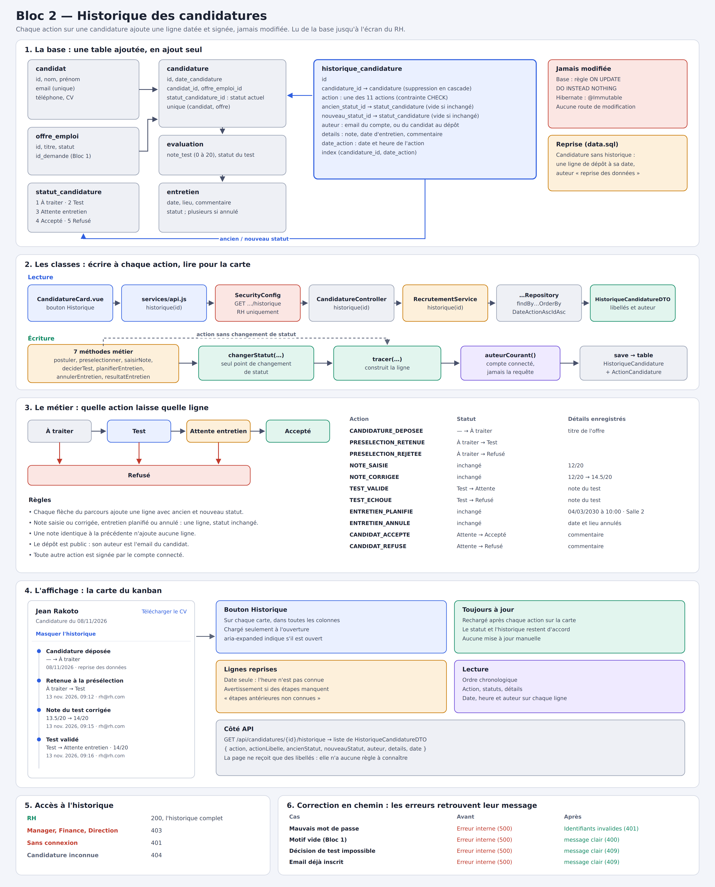

# Bloc 2 — Historique des candidatures

J'ai écrit cette documentation pour expliquer tout ce que j'ai ajouté au Bloc 2 sur la branche `bloc2-test` : la traçabilité des candidatures, puis la correction des messages d'erreur faite en chemin. Je suis la même progression que le plan : la base, les classes, le métier, puis l'affichage.



## Sommaire

1. [Pourquoi cet ajout](#1-pourquoi-cet-ajout)
2. [Les choix de conception](#2-les-choix-de-conception)
3. [Vue d'ensemble des fichiers](#3-vue-densemble-des-fichiers)
4. [La base de données](#4-la-base-de-données)
5. [Les classes](#5-les-classes)
6. [Le métier : la traçabilité dans `RecrutementService`](#6-le-métier--la-traçabilité-dans-recrutementservice)
7. [L'affichage](#7-laffichage)
8. [Sécurité](#8-sécurité)
9. [Correction en chemin : les messages d'erreur](#9-correction-en-chemin--les-messages-derreur)
10. [Tests](#10-tests)
11. [Référence de l'API](#11-référence-de-lapi)
12. [Flux complet : la candidature de Jean](#12-flux-complet--la-candidature-de-jean)
13. [Procédure de vérification](#13-procédure-de-vérification)
14. [Limites connues et pistes](#14-limites-connues-et-pistes)

---

## 1. Pourquoi cet ajout

Le cours demande, pour le Bloc 2 : « Conserver les évaluations et la décision finale » et « L'historique doit être traçable ».

Avant cet ajout, une candidature n'avait **qu'une seule case « statut »**, écrasée à chaque étape. Pour Jean, qui a postulé, été retenu, réussi son test puis été refusé après l'entretien, la base ne gardait que « Jean, Refusé ». Personne ne pouvait dire qui l'avait présélectionné, ni quand.

Le Bloc 1 faisait déjà mieux : chaque avis sur une demande y est une ligne séparée de la table `validation`, jamais écrasée. J'ai appliqué la même idée au Bloc 2 : **chaque action ajoute une ligne**.

---

## 2. Les choix de conception

### Une ligne par action, pas seulement par changement de statut

Certaines actions ne changent pas le statut mais comptent quand même : corriger une note, planifier ou annuler un entretien. Je les trace aussi. Les colonnes « ancien statut » et « nouveau statut » restent alors vides, et la colonne `details` dit ce qui s'est passé, par exemple `12/20 → 14.5/20`.

### Un seul point de changement de statut

Tous les changements de statut passent par la méthode `changerStatut`, qui écrit la ligne d'historique. Il n'existe donc aucun moyen de changer un statut sans laisser de trace. J'ai vérifié qu'aucun autre code du projet ne modifie le statut d'une candidature.

### L'auteur vient du compte connecté

La page ne transmet jamais l'auteur : le serveur le lit dans la session. Une seule exception, le dépôt de candidature, qui est public et se fait sans connexion. L'auteur est alors l'email du candidat.

### Une ligne ne se modifie jamais

Un historique qu'on peut réécrire ne prouve rien. J'ai donc mis trois protections :

- en base, une règle SQL ignore toute modification ;
- côté Hibernate, l'entité est déclarée `@Immutable` ;
- côté API, il n'existe aucune route de modification ou de suppression.

### Les anciennes candidatures ne sont pas inventées

Les candidatures déjà en base n'ont aucune trace de leur passé. Je ne connais que leur date de dépôt : je crée donc seulement cette ligne, avec l'auteur « reprise des données ». Je n'ai inventé ni les étapes suivantes ni leur heure, et l'écran le signale.

---

## 3. Vue d'ensemble des fichiers

| Couche | Fichier | Rôle | État |
|---|---|---|---|
| Base | `resources/schema.sql` | table `historique_candidature` et ses règles | modifié |
| Base | `resources/data.sql` | reprise des candidatures existantes | modifié |
| Classe | `model/ActionCandidature.java` | les 11 actions possibles | nouveau |
| Classe | `model/HistoriqueCandidature.java` | une ligne d'historique | nouveau |
| Classe | `repository/HistoriqueCandidatureRepository.java` | lecture dans l'ordre | nouveau |
| Classe | `dto/HistoriqueCandidatureDTO.java` | format envoyé à la page | nouveau |
| Métier | `service/RecrutementService.java` | écrit une ligne à chaque action | modifié |
| API | `controller/CandidatureController.java` | `GET /api/candidatures/{id}/historique` | modifié |
| Sécurité | `security/SecurityConfig.java` | historique réservé au RH | modifié |
| Erreurs | `exception/ErreursPrioritaires.java` | messages d'erreur rétablis | nouveau |
| Erreurs | `exception/GestionErreurs.java`, `GlobalExceptionHandler.java` | gestionnaires déplacés | modifiés |
| Affichage | `components/candidature/CandidatureCard.vue` | bouton et frise de l'historique | modifié |
| Affichage | `services/api.js` | appel `historique(id)` | modifié |
| Tests | `Bloc2HistoriqueIntegrationTest.java` | 5 tests sur une vraie base | nouveau |

---

## 4. La base de données

### 4.1 La table `historique_candidature`

```sql
-- Historique d'une candidature : une ligne par action, avec son auteur et sa date. Jamais modifiée.
CREATE TABLE IF NOT EXISTS historique_candidature (
    id SERIAL PRIMARY KEY,
    candidature_id INT NOT NULL REFERENCES candidature(id) ON DELETE CASCADE,
    action VARCHAR(40) NOT NULL,
    ancien_statut_id INT REFERENCES statut_candidature(id),
    nouveau_statut_id INT REFERENCES statut_candidature(id),
    auteur VARCHAR(255) NOT NULL,
    details TEXT,
    date_action TIMESTAMP NOT NULL DEFAULT CURRENT_TIMESTAMP
);
CREATE INDEX IF NOT EXISTS idx_historique_candidature ON historique_candidature(candidature_id, date_action);

ALTER TABLE historique_candidature DROP CONSTRAINT IF EXISTS ck_historique_candidature_action;
ALTER TABLE historique_candidature ADD CONSTRAINT ck_historique_candidature_action
    CHECK (action IN ('CANDIDATURE_DEPOSEE','PRESELECTION_RETENUE','PRESELECTION_REJETEE','NOTE_SAISIE',
                      'NOTE_CORRIGEE','TEST_VALIDE','TEST_ECHOUE','ENTRETIEN_PLANIFIE','ENTRETIEN_ANNULE',
                      'CANDIDAT_ACCEPTE','CANDIDAT_REFUSE'));

-- Une ligne d'historique ne se corrige pas : toute modification est ignorée par la base.
CREATE OR REPLACE RULE historique_candidature_non_modifiable AS
    ON UPDATE TO historique_candidature DO INSTEAD NOTHING;
```

Ligne par ligne :

- `candidature_id ... ON DELETE CASCADE` : une ligne appartient à une candidature. Si la candidature est supprimée, son historique disparaît avec elle, comme l'évaluation et les entretiens.
- `action VARCHAR(40)` : le nom de l'action, en clair, par exemple `TEST_VALIDE`. Je l'ai préféré à un nombre : la base reste lisible sans le code Java.
- `ancien_statut_id` et `nouveau_statut_id` : ils pointent vers `statut_candidature`, la table de statuts déjà utilisée. Ils sont facultatifs, car vides quand l'action ne change pas le statut.
- `auteur` : l'email de la personne, ou « reprise des données ».
- `details` : en `TEXT`, car un commentaire d'entretien peut être long.
- L'index `(candidature_id, date_action)` sert exactement la requête d'affichage : les lignes d'une candidature, dans l'ordre.
- La contrainte `CHECK` n'accepte que les 11 actions connues. Elle est supprimée puis recréée à chaque démarrage, pour suivre une éventuelle nouvelle action.
- La règle `ON UPDATE ... DO INSTEAD NOTHING` transforme toute modification en « rien ». J'ai choisi une règle plutôt qu'un déclencheur : Spring exécute `schema.sql` en coupant aux points-virgules, ce qui casserait le corps d'une fonction PL/pgSQL.

Tout est idempotent (`IF NOT EXISTS`, `DROP ... IF EXISTS`, `CREATE OR REPLACE`) : le script peut être rejoué à chaque démarrage sans erreur ni perte de données.

### 4.2 La reprise des candidatures existantes

```sql
-- Candidatures antérieures à l'historique : seul leur dépôt est connu (date de candidature).
-- La ligne est marquée « reprise des données » ; les étapes suivantes restent inconnues.
INSERT INTO historique_candidature (candidature_id, action, nouveau_statut_id, auteur, details, date_action)
SELECT c.id, 'CANDIDATURE_DEPOSEE', 1, 'reprise des données',
       'Candidature antérieure à l''historique : étapes suivantes non enregistrées', c.date_candidature
FROM candidature c
WHERE NOT EXISTS (SELECT 1 FROM historique_candidature h WHERE h.candidature_id = c.id);
```

- Je l'ai placée **à la fin** de `data.sql`, après l'insertion des candidatures de démonstration. Dès le premier démarrage, elles ont donc leur ligne.
- `NOT EXISTS` évite les doublons : au redémarrage suivant, aucune ligne n'est ajoutée.
- `nouveau_statut_id = 1` correspond à « À traiter », le statut de toute candidature au moment de son dépôt.

---

## 5. Les classes

### 5.1 `ActionCandidature`

```java
/** Ce qui peut arriver a une candidature. Chaque action ajoute une ligne a son historique. */
public enum ActionCandidature {

    CANDIDATURE_DEPOSEE("Candidature déposée"),
    PRESELECTION_RETENUE("Retenue à la présélection"),
    PRESELECTION_REJETEE("Rejetée à la présélection"),
    NOTE_SAISIE("Note du test saisie"),
    NOTE_CORRIGEE("Note du test corrigée"),
    TEST_VALIDE("Test validé"),
    TEST_ECHOUE("Test échoué"),
    ENTRETIEN_PLANIFIE("Entretien planifié"),
    ENTRETIEN_ANNULE("Entretien annulé"),
    CANDIDAT_ACCEPTE("Accepté après entretien"),
    CANDIDAT_REFUSE("Refusé après entretien");

    private final String libelle;

    ActionCandidature(String libelle) {
        this.libelle = libelle;
    }

    public String getLibelle() {
        return libelle;
    }
}
```

Chaque action porte son libellé français : la page affiche « Test validé » sans connaître les codes.

### 5.2 `HistoriqueCandidature`

```java
/**
 * Une ligne de l'historique d'une candidature : qui a fait quoi, et quand.
 * Une ligne n'est jamais modifiee : @Immutable cote Hibernate, regle SQL cote base.
 */
@Entity
@Immutable
@Table(name = "historique_candidature", schema = "mrtovo")
@Getter
@Setter
public class HistoriqueCandidature {

    @Id
    @GeneratedValue(strategy = GenerationType.IDENTITY)
    private Long id;

    @ManyToOne(fetch = FetchType.LAZY, optional = false)
    @JoinColumn(name = "candidature_id", nullable = false)
    private Candidature candidature;

    @Enumerated(EnumType.STRING)
    @Column(name = "action", nullable = false, length = 40)
    private ActionCandidature action;

    /** Vides quand l'action ne change pas le statut (note corrigee, entretien annule...). */
    @ManyToOne
    @JoinColumn(name = "ancien_statut_id")
    private StatutCandidature ancienStatut;

    @ManyToOne
    @JoinColumn(name = "nouveau_statut_id")
    private StatutCandidature nouveauStatut;

    @Column(name = "auteur", nullable = false)
    private String auteur;

    @Column(name = "details", columnDefinition = "TEXT")
    private String details;

    @Column(name = "date_action", nullable = false)
    private LocalDateTime dateAction;
}
```

- `@Immutable` : Hibernate n'enverra jamais d'`UPDATE` pour cette entité, même si un setter est appelé par erreur.
- J'ai utilisé `@Getter @Setter` plutôt que `@Data`, qui génère `equals` et `hashCode` à partir des relations. Sur une entité JPA, cela peut charger toute la candidature pour une simple comparaison.
- `fetch = FetchType.LAZY` sur la candidature : afficher l'historique n'a pas besoin de la recharger.
- `@Enumerated(EnumType.STRING)` stocke `TEST_VALIDE` et non un rang. Réordonner l'énumération ne corrompt donc pas les anciennes lignes.

### 5.3 `HistoriqueCandidatureRepository`

```java
public interface HistoriqueCandidatureRepository extends JpaRepository<HistoriqueCandidature, Long> {

    /** Ordre chronologique ; l'identifiant departage deux actions de la meme seconde. */
    List<HistoriqueCandidature> findByCandidatureIdOrderByDateActionAscIdAsc(Long candidatureId);
}
```

Deux actions peuvent tomber dans la même seconde, par exemple une note saisie puis validée aussitôt. L'identifiant, toujours croissant, les départage.

### 5.4 `HistoriqueCandidatureDTO`

```java
/** Une ligne de l'historique telle que l'affiche la fiche du candidat. */
public record HistoriqueCandidatureDTO(
        Long id,
        String action,
        String actionLibelle,
        Long ancienStatutId,
        String ancienStatut,
        Long nouveauStatutId,
        String nouveauStatut,
        String auteur,
        String details,
        LocalDateTime date
) {
}
```

Le DTO envoie à la fois les identifiants et les libellés. La page affiche les libellés tels quels, sans table de correspondance à maintenir.

---

## 6. Le métier : la traçabilité dans `RecrutementService`

### 6.1 Le point de passage unique

```java
    /** Seul point de changement de statut : il ne peut donc pas y en avoir un sans sa ligne d'historique. */
    private void changerStatut(Candidature c, long statutId, ActionCandidature action, String details) {
        StatutCandidature ancien = c.getStatutCandidature();
        StatutCandidature nouveau = statutCandidatureRepo.findById(statutId).orElseThrow();
        c.setStatutCandidature(nouveau);
        tracer(c, action, ancien, nouveau, auteurCourant(), details);
    }

    private void tracer(Candidature c, ActionCandidature action, StatutCandidature ancien,
                        StatutCandidature nouveau, String auteur, String details) {
        HistoriqueCandidature ligne = new HistoriqueCandidature();
        ligne.setCandidature(c);
        ligne.setAction(action);
        ligne.setAncienStatut(ancien);
        ligne.setNouveauStatut(nouveau);
        ligne.setAuteur(auteur);
        ligne.setDetails(details);
        ligne.setDateAction(LocalDateTime.now());
        historiqueRepo.save(ligne);
    }

    /** L'auteur vient du compte connecte, jamais de la requete. */
    private static String auteurCourant() {
        Authentication authentication = SecurityContextHolder.getContext().getAuthentication();
        if (authentication == null || !authentication.isAuthenticated()
                || authentication instanceof AnonymousAuthenticationToken) {
            return "inconnu";
        }
        return authentication.getName();
    }
```

- `changerStatut` lit l'ancien statut **avant** de le remplacer, puis appelle `tracer`. C'est l'unique méthode qui modifie le statut.
- `tracer` construit la ligne. L'heure vient du serveur (`LocalDateTime.now()`), jamais de la page.
- `auteurCourant` lit le compte dans le contexte de sécurité de Spring. Un appel anonyme donne « inconnu ». Cela ne devrait pas arriver, car toutes ces routes exigent une connexion.

### 6.2 Les détails lisibles

```java
    private static String note(BigDecimal note) {
        return note == null ? "sans note" : note.stripTrailingZeros().toPlainString() + "/20";
    }

    private static String decrireEntretien(Entretien e) {
        return e.getDateEntretien().format(FORMAT_ENTRETIEN)
                + (e.getLieu() == null || e.getLieu().isBlank() ? "" : " · " + e.getLieu());
    }
```

- `stripTrailingZeros` affiche `14.5/20` au lieu de `14.50/20`.
- Un entretien se décrit par sa date et son lieu, par exemple `04/03/2030 à 10:00 · Salle 2`.

### 6.3 Chaque action, une à une

**Dépôt** (`postuler`), après l'enregistrement de la candidature :

```java
        // Le depot est public : l'auteur est le candidat lui-meme, identifie par son email.
        tracer(candidature, ActionCandidature.CANDIDATURE_DEPOSEE, null, candidature.getStatutCandidature(),
                emailNormalise, "Offre « " + offre.getTitre() + " »");
```

**Présélection** : retenue ou rejetée, via `changerStatut`.

```java
        if (retenue) {
            Evaluation test = new Evaluation();
            test.setCandidature(c);
            test.setStatutEvaluation(statutEvaluationRepo.getReferenceById(Statuts.Evaluation.EN_ATTENTE));
            evaluationRepo.save(test);
            changerStatut(c, Statuts.Candidature.TEST, ActionCandidature.PRESELECTION_RETENUE, null);
        } else {
            changerStatut(c, Statuts.Candidature.REFUSE, ActionCandidature.PRESELECTION_REJETEE, null);
        }
```

**Note du test** :

```java
        BigDecimal ancienne = test.getNoteTest();
        if (ancienne != null && ancienne.compareTo(note) == 0) {
            return versDTO(c);
        }
        test.setNoteTest(note);
        if (ancienne == null) {
            tracer(c, ActionCandidature.NOTE_SAISIE, null, null, auteurCourant(), note(note));
        } else {
            tracer(c, ActionCandidature.NOTE_CORRIGEE, null, null, auteurCourant(),
                    note(ancienne) + " → " + note(note));
        }
        return versDTO(c);
    }
```

- Une note identique à la précédente ne crée aucune ligne : `14.5` puis `14.50` n'est pas une correction. J'utilise `compareTo` et non `equals`, qui tiendrait compte du nombre de décimales.
- La première note est une saisie ; les suivantes sont des corrections, avec l'ancienne et la nouvelle valeur.

**Décision du test**, avec la note dans les détails :

```java
        if (valide) {
            test.setStatutEvaluation(statutEvaluationRepo.getReferenceById(Statuts.Evaluation.VALIDE));
            changerStatut(c, Statuts.Candidature.ATTENTE_ENTRETIEN, ActionCandidature.TEST_VALIDE,
                    note(test.getNoteTest()));
        } else {
            test.setStatutEvaluation(statutEvaluationRepo.getReferenceById(Statuts.Evaluation.ECHOUE));
            changerStatut(c, Statuts.Candidature.REFUSE, ActionCandidature.TEST_ECHOUE, note(test.getNoteTest()));
        }
```

**Entretien planifié et annulé** : ces actions ne changent pas le statut. Elles passent donc par `tracer` directement.

```java
        entretienRepo.save(e);
        tracer(c, ActionCandidature.ENTRETIEN_PLANIFIE, null, null, auteurCourant(), decrireEntretien(e));
```

```java
    public CandidatureDTO annulerEntretien(Long entretienId) {
        Entretien e = chargerEntretienPlanifie(entretienId);
        e.setStatutEntretien(statutEntretienRepo.getReferenceById(Statuts.Entretien.ANNULE));
        Candidature c = e.getEvaluation().getCandidature();
        tracer(c, ActionCandidature.ENTRETIEN_ANNULE, null, null, auteurCourant(), decrireEntretien(e));
        return versDTO(c);
    }
```

**Résultat de l'entretien**, avec le commentaire nettoyé de ses espaces :

```java
        e.setStatutEntretien(statutEntretienRepo.getReferenceById(Statuts.Entretien.TERMINE));
        changerStatut(c, accepte ? Statuts.Candidature.ACCEPTE : Statuts.Candidature.REFUSE,
                accepte ? ActionCandidature.CANDIDAT_ACCEPTE : ActionCandidature.CANDIDAT_REFUSE,
                commentaire == null || commentaire.isBlank() ? null : commentaire.trim());
```

### 6.4 La lecture

```java
    @Transactional(readOnly = true)
    public List<HistoriqueCandidatureDTO> historique(Long candidatureId) {
        chargerCandidature(candidatureId);
        return historiqueRepo.findByCandidatureIdOrderByDateActionAscIdAsc(candidatureId).stream()
                .map(RecrutementService::historiqueVersDTO)
                .toList();
    }
```

`chargerCandidature` renvoie une erreur 404 si la candidature n'existe pas, au lieu d'une liste vide qui laisserait croire à une candidature sans historique.

Toutes ces écritures se font dans la même transaction que l'action. Si l'action échoue, sa ligne d'historique est annulée avec elle : l'historique ne peut pas mentionner une action qui n'a pas eu lieu.

---

## 7. L'affichage

### 7.1 L'appel

```js
historique: (id) => apiGet(`/candidatures/${id}/historique`),
```

### 7.2 La logique de la carte

```js
// Historique : chargé à la demande, puis rechargé après chaque action sur la carte.
const REPRISE = 'reprise des données'
const historiqueOuvert = ref(false)
const historique = ref([])
const erreurHistorique = ref('')
const historiqueIncomplet = computed(() => {
  const dernier = historique.value.at(-1)
  const dernierStatut = [...historique.value].reverse().find((h) => h.nouveauStatutId)?.nouveauStatutId
  return Boolean(dernier) && dernierStatut !== c.value.statutId
})

async function chargerHistorique() {
  erreurHistorique.value = ''
  try {
    historique.value = await candidaturesApi.historique(c.value.id)
  } catch (e) {
    erreurHistorique.value = messageErreur(e)
  }
}

function basculerHistorique() {
  historiqueOuvert.value = !historiqueOuvert.value
  if (historiqueOuvert.value) chargerHistorique()
}

watch(c, () => {
  if (historiqueOuvert.value) chargerHistorique()
})
```

- **Chargé à la demande** : l'historique n'est demandé qu'à l'ouverture. Un kanban de 30 cartes ne fait donc pas 30 appels.
- **Toujours à jour** : après une action, le tableau remplace la candidature, et `watch(c, …)` recharge l'historique s'il est ouvert. Le statut et l'historique ne peuvent pas se contredire à l'écran.
- **`historiqueIncomplet`** compare le dernier statut connu de l'historique avec le statut réel. S'ils diffèrent, c'est une candidature reprise dont les étapes manquent, et la carte l'indique.

### 7.3 Le gabarit

```html
    <button
      type="button"
      class="lien-historique"
      :aria-expanded="historiqueOuvert"
      @click="basculerHistorique"
    >
      {{ historiqueOuvert ? "Masquer l'historique" : 'Historique' }}
    </button>
    <div v-if="historiqueOuvert" class="historique">
      <p v-if="erreurHistorique" class="error">{{ erreurHistorique }}</p>
      <ol v-else>
        <li v-for="h in historique" :key="h.id">
          <div class="h-titre">{{ h.actionLibelle }}</div>
          <div v-if="h.ancienStatut || h.nouveauStatut" class="h-statut">
            {{ h.ancienStatut ?? '—' }} → {{ h.nouveauStatut }}
          </div>
          <div v-if="h.details" class="h-details">{{ h.details }}</div>
          <!-- Une ligne reprise ne connaît que le jour de la candidature, pas l'heure. -->
          <div class="h-meta muted">{{ h.auteur === REPRISE ? fmtDate(h.date) : fmtDateHeure(h.date) }} · {{ h.auteur }}</div>
        </li>
      </ol>
      <p v-if="historiqueIncomplet" class="muted small">
        Les étapes antérieures à la mise en place de l'historique ne sont pas connues.
      </p>
    </div>
```

- Le bouton porte `aria-expanded`, qui indique aux lecteurs d'écran si l'historique est ouvert.
- Une liste ordonnée (`<ol>`) dit que l'ordre a un sens.
- Une ligne reprise n'affiche que la date (`fmtDate`) : afficher « 00:00 » ferait croire à une heure réelle.

La frise reprend les variables de couleur du thème (`--primary`, `--border`) : elle suit l'apparence du reste de la carte.

---

## 8. Sécurité

```java
                        // Qui a fait quoi sur une candidature : information reservee au RH.
                        .requestMatchers(HttpMethod.GET, "/api/candidatures/*/historique").hasRole("RH")
```

L'historique dit qui a fait quoi : je le réserve au RH.

J'ai mis la règle dans `SecurityConfig` plutôt qu'en `@PreAuthorize` sur le contrôleur. Sur cette branche, le gestionnaire d'erreurs du Bloc 3 attrape toutes les exceptions : un refus levé par `@PreAuthorize` serait devenu une erreur 500 au lieu de 403. La règle d'URL refuse la requête avant même le contrôleur.

| Appelant | Réponse |
|---|---|
| RH | 200 |
| Manager, Finance, Direction | 403 |
| Sans connexion | 401 |
| Candidature inconnue | 404 |

---

## 9. Correction en chemin : les messages d'erreur

### Le problème

En testant la route, une candidature inconnue renvoyait 500 au lieu de 404. En cherchant, j'ai trouvé un défaut plus large, présent avant mon travail. Depuis la fusion avec le Bloc 3, `RecrutementExceptionHandler` attrape `Exception` pour tous les contrôleurs. Il passait avant les gestionnaires des Blocs 1 et 2, et transformait leurs erreurs prévues en « Erreur interne » :

| Cas | Avant | Après |
|---|---|---|
| Mauvais mot de passe | Erreur interne (500) | « Identifiants invalides » (401) |
| Motif vide (Bloc 1) | Erreur interne (500) | « Le motif est obligatoire… » (400) |
| Décision de test impossible | Erreur interne (500) | message de la règle (409) |
| Candidature inconnue | Erreur interne (500) | « Candidature #9999 introuvable » (404) |
| Email déjà inscrit | Erreur interne (500) | « Un compte existe déjà… » (409) |
| Email invalide au dépôt | Erreur interne (500) | message de validation (400) |

### La correction

```java
/**
 * Erreurs prevues par les Blocs 1 et 2, traitees en priorite.
 * Le gestionnaire du Bloc 3 (RecrutementExceptionHandler) attrape Exception : sans cet ordre,
 * il passait avant et transformait ces erreurs en « Erreur interne » (500). Exemples :
 * « Identifiants invalides », « Le motif est obligatoire », « Saisissez la note du test ».
 * Les codes et les messages sont ceux d'origine.
 */
@RestControllerAdvice
@Order(Ordered.HIGHEST_PRECEDENCE)
public class ErreursPrioritaires {
```

- `@Order(Ordered.HIGHEST_PRECEDENCE)` fait passer ce gestionnaire en premier.
- Il ne traite que les erreurs **prévues** par les Blocs 1 et 2. J'ai repris leurs codes et leurs messages à l'identique, depuis `GestionErreurs` et `GlobalExceptionHandler`, d'où je les ai retirés pour éviter les doublons.
- Les erreurs du Bloc 3 et les erreurs inattendues continuent de passer par `RecrutementExceptionHandler`, avec leur format habituel. J'ai vérifié qu'une proposition inconnue du Bloc 3 renvoie toujours son 404 au même format.

---

## 10. Tests

`Bloc2HistoriqueIntegrationTest` tourne sur une vraie base PostgreSQL : il vérifie la règle SQL, la contrainte et la reprise, ce qu'un test avec des simulations ne pourrait pas faire.

| Test | Ce que je vérifie |
|---|---|
| `leParcoursCompletEstTraceAvecAuteursEtStatuts` | les 9 lignes d'un parcours complet, dans l'ordre, avec auteur, statuts et détails |
| `uneNoteIdentiqueNAjouteAucuneLigne` | `15` puis `15.00` ne crée pas de correction |
| `unRejetALaPresélectionEstTrace` | le rejet laisse sa ligne vers « Refusé » |
| `uneLigneDHistoriqueNePeutPasEtreModifiee` | un `UPDATE` direct en base ne change rien |
| `lesCandidaturesAnterieuresOntLeurDepotRepris` | aucune candidature sans historique après le démarrage |

Le parcours complet du premier test :

```java
        service.preselectionner(candidatureId, true);
        service.saisirNote(candidatureId, new BigDecimal("12"));
        service.saisirNote(candidatureId, new BigDecimal("14.50"));
        service.deciderTest(candidatureId, true);
        var planifie = service.planifierEntretien(candidatureId, LocalDateTime.of(2030, 3, 4, 10, 0), "Salle 2");
        service.annulerEntretien(planifie.entretien().id());
        var replanifie = service.planifierEntretien(candidatureId, LocalDateTime.of(2030, 3, 5, 14, 30), null);
        service.resultatEntretien(replanifie.entretien().id(), true, "  Très bon profil  ");
```

Le compte connecté est simulé par `connecter("rh@rh.com")`, qui place une authentification dans le contexte de sécurité.

**Résultat** : 21 tests sur 21 pour tout le backend, dont ces 5. Les tests d'intégration ont besoin d'une base PostgreSQL.

---

## 11. Référence de l'API

### `GET /api/candidatures/{id}/historique`

Réservé au RH. La réponse est la liste des lignes, de la plus ancienne à la plus récente :

```json
[
  {
    "id": 12,
    "action": "PRESELECTION_RETENUE",
    "actionLibelle": "Retenue à la présélection",
    "ancienStatutId": 1,
    "ancienStatut": "À traiter",
    "nouveauStatutId": 2,
    "nouveauStatut": "Test",
    "auteur": "rh@rh.com",
    "details": null,
    "date": "2026-11-13T09:12:41"
  }
]
```

Aucune route ne modifie ou ne supprime une ligne.

---

## 12. Flux complet : la candidature de Jean

| Moment | Action à l'écran | Ligne ajoutée |
|---|---|---|
| 10 nov. | Jean postule sur la page publique | Candidature déposée · — → À traiter · jean@… |
| 12 nov. | Le RH clique **Retenir** | Retenue à la présélection · À traiter → Test · rh@rh.com |
| 13 nov. | Le RH saisit 12 | Note du test saisie · 12/20 |
| 13 nov. | Le RH corrige en 14,5 | Note du test corrigée · 12/20 → 14.5/20 |
| 13 nov. | Le RH clique **Valider** | Test validé · Test → Attente entretien · 14.5/20 |
| 14 nov. | Le RH planifie l'entretien | Entretien planifié · 18/11/2026 à 10:00 · Salle 2 |
| 18 nov. | Le RH clique **Refuser** | Refusé après entretien · Attente entretien → Refusé · commentaire |

Avant, la base ne gardait que « Jean, Refusé ». Elle peut maintenant répondre à « qui l'a présélectionné, et quand ? ».

---

## 13. Procédure de vérification

1. Redémarrer le backend : la table est créée, et les candidatures existantes reçoivent leur ligne de dépôt.
2. Lancer les tests :

   ```bash
   cd backend
   JAVA_HOME=/usr/lib/jvm/jdk-21.0.12-oracle-x64 ./mvnw test
   ```

3. Se connecter en RH (`rh@rh.com` / `rh123`), menu **Candidatures**, puis ouvrir le kanban d'une offre.
4. Sur une carte, cliquer **Historique** : une candidature de démonstration affiche son dépôt repris.
5. Faire avancer une candidature (Retenir, note, Valider) en gardant l'historique ouvert : chaque action y apparaît aussitôt, signée `rh@rh.com`.
6. Corriger une note : la ligne montre l'ancienne et la nouvelle valeur.
7. Se connecter avec un mauvais mot de passe : le message est « Identifiants invalides », et non plus « Erreur interne ».
8. En base, essayer `UPDATE mrtovo.historique_candidature SET auteur = 'x';` : la réponse est `UPDATE 0`.

---

## 14. Limites connues et pistes

- **Accès aux actions** : seul l'historique et le CV sont réservés au RH. Les routes qui font avancer une candidature (présélection, note, entretien) restent ouvertes aux managers, à la Finance et à la Direction s'ils appellent l'API directement. C'est la prochaine correction utile.
- **Suppression** : une ligne ne se modifie pas, mais disparaît si sa candidature est supprimée. Aucune route ne supprime une candidature, mais la base le permet.
- **Passé non reconstitué** : les candidatures antérieures n'ont que leur dépôt. Leurs étapes intermédiaires sont perdues.
- **Validation des erreurs** : une note hors de 0 à 20 répond encore au format du Bloc 3 (« Donnees invalides » avec le détail). Le message reste lisible, mais diffère des autres erreurs du Bloc 2.
- **Format des notes** : l'historique écrit `14.5/20` avec un point, alors que le champ de saisie affiche `14,5`.
- **Pas de recherche transversale** : on lit l'historique d'une candidature, mais pas « toutes les actions de rh@rh.com cette semaine ».
