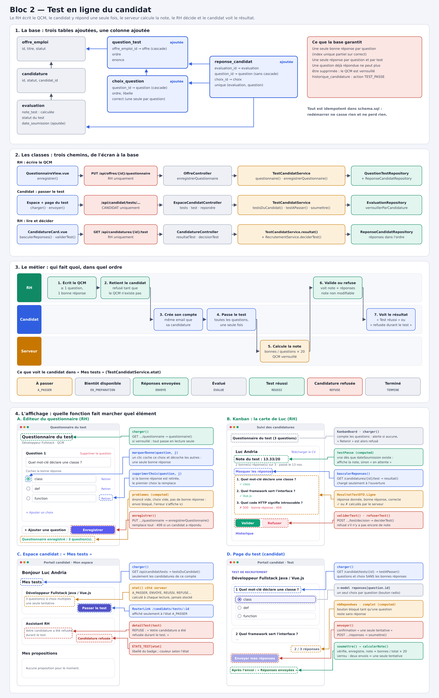

# Bloc 2 — Test en ligne du candidat

J'ai écrit cette documentation pour expliquer comment j'ai remplacé la note saisie à la main par un **test en ligne**. Le RH écrit un QCM pour chaque offre, le candidat y répond depuis son espace, le serveur calcule la note, puis le RH valide ou refuse, et le candidat voit le résultat.

Elle suit trois parties : **la base et les classes**, **le métier**, puis **l'affichage**. Le plan les reprend, avec dans sa partie 4 des maquettes annotées qui montrent quelle fonction fait marcher quel élément de l'écran.



## Sommaire

1. [Ce qui change](#1-ce-qui-change)
2. [Les décisions](#2-les-décisions)
3. [Partie 1 — La base et les classes](#3-partie-1--la-base-et-les-classes)
4. [Partie 2 — Le métier](#4-partie-2--le-métier)
5. [Partie 3 — L'affichage](#5-partie-3--laffichage)
6. [Sécurité](#6-sécurité)
7. [Tests](#7-tests)
8. [Référence de l'API](#8-référence-de-lapi)
9. [La démonstration pas à pas](#9-la-démonstration-pas-à-pas)
10. [Limites connues et pistes](#10-limites-connues-et-pistes)

---

## 1. Ce qui change

| Avant | Après |
|---|---|
| Le RH tapait la note du test dans la carte du kanban. | Le candidat passe un QCM depuis son espace ; la note en découle. |
| La note pouvait être corrigée à tout moment. | La note ne se modifie plus : elle vient des réponses. |
| Le candidat ne voyait rien de son test. | Il voit « À passer », « Réponses envoyées », « Test réussi » ou « Votre candidature a été refusée durant le test. » |
| On pouvait retenir un candidat sans test prévu. | Retenir un candidat exige que le QCM de l'offre existe. |

---

## 2. Les décisions

| Question | Choix |
|---|---|
| Qui écrit les questions ? | Le **RH**, pour chaque offre, dans l'application. |
| Quel type de questions ? | **QCM uniquement** : de 2 à 6 choix, une seule bonne réponse. La note se calcule seule. |
| Le RH peut-il modifier la note ? | **Non** : elle reste celle qui découle des réponses. |
| Comment le candidat obtient-il un compte ? | Par la page **Créer un compte**, avec l'email de sa candidature : le compte se relie seul à son dossier. |
| Combien de tentatives ? | **Une seule.** |
| Le candidat voit-il sa note ? | **Non** : il voit seulement l'issue. C'est le RH qui décide, et la note n'est qu'un élément de sa décision. |

---

## 3. Partie 1 — La base et les classes

### 3.1 Les tables

```sql
-- Test en ligne : QCM écrit par le RH pour chaque offre, passé par le candidat depuis son espace.
CREATE TABLE IF NOT EXISTS question_test (
    id SERIAL PRIMARY KEY,
    offre_emploi_id INT NOT NULL REFERENCES offre_emploi(id) ON DELETE CASCADE,
    ordre INT NOT NULL,
    enonce TEXT NOT NULL
);
CREATE INDEX IF NOT EXISTS idx_question_test_offre ON question_test(offre_emploi_id, ordre);

CREATE TABLE IF NOT EXISTS choix_question (
    id SERIAL PRIMARY KEY,
    question_id INT NOT NULL REFERENCES question_test(id) ON DELETE CASCADE,
    ordre INT NOT NULL,
    libelle VARCHAR(500) NOT NULL,
    correct BOOLEAN NOT NULL DEFAULT FALSE
);
CREATE INDEX IF NOT EXISTS idx_choix_question ON choix_question(question_id);
-- Une seule bonne réponse par question.
CREATE UNIQUE INDEX IF NOT EXISTS ux_choix_question_correct ON choix_question(question_id) WHERE correct;

-- Moment où le candidat a envoyé ses réponses (null : test pas encore passé).
ALTER TABLE evaluation ADD COLUMN IF NOT EXISTS date_soumission TIMESTAMP;

-- Une réponse par question et par test. Sans cascade vers la question : une question
-- à laquelle un candidat a répondu ne peut plus être supprimée.
CREATE TABLE IF NOT EXISTS reponse_candidat (
    id SERIAL PRIMARY KEY,
    evaluation_id INT NOT NULL REFERENCES evaluation(id) ON DELETE CASCADE,
    question_id INT NOT NULL REFERENCES question_test(id),
    choix_id INT NOT NULL REFERENCES choix_question(id),
    UNIQUE (evaluation_id, question_id)
);
```

- **`question_test`** : une question d'une offre, avec son ordre d'affichage. Si l'offre disparaît, ses questions disparaissent avec elle (`ON DELETE CASCADE`).
- **`choix_question`** : les choix d'une question. La colonne `correct` dit lequel est juste.
- **L'index unique partiel** `ux_choix_question_correct` porte sur `question_id`, mais seulement pour les lignes où `correct` est vrai. La base refuse donc elle-même une deuxième bonne réponse à la même question.
- **`evaluation.date_soumission`** : le moment où le candidat a envoyé ses réponses. Tant qu'elle est vide, le test n'a pas été passé.
- **`reponse_candidat`** : le choix du candidat pour chaque question.
  - `UNIQUE (evaluation_id, question_id)` : une seule réponse par question et par test.
  - **Pas de cascade vers `question_test`** : une question à laquelle un candidat a répondu ne peut plus être supprimée. C'est la garantie, au niveau de la base, que le QCM se verrouille.

L'historique gagne une action, `TEST_PASSE`, ajoutée à la contrainte `CHECK` de `historique_candidature`. Tout est écrit pour être rejoué à chaque démarrage (`IF NOT EXISTS`) sans erreur ni perte.

### 3.2 Les entités

```java
/** Une question du QCM d'une offre, ecrite par le RH. */
@Entity
@Table(name = "question_test", schema = "mrtovo")
@Getter
@Setter
public class QuestionTest {

    @Id
    @GeneratedValue(strategy = GenerationType.IDENTITY)
    private Long id;

    @ManyToOne(fetch = FetchType.LAZY, optional = false)
    @JoinColumn(name = "offre_emploi_id", nullable = false)
    private OffreEmploi offreEmploi;

    @Column(nullable = false)
    private Integer ordre;

    @Column(nullable = false, columnDefinition = "TEXT")
    private String enonce;

    /** Les choix vivent et meurent avec leur question. */
    @OneToMany(mappedBy = "question", cascade = CascadeType.ALL, orphanRemoval = true)
    @OrderBy("ordre ASC")
    private List<ChoixQuestion> choix = new ArrayList<>();
}
```

Les choix vivent et meurent avec leur question (`cascade = ALL`, `orphanRemoval = true`). `@OrderBy` les rend toujours dans l'ordre saisi par le RH.

```java
/** Un choix de reponse. Une seule bonne reponse par question (index unique partiel en base). */
@Entity
@Table(name = "choix_question", schema = "mrtovo")
@Getter
@Setter
public class ChoixQuestion {

    @Id
    @GeneratedValue(strategy = GenerationType.IDENTITY)
    private Long id;

    @ManyToOne(fetch = FetchType.LAZY, optional = false)
    @JoinColumn(name = "question_id", nullable = false)
    private QuestionTest question;

    @Column(nullable = false)
    private Integer ordre;

    @Column(nullable = false, length = 500)
    private String libelle;

    /** Ne quitte jamais le serveur vers un candidat. */
    @Column(nullable = false)
    private boolean correct;
}
```

J'ai utilisé `@Getter @Setter` et non `@Data` : `@Data` génère `equals` et `hashCode` à partir des relations, ce qui ferait boucler une question et ses choix l'un sur l'autre.

`ReponseCandidat` relie une évaluation, une question et un choix. `Evaluation` gagne `dateSoumission`, et l'énumération `ActionCandidature` gagne `TEST_PASSE`. `NOTE_SAISIE` et `NOTE_CORRIGEE` restent, pour les lignes d'historique écrites avant ce changement.

### 3.3 Les dépôts

```java
public interface ReponseCandidatRepository extends JpaRepository<ReponseCandidat, Long> {

    /** Un candidat a-t-il deja repondu au questionnaire de cette offre ? Si oui, il est verrouille. */
    boolean existsByQuestionOffreEmploiId(Long offreId);

    List<ReponseCandidat> findByEvaluationIdOrderByQuestionOrdreAsc(Long evaluationId);

    long countByEvaluationId(Long evaluationId);

    long countByEvaluationIdAndChoixCorrectTrue(Long evaluationId);
}
```

`existsByQuestionOffreEmploiId` répond à la question « un candidat a-t-il déjà répondu au QCM de cette offre ? ». C'est le test du verrouillage côté Java.

```java
    /** Verrou pendant l'envoi des reponses : deux envois simultanes ne donnent qu'une seule tentative. */
    @Lock(LockModeType.PESSIMISTIC_WRITE)
    @Query("select e from Evaluation e where e.candidature.id = :candidatureId")
    Optional<Evaluation> verrouillerParCandidature(@Param("candidatureId") Long candidatureId);
```

`PESSIMISTIC_WRITE` pose un verrou sur la ligne de l'évaluation pendant l'envoi des réponses. Si le candidat clique deux fois très vite, le second envoi attend la fin du premier, puis voit `date_soumission` remplie et il est refusé.

### 3.4 Les DTO

Il y a deux familles de DTO, et c'est voulu.

- **`QuestionnaireDTO`**, pour le RH, contient `correct` sur chaque choix.
- **`TestCandidatDTO`**, pour le candidat, **n'a pas de champ pour la bonne réponse** :

```java
/**
 * Ce que voit le candidat. Aucun champ ne porte la bonne reponse ni la note :
 * le RH decide, le candidat apprend la suite par le parcours de recrutement.
 */
public final class TestCandidatDTO {

    private TestCandidatDTO() {}

    /**
     * etat : A_PASSER, EN_PREPARATION (pas encore de questionnaire), ENVOYE (en attente de la decision du RH),
     * EVALUE (note manuelle), REUSSI (test valide), REFUSE (candidature refusee au test), TERMINE (autre cas).
     */
    public record Resume(Long candidatureId, String offreTitre, String etat, int nbQuestions,
                         LocalDateTime dateSoumission) {}
```

Si le serveur réutilisait le DTO du RH en se contentant de vider le champ, un oubli suffirait à envoyer les bonnes réponses. Avec un type séparé, c'est impossible : le champ n'existe pas.

`ResultatTestDTO` donne au RH, pour chaque question, la réponse donnée, la bonne réponse et si elle est correcte. `CandidatureDTO.TestDTO` gagne `dateSoumission`, `nbBonnes` et `nbQuestions`, pour que la carte du kanban affiche la note sans appel supplémentaire.

### 3.5 Les classes, chemin par chemin

| Chemin | Écran | Route | Contrôleur | Service |
|---|---|---|---|---|
| RH écrit le QCM | `QuestionnaireView.vue` | `PUT /api/offres/{id}/questionnaire` | `OffreController` | `TestCandidatService.enregistrerQuestionnaire` |
| Candidat voit ses tests | `EspaceCandidatView.vue` | `GET /api/candidat/tests` | `EspaceCandidatController` | `testsDuCandidat` |
| Candidat ouvre son test | `TestCandidatView.vue` | `GET /api/candidat/tests/{id}` | `EspaceCandidatController` | `testAPasser` |
| Candidat envoie | `TestCandidatView.vue` | `POST /api/candidat/tests/{id}/reponses` | `EspaceCandidatController` | `soumettre` |
| RH lit les réponses | `CandidatureCard.vue` | `GET /api/candidatures/{id}/test` | `CandidatureController` | `resultat` |
| RH décide | `CandidatureCard.vue` | `POST /api/candidatures/{id}/test/decision` | `CandidatureController` | `RecrutementService.deciderTest` |

J'ai mis toute la logique du test dans un service à part, `TestCandidatService`, pour ne pas alourdir `RecrutementService`, déjà long. Il réutilise la méthode `tracer` de `RecrutementService` pour écrire dans l'historique.

---

## 4. Partie 2 — Le métier

### 4.1 Le parcours

| Étape | Qui | Règle |
|---|---|---|
| 1. Écrire le QCM | RH | au moins une question, de 2 à 6 choix, exactement une bonne réponse |
| 2. Retenir le candidat | RH | refusé tant que le QCM de l'offre n'existe pas |
| 3. Créer son compte | Candidat | avec l'email de sa candidature, pour être relié à son dossier |
| 4. Passer le test | Candidat | répondre à toutes les questions, une seule fois |
| 5. Calculer la note | Serveur | bonnes réponses / nombre de questions × 20 ; le QCM se verrouille |
| 6. Valider ou refuser | RH | voit la note et le détail des réponses ; la note n'est pas modifiable |
| 7. Voir le résultat | Candidat | « Test réussi » ou « Votre candidature a été refusée durant le test. » |

### 4.2 Écrire le questionnaire

```java
    /** Remplace tout le questionnaire. Interdit des qu'un candidat a repondu : sa note ne correspondrait plus. */
    public QuestionnaireDTO enregistrerQuestionnaire(Long offreId, QuestionnaireRequest requete) {
        OffreEmploi offre = chargerOffre(offreId);
        if (reponseRepo.existsByQuestionOffreEmploiId(offreId)) {
            throw new RegleMetierException(
                    "Des candidats ont déjà répondu à ce questionnaire : il ne peut plus être modifié.");
        }
        for (int i = 0; i < requete.questions().size(); i++) {
            long bonnes = requete.questions().get(i).choix().stream().filter(QuestionnaireRequest.Choix::correct).count();
            if (bonnes != 1) {
                throw new ResponseStatusException(BAD_REQUEST,
                        "La question " + (i + 1) + " doit avoir exactement une bonne réponse.");
            }
        }

        // Suppression puis flush avant de recreer : Hibernate executerait sinon les insertions en premier.
        questionRepo.deleteAll(questionRepo.findByOffreEmploiIdOrderByOrdreAsc(offreId));
        questionRepo.flush();

        int ordreQuestion = 1;
        for (QuestionnaireRequest.Question q : requete.questions()) {
            QuestionTest question = new QuestionTest();
            question.setOffreEmploi(offre);
            question.setOrdre(ordreQuestion++);
            question.setEnonce(q.enonce().trim());
            int ordreChoix = 1;
            for (QuestionnaireRequest.Choix c : q.choix()) {
                ChoixQuestion choix = new ChoixQuestion();
                choix.setQuestion(question);
                choix.setOrdre(ordreChoix++);
                choix.setLibelle(c.libelle().trim());
                choix.setCorrect(c.correct());
                question.getChoix().add(choix);
            }
            questionRepo.save(question);
        }
        questionRepo.flush();
        return questionnaire(offreId);
    }
```

- **Verrouillé ?** Si un candidat a répondu, je refuse avec un 409. Changer les questions rendrait sa note incompréhensible.
- **Une bonne réponse par question** : je le vérifie avant d'écrire, avec un message qui donne le numéro de la question. La base le garantit aussi, avec son index unique.
- **Supprimer puis recréer** : le questionnaire est remplacé en entier, ce qui est plus simple qu'un calcul de différences. Le `flush` entre les deux est nécessaire, car Hibernate exécute normalement les insertions **avant** les suppressions. Sans lui, l'ancien et le nouveau questionnaire coexisteraient un instant.

### 4.3 Retenir un candidat

Dans `RecrutementService.preselectionner` :

```java
        if (retenue && questionRepo.countByOffreEmploiId(c.getOffreEmploi().getId()) == 0) {
            throw new RegleMetierException(
                    "Créez d'abord le questionnaire du test de cette offre : le candidat retenu doit pouvoir le passer.");
        }
```

Sans cette règle, un candidat retenu attendrait un test qui n'existe pas.

### 4.4 Passer le test et calculer la note

```java
    /** Une seule tentative : le verrou sur l'evaluation empeche deux envois simultanes. */
    public TestCandidatDTO.Resume soumettre(String email, Long candidatureId, ReponsesTestRequest requete) {
        Candidature candidature = candidatureDuCandidat(email, candidatureId);
        Evaluation test = evaluationRepo.verrouillerParCandidature(candidatureId)
                .orElseThrow(() -> new RegleMetierException("Aucun test n'est prévu pour cette candidature."));
        verifierPassable(candidature, test);

        List<QuestionTest> questions = questionRepo.findByOffreEmploiIdOrderByOrdreAsc(candidature.getOffreEmploi().getId());
        Map<Long, Long> choixParQuestion = new HashMap<>();
        for (ReponsesTestRequest.Reponse r : requete.reponses()) {
            if (choixParQuestion.put(r.questionId(), r.choixId()) != null) {
                throw new ResponseStatusException(BAD_REQUEST, "Une question a reçu plusieurs réponses.");
            }
        }
        if (choixParQuestion.size() != questions.size()
                || !questions.stream().allMatch(q -> choixParQuestion.containsKey(q.getId()))) {
            throw new ResponseStatusException(BAD_REQUEST, "Répondez à toutes les questions, une réponse par question.");
        }

        int bonnes = 0;
        for (QuestionTest question : questions) {
            Long choixId = choixParQuestion.get(question.getId());
            ChoixQuestion choix = question.getChoix().stream()
                    .filter(candidat -> candidat.getId().equals(choixId))
                    .findFirst()
                    .orElseThrow(() -> new ResponseStatusException(BAD_REQUEST,
                            "Ce choix ne correspond pas à la question posée."));
            ReponseCandidat reponse = new ReponseCandidat();
            reponse.setEvaluation(test);
            reponse.setQuestion(question);
            reponse.setChoix(choix);
            reponseRepo.save(reponse);
            if (choix.isCorrect()) {
                bonnes++;
            }
        }

        BigDecimal note = calculerNote(bonnes, questions.size());
        test.setNoteTest(note);
        test.setDateSoumission(LocalDateTime.now());
        // Signee par le candidat : c'est lui qui a produit cette note, pas le RH.
        recrutementService.tracer(candidature, ActionCandidature.TEST_PASSE, null, null, email.toLowerCase(),
                RecrutementService.note(note) + " · " + bonnes + " bonne(s) réponse(s) sur " + questions.size());
        return new TestCandidatDTO.Resume(candidatureId, candidature.getOffreEmploi().getTitre(), "ENVOYE",
                questions.size(), test.getDateSoumission());
    }

    /** Bonnes reponses / nombre de questions x 20, arrondi au centieme. */
    static BigDecimal calculerNote(int bonnes, int total) {
        return VINGT.multiply(BigDecimal.valueOf(bonnes)).divide(BigDecimal.valueOf(total), 2, RoundingMode.HALF_UP);
    }
```

Bloc par bloc :

1. **`candidatureDuCandidat`** vérifie que la candidature appartient au compte connecté. Sinon, je réponds 404 et non 403, pour qu'un candidat ne puisse pas deviner les candidatures des autres.
2. **Le verrou**, puis **`verifierPassable`** : le test doit être « à passer », ni déjà envoyé ni déjà évalué.
3. **La vérification des réponses** : une seule réponse par question, aucune question oubliée, et chaque choix doit appartenir à sa question. Un choix d'une autre question est refusé.
4. **L'enregistrement**, réponse par réponse, en comptant les bonnes.
5. **La note**, enregistrée avec la date d'envoi.
6. **L'historique** : la ligne `TEST_PASSE` est signée de l'email du candidat, puisque c'est lui qui a produit la note.

Tout se passe dans une seule transaction : si une réponse est invalide, rien n'est enregistré.

### 4.5 Ce que voit le candidat

```java
    private String etat(Candidature c, Evaluation test) {
        if (!c.getStatutCandidature().getId().equals(Statuts.Candidature.TEST)) {
            // Le RH a decide : le candidat doit savoir si son test l'a arrete ou l'a fait avancer.
            long resultat = test.getStatutEvaluation() == null ? 0 : test.getStatutEvaluation().getId();
            if (resultat == Statuts.Evaluation.ECHOUE) {
                return "REFUSE";
            }
            return resultat == Statuts.Evaluation.VALIDE ? "REUSSI" : "TERMINE";
        }
        if (test.getDateSoumission() != null) {
            return "ENVOYE";
        }
        if (test.getNoteTest() != null) {
            return "EVALUE";
        }
        return questionRepo.countByOffreEmploiId(c.getOffreEmploi().getId()) > 0 ? "A_PASSER" : "EN_PREPARATION";
    }
```

| État | Signification | Ce que voit le candidat |
|---|---|---|
| `A_PASSER` | statut Test, QCM prêt | « À passer » et le bouton **Passer le test** |
| `EN_PREPARATION` | statut Test, pas encore de QCM | « Bientôt disponible » |
| `ENVOYE` | réponses envoyées, le RH n'a pas décidé | « Réponses envoyées » |
| `EVALUE` | note saisie à la main avant le test en ligne | « Évalué par le recruteur » |
| `REUSSI` | le RH a validé le test | « Test réussi » |
| `REFUSE` | le RH a refusé au test | « Votre candidature a été refusée durant le test. » |
| `TERMINE` | autre cas | « Terminé » |

L'état n'est jamais stocké : il est déduit à chaque lecture du statut de la candidature et de l'évaluation. Il ne peut donc pas se désynchroniser.

### 4.6 La décision du RH

`RecrutementService.deciderTest` n'a presque pas changé. Seul son message d'erreur a été adapté : il refuse de décider tant qu'il n'y a pas de note, c'est-à-dire tant que le candidat n'a pas passé le test.

---

## 5. Partie 3 — L'affichage

La partie 4 du plan montre les quatre écrans. Pour chacun, voici les éléments annotés, la fonction qui les fait marcher, et ce qu'elle appelle côté serveur.

### 5.1 L'éditeur du questionnaire (RH) — `QuestionnaireView.vue`

On l'ouvre par le bouton **Questionnaire du test** du kanban.

| Élément | Fonction | Ce qu'elle fait |
|---|---|---|
| Le titre et tout le formulaire | `charger()` | `GET …/questionnaire` → `questionnaire()` ; si le QCM est verrouillé, le formulaire passe en lecture seule |
| Le bouton radio d'un choix | `marquerBonne(question, j)` | coche ce choix et décoche les autres |
| « Retirer » | `supprimerChoix(question, j)` | si la bonne réponse est retirée, le premier choix la remplace |
| Le message sous les boutons | `problemes` | liste ce que le serveur refuserait ; l'envoi est bloqué tant qu'il y en a |
| « Enregistrer » | `enregistrer()` | `PUT …/questionnaire` → `enregistrerQuestionnaire()` |

```js
/** Ce que le serveur refuserait : on le signale avant l'envoi, question par question. */
const problemes = computed(() => questions.value.flatMap((q, i) => {
  const liste = []
  if (!q.enonce.trim()) liste.push(`Question ${i + 1} : l'énoncé est vide.`)
  if (q.choix.some((c) => !c.libelle.trim())) liste.push(`Question ${i + 1} : un choix est vide.`)
  if (q.choix.filter((c) => c.correct).length !== 1) liste.push(`Question ${i + 1} : cochez la bonne réponse.`)
  return liste
}))
```

```js
function marquerBonne(question, index) {
  question.choix.forEach((c, i) => { c.correct = i === index })
}

function supprimerChoix(question, index) {
  const etaitBonne = question.choix[index].correct
  question.choix.splice(index, 1)
  if (etaitBonne) question.choix[0].correct = true
}
```

Les boutons radio d'une même question partagent un `name`, et leur `aria-label` dit lequel est la bonne réponse. Le formulaire est un `fieldset` : le verrouiller le désactive en entier d'un seul attribut.

### 5.2 La carte du kanban (RH) — `CandidatureCard.vue` et `KanbanBoard.vue`

| Élément | Fonction | Ce qu'elle fait |
|---|---|---|
| Bouton « Questionnaire du test (3 questions) » et alerte | `KanbanBoard · charger()` | compte les questions ; s'il n'y en a aucune, une alerte prévient que « Retenir » sera refusé |
| « Note du test : 13.33/20 » | `testPasse` | vrai dès que `dateSoumission` existe ; sinon la carte affiche « En attente des réponses du candidat » |
| « Voir les réponses » | `basculerReponses()` | `GET /candidatures/{id}/test` → `resultat()`, chargé seulement à l'ouverture |
| La liste ✓ / ✗ | `ResultatTestDTO.Ligne` | réponse donnée, bonne réponse et justesse, calculées par le serveur |
| « Valider » / « Refuser » | `validerTest()` / `refuserTest()` | `POST …/test/decision` → `deciderTest()` |

```js
// 2. Test : le candidat répond au QCM depuis son espace, la note en découle
const testPasse = computed(() => Boolean(c.value.test?.dateSoumission))
const reponsesOuvertes = ref(false)
const reponses = ref([])
async function basculerReponses() {
  reponsesOuvertes.value = !reponsesOuvertes.value
  if (!reponsesOuvertes.value) return
  try {
    reponses.value = (await candidaturesApi.resultatTest(c.value.id)).reponses
  } catch (e) {
    erreur.value = messageErreur(e)
  }
}
const validerTest = () => agir(() => candidaturesApi.deciderTest(c.value.id, true))
const refuserTest = () =>
  agir(() => candidaturesApi.deciderTest(c.value.id, false), `Refuser ${nom.value} au test ?`)
```

La saisie de la note et le bouton « Enregistrer » ont disparu de la carte. Les boutons « Valider » et « Refuser » n'apparaissent que s'il existe une note : celle du test en ligne, ou une note saisie à la main avant ce changement, comme celle de Sarah dans les données de démonstration.

### 5.3 L'espace candidat — `EspaceCandidatView.vue`

| Élément | Fonction | Ce qu'elle fait |
|---|---|---|
| La section « Mes tests » | `charger()` | `GET /api/candidat/tests` → `testsDuCandidat()`, en même temps que les propositions |
| La phrase sous le titre de l'offre | `detailTest(test)` | le texte selon l'état, dont « Votre candidature a été refusée durant le test. » |
| « Passer le test » | `RouterLink` | affiché seulement à l'état `A_PASSER` |
| Le badge | `ETATS_TEST[etat]` | le libellé ; sa couleur suit l'état (vert si réussi, rouge si refusé) |

```js
const ETATS_TEST = {
  A_PASSER: 'À passer',
  EN_PREPARATION: 'Bientôt disponible',
  ENVOYE: 'Réponses envoyées',
  EVALUE: 'Évalué par le recruteur',
  REUSSI: 'Test réussi',
  REFUSE: 'Candidature refusée',
  TERMINE: 'Terminé',
}

function detailTest(test) {
  if (test.etat === 'A_PASSER') return `${test.nbQuestions} question(s) à choix multiples · une seule tentative`
  if (test.etat === 'EN_PREPARATION') return 'Le recruteur prépare encore les questions. Revenez plus tard.'
  if (test.etat === 'ENVOYE') {
    const le = new Date(test.dateSoumission).toLocaleString('fr-FR', { dateStyle: 'medium', timeStyle: 'short' })
    return `Envoyé le ${le}. Le recruteur étudie votre test.`
  }
  if (test.etat === 'REFUSE') return 'Votre candidature a été refusée durant le test.'
  if (test.etat === 'REUSSI') return 'Vous avez réussi le test. La suite se fait en entretien avec le recruteur.'
  return 'La suite de votre candidature se poursuit avec le recruteur.'
}
const chargement = ref(true)
const erreur = ref('')
const actionErreur = ref('')
const message = ref('')
const actionEnCours = ref(null)
const negociationOuverte = ref(null)
const negociation = reactive({ salaireRevendique: '', avantageRevendique: '', motif: '' })
```

Le menu du portail s'appelle maintenant **Mon espace** au lieu de « Mes propositions », puisqu'il contient aussi les tests.

### 5.4 La page du test — `TestCandidatView.vue`

| Élément | Fonction | Ce qu'elle fait |
|---|---|---|
| Les questions et leurs choix | `charger()` | `GET /candidat/tests/{id}` → `testAPasser()`, sans les bonnes réponses |
| Un choix coché | `v-model="reponses[question.id]"` | un seul choix par question (boutons radio) |
| « 2 / 3 réponses » | `nbRepondues`, `complet` | le bouton d'envoi reste bloqué tant qu'une question est sans réponse |
| « Envoyer mes réponses » | `envoyer()` | confirmation « une seule tentative », puis `POST …/reponses` → `soumettre()` |
| « Réponses envoyées » | `termine` | remplace le formulaire après l'envoi |

```js
const nbRepondues = computed(() => Object.keys(reponses).length)
const complet = computed(() => test.value && nbRepondues.value === test.value.questions.length)

async function charger() {
  try {
    test.value = await apiGet(`/candidat/tests/${route.params.id}`)
  } catch (e) {
    erreur.value = e.message || 'Impossible de charger le test.'
  } finally {
    chargement.value = false
  }
}

async function envoyer() {
  if (!complet.value) return
  if (!window.confirm('Envoyer vos réponses ? Une seule tentative est possible : vous ne pourrez plus les modifier.')) return
  envoi.value = true
  erreur.value = ''
  try {
    await apiPost(`/candidat/tests/${route.params.id}/reponses`, {
      reponses: Object.entries(reponses).map(([questionId, choixId]) => ({
        questionId: Number(questionId),
        choixId,
      })),
    })
    termine.value = true
  } catch (e) {
    erreur.value = e.message || "L'envoi a échoué."
  } finally {
    envoi.value = false
  }
}
```

Chaque question est un `fieldset` avec sa `legend`. Un lecteur d'écran annonce ainsi la question avant les choix, et le compteur de réponses est lu à chaque changement (`aria-live`).

### 5.5 La navigation du candidat

Le routeur gardait le candidat dans trois pages : son espace, les offres et la page de postulation. J'ai ajouté les tests :

```js
  // Un candidat reste dans son portail : espace, offres et tests.
  if (auth.role === 'CANDIDAT' && to.path !== '/candidats/espace'
      && !to.path.startsWith('/candidats/offres') && !to.path.startsWith('/candidats/tests/')) return '/candidats/espace'
```

Sans cette ligne, le bouton « Passer le test » ramenait le candidat à son espace. C'est la démonstration dans le navigateur qui l'a révélé.

---

## 6. Sécurité

| Route | Qui |
|---|---|
| `GET` et `PUT /api/offres/{id}/questionnaire` | RH uniquement : le QCM contient les bonnes réponses |
| `GET /api/candidatures/{id}/test` | RH uniquement |
| `/api/candidat/tests/**` | Candidat connecté, et seulement pour ses propres candidatures |

```java
                        // Bloc 2 : le QCM (bonnes réponses comprises) et les réponses d'un candidat, réservés au RH.
                        .requestMatchers("/api/offres/*/questionnaire").hasRole("RH")
                        .requestMatchers(HttpMethod.GET, "/api/candidatures/*/test").hasRole("RH")
```

Les règles sont dans `SecurityConfig` plutôt qu'en `@PreAuthorize` : sur cette branche, un refus levé par `@PreAuthorize` serait transformé en erreur 500 par le gestionnaire d'erreurs du Bloc 3.

Les bonnes réponses ne quittent jamais le serveur vers un candidat : son DTO n'a pas de champ pour les porter. La démonstration le vérifie : la page du test de Luc ne contient nulle part le mot « correct ».

---

## 7. Tests

`TestCandidatIntegrationTest` tourne sur une vraie base PostgreSQL. Chaque test crée sa propre offre, pour ne jamais tomber sur un questionnaire déjà verrouillé.

| Test | Ce que je vérifie |
|---|---|
| `leCandidatPasseLeTestEtLaNoteEstCalculeeParLeServeur` | parcours complet : rien de « correct » dans ce que reçoit le candidat, note 13.33 pour 2/3, détail des réponses, historique signé par le candidat, état `REUSSI` après validation |
| `uneSeuleTentative` | un second envoi est refusé, la note reste celle du premier |
| `leQuestionnaireSeVerrouilleDesQuUnCandidatARepondu` | modification refusée après une réponse |
| `desReponsesIncompletesOuEtrangeresSontRefuseesSansRienEnregistrer` | réponse manquante, choix d'une autre question, doublon : refus, aucune note |
| `unCandidatNeVoitPasLeTestDUnAutre` | 404 pour la candidature d'un autre |
| `onNeRetientPasUnCandidatTantQueLOffreNAPasDeQuestionnaire` | « Retenir » refusé sans QCM, « Rejeter » toujours possible |
| `onNeDecidePasDuTestAvantQueLeCandidatLAitPasse` | pas de décision sans note |
| `unCandidatRefuseAuTestLeVoitDansSonEspace` | état `REFUSE` après un refus du RH |
| `unRejetALaPreselectionNeMontreAucunTest` | aucun test affiché à un candidat rejeté avant le test |
| `chaqueQuestionDoitAvoirExactementUneBonneReponse` | zéro ou deux bonnes réponses refusées, l'ancien QCM reste intact |
| `enregistrerRemplaceToutLeQuestionnaire` | l'enregistrement remplace bien tout le QCM |
| `laNoteEstLaProportionDeBonnesReponsesSurVingt` | 2/3 = 13.33, 0/5 = 0, 5/5 = 20, 1/3 = 6.67 |

`Bloc2WorkflowIntegrationTest` et `Bloc2HistoriqueIntegrationTest` ont été adaptés : la note y vient désormais d'un test passé par le candidat. Les outils communs, comme un QCM prêt, un compte candidat ou des réponses choisies, sont dans `TestEnLigneSupport`.

**Résultat** : 32 tests sur 32 pour tout le backend.

---

## 8. Référence de l'API

| Méthode | Route | Corps | Réponse |
|---|---|---|---|
| GET | `/api/offres/{id}/questionnaire` | — | `QuestionnaireDTO` |
| PUT | `/api/offres/{id}/questionnaire` | `{ questions: [{ enonce, choix: [{ libelle, correct }] }] }` | `QuestionnaireDTO` ; 409 si verrouillé, 400 si invalide |
| GET | `/api/candidat/tests` | — | liste de `TestCandidatDTO.Resume` |
| GET | `/api/candidat/tests/{candidatureId}` | — | `TestCandidatDTO.Questionnaire` ; 409 si le test n'est pas à passer |
| POST | `/api/candidat/tests/{candidatureId}/reponses` | `{ reponses: [{ questionId, choixId }] }` | `TestCandidatDTO.Resume` ; 409 si déjà envoyé, 400 si incomplet |
| GET | `/api/candidatures/{id}/test` | — | `ResultatTestDTO` |

La route `PUT /api/candidatures/{id}/test/note`, qui servait à saisir la note à la main, a été **supprimée**.

---

## 9. La démonstration pas à pas

1. Redémarrer le backend : les tables se créent.
2. **RH** (`rh@rh.com` / `rh123`) : **Candidatures**, kanban de l'offre. Le bandeau signale l'absence de questionnaire ; **Retenir** Jean est refusé avec un message clair.
3. **Questionnaire du test** : écrire trois questions, cocher les bonnes réponses, **Enregistrer**.
4. **Luc** : sur le portail candidat, **Créer un compte** avec `luc.andria@gmail.com`. Il arrive dans **Mon espace**, qui affiche « Mes tests » et le bouton **Passer le test**.
5. Luc répond. Le bouton d'envoi se débloque à la dernière réponse ; il confirme l'envoi. Revenir sur la page du test affiche « une seule tentative ».
6. **RH** : la carte de Luc affiche sa note, par exemple 13.33/20 pour 2 bonnes réponses sur 3. **Voir les réponses** montre les ✓ et les ✗ ; l'historique contient « Test passé par le candidat », signé de l'email de Luc.
7. Le RH clique **Refuser**. Luc voit dans son espace : « Votre candidature a été refusée durant le test. »
8. Le questionnaire est maintenant en lecture seule.

---

## 10. Limites connues et pistes

- **Pas de chronomètre** : le candidat peut prendre le temps qu'il veut.
- **Ordre fixe** : questions et choix apparaissent toujours dans le même ordre. Les mélanger compliquerait la triche à plusieurs.
- **Questions de même poids** : chaque question compte autant. Un barème par question demanderait une colonne de points.
- **Pas de brouillon** : quitter la page fait perdre les réponses non envoyées.
- **QCM verrouillé pour toute l'offre** : dès qu'un candidat a répondu, impossible de corriger une coquille. Une version du questionnaire par candidat lèverait cette limite.
- **Refus après l'entretien** : un candidat refusé après l'entretien voit toujours « Test réussi », ce qui est exact pour son test. Une section « Mes candidatures » qui suit tout le parcours serait plus claire.
- **Notification** : aucun email ne prévient le candidat qu'un test l'attend. Le RH doit le lui dire.
- **Compte requis** : un candidat qui a postulé sans compte doit en créer un avec le même email pour passer le test.
- **Menu du portail sur téléphone** : il déborde de quelques pixels à 390 px de large. Le défaut existait avant ce travail.
